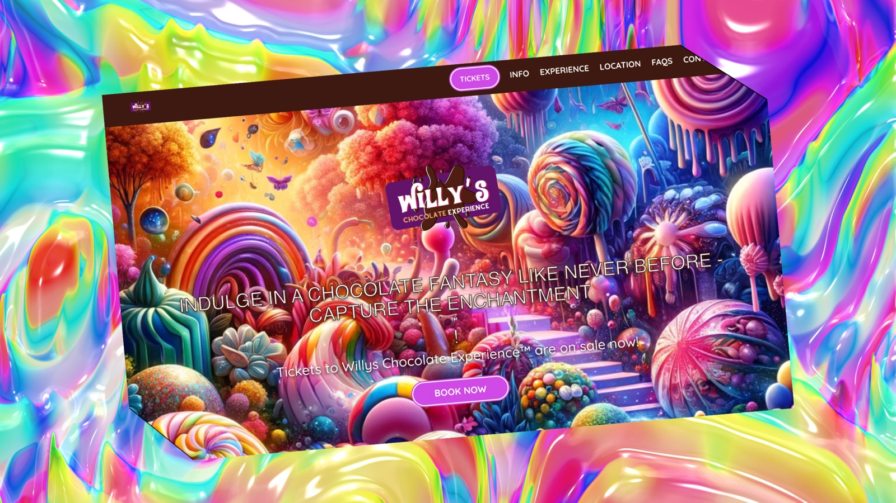
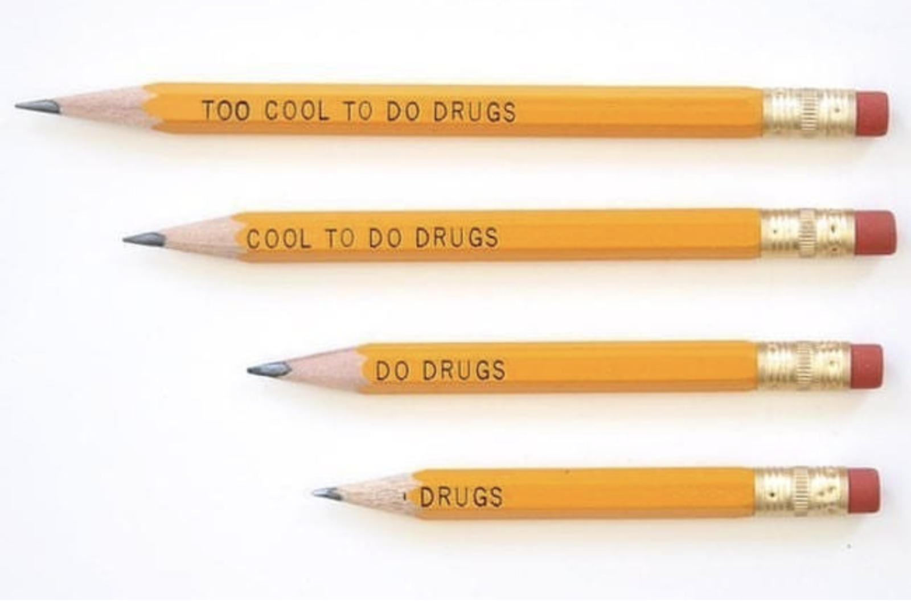
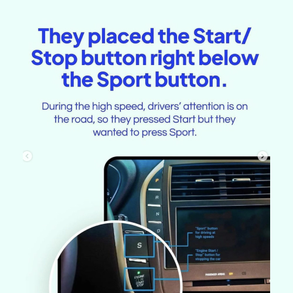
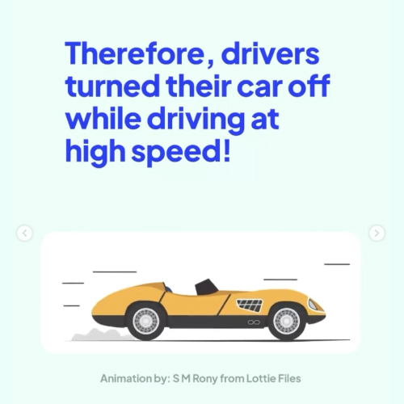
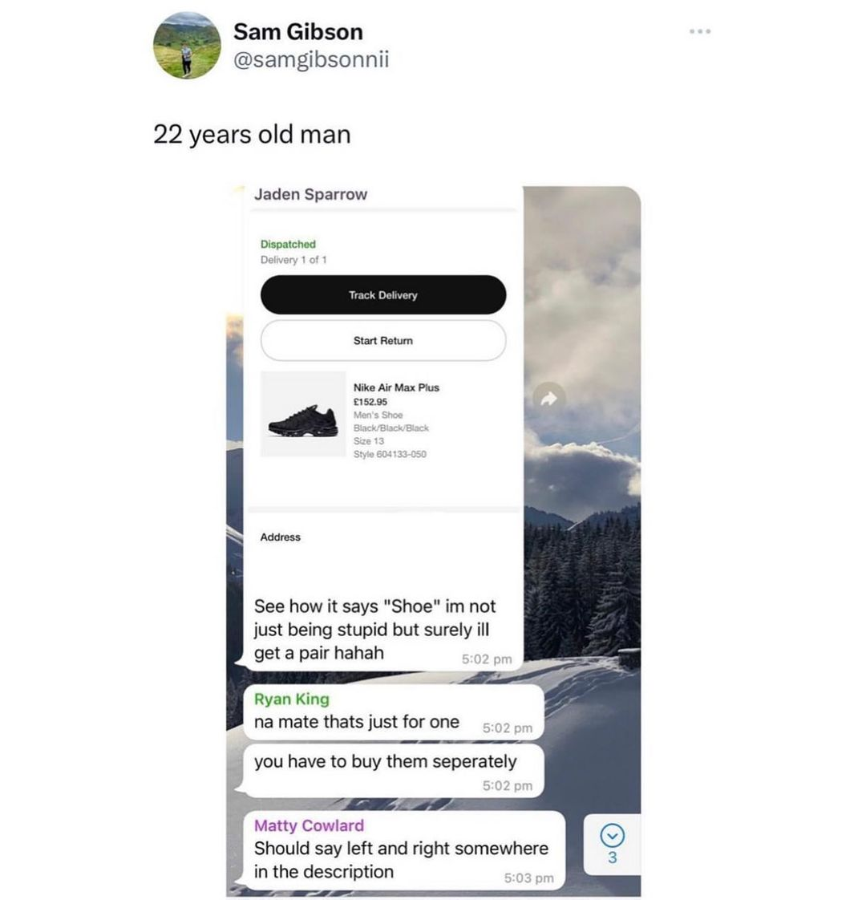

# Bad User Experience

So now we have an understanding of what a good user experience designer should do, consistency, utility, accessibility, and we recognise the importance of empathy and attention to detail, let’s look at some examples of bad user experience design starting with Glasgow based company, House of Illumi design so with Glasgow-based company house of illuminati from the presentation of Willy Wonka's chocolate experience so this was the website and did you have at this okay so at the event organiser house of the Livona early which charge £35 for tickets promise and immersive experience based on the Warner Brothers Phil Walker story Timothy Sharmilee as the young chocolate after opinion event of this the vet the vet publicly event publicly promised giant mushrooms candy canes and chocolate fountains along with special audio visual effects on the raided by dancing bus according to the guardian is very eager family is turned up to the address in turn is it to the address in white inch industrial estate in Glasgow and they were presented to the spa see decorated warehouse for the scarring on classic props a small bites the house on some backdrops pinned against the walls this clip disclaimer what say things that what whilst I think that the incident why I think the incident acquire international media attentionnati and their presentation of Willy’s Chocolate Experience.
 

Who summary else oh noThe event organiser, House of Illuminati, which charged up to £35 for tickets, promised an “immersive experience” based on the Warner Bros film Wonka, which stars Timothée Chalamet as the young chocolate [entrepreneur.My](http://entrepreneur.My) La MM ln l myexpectation moving forward so this is something that I saw on Instagram or something 22-year-old man asked how I’m not just being stupid but surely I get a pair and then someone says that’s just for one you have to buy them separately. Will use your products and ways that you cannot expect and it’s amazing how often people don’t do what you want them to do and you’ll really see that in usability testing they just don’t do what you bloody well expect them to do so frustration but it’s a fuck you keep honesty transparency accessibility there are exceptions and he’s changed this. I’ll try and get the old Cars website. This would be an example of links Cars bad design and I don’t know if you know this have you seen it before Cars this guy had this website was so bad that it was good so there  fun and less tiring for them. The suitcases are colourful lights with and shaped like animals or vehicles that come in an assortment of things the inventor originally pitched his concept on British TV show called dragons I’m sure you have some version countries in countries rejected on the grinds of the product.  . Watch the video watch the video in the case of genius can teach product design the fact that Rob who has a net worth of run 12 million today has intricately understood a few things pertinent to the user. less tiring for  

The event publicy promised giant mushrooms, candy canes and chocolate fountains, along with special audio and visual effects, all narrated by dancing Oompa-Loompas.

According to the Guardian newspaper, eager families turned up to the address in Whiteinch industrial estate in Glasgow and they were presented with a sparsely decorated warehouse with a scattering of plastic props, a small bouncy castle and some backdrops pinned against the walls. 

Disclaimer: Whilst I think that this incident international media attention given Hollywood’s interest in copyright infringement and a need perceived as if only the can do, it’s still worth examination.

[https://www.cbsnews.com/news/willy-wonka-immersive-experience-glasgow-illuminati-house-box-hub-angry-parents-called-police/](https://www.cbsnews.com/news/willy-wonka-immersive-experience-glasgow-illuminati-house-box-hub-angry-parents-called-police/)

The big issue was that the user was given unrealistic expectations from the advertisers and thus when presented with the realities, they were left feeling decieved. 

> Good design is honest.
> 

Deiter Rams

All design is user experience design. It’s just if it’s either a good experience or a bad experience.  The experience of waiting for a website to load, waiting for your food to come or waiting for your baggage to arrive, can have detrimental results in experience.   

At Houston's George Bush Airport, the airport management faced numerous complaints about the long wait times for baggage claim. After assessing the issue, they discovered that passengers actually spent most of their time standing around waiting at the carousel, even though the actual wait time for luggage wasn’t excessively long.

To address this, the airport made a simple but effective change: they moved the arrival gates farther away from the main terminal and baggage claim area. This increased the amount of walking time for passengers, which in turn decreased the amount of time they spent standing and waiting at the carousel. This change led to a significant reduction in complaints about baggage claim wait times.

This case demonstrates a key insight about good user experience design and behavioral economics: people's satisfaction with a waiting experience is influenced not just by the actual length of the wait, but also by how they spend that time. Making passengers walk instead of waiting idly made the wait feel shorter and more acceptable.

Attention given even to issues like how the loading screen works is imperative to good User Experience Design. 

### Coercive Design

[https://www.instagram.com/p/CxLDZcASFVy/?hl=en](https://www.instagram.com/p/CxLDZcASFVy/?hl=en)

I’m sure we all recognise that the reason the close ad button is so inaccessible is because the advertisers want you to see their services for as long as possible. Although we all know this, we should be aware that this may be considered unethical.  

## Accessibility

The above shows how people actually work with the construction of a park pathway. Field studies means going out there and actually seeing how people work with your design in advance. The more we can anticipate, the better the experience the customer will have and if you leave it too late, it can be an a costly fix. 

### Confusion and lack of Clear Signs

People interpret signs as meaning different things. Let’s be aware of this. 

## Visibility of System Status

> An informed customer is a happy customer.
> 

Google, anonymous 

When its so bad, its good. 

[LINGsCARS - Cheap Car Leasing](https://www.lingscars.com/)

