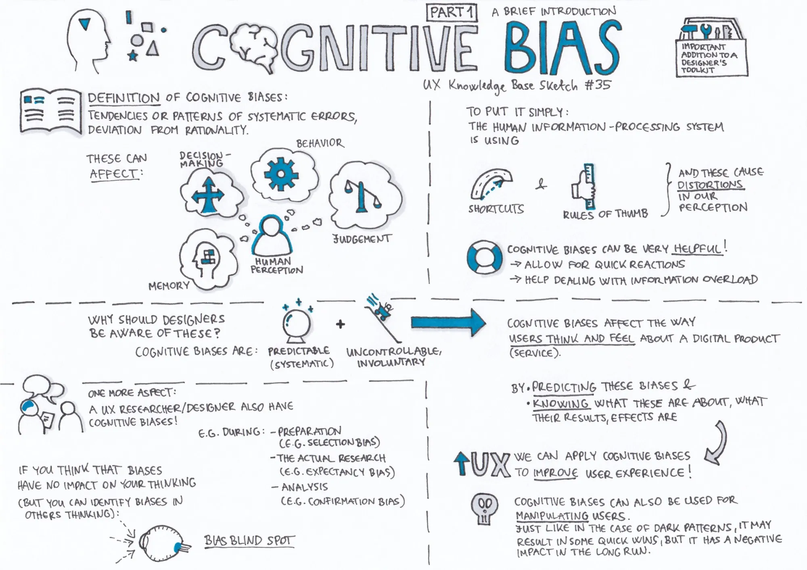

# Bias

[01. Bias: Authority Bias](01-bias-authority-bias.html)

[01. Bias: Optimism Bias](01-bias-optimism-bias.html)

[02. Bias: Availability Bias](02-bias-availability-bias.html)

[03. Bias: Anchoring Bias](03-bias-anchoring-bias.html)

[04. Bias: Bandwagon Effect](04-bias-bandwagon-effect.html)

[05. Bias: Barnum Effect](05-bias-barnum-effect.html)

[06. Bias: False Consensus Effect](06-bias-false-consensus-effect.html)

[07. Bias: Framing Effect](07-bias-framing-effect.html)

[08. Bias: Overconfidence Bias](08-bias-overconfidence-bias.html)

[09. Bias: Scarcity Effect](09-bias-scarcity-effect.html)

[10. Bias: Survivorship Bias](10-bias-survivorship-bias.html)
