# Colors

The power of color knows no limits as long as users perceive colors equally. However, we should factor in that some people see the world through different lenses. As designers, we should know how to use color and other visual tools to communicate the intended message. Again, this is an opportunity to get to know the user.  Consider fringe cases where necessary. Visually impaired people see colors differently. According to Colour Blind Awareness, nearly 300 million people worldwide have some form of color blindness

Contrast and color can make or break an app and really matter to all users. Color delivers a message while evoking emotions and ideas.

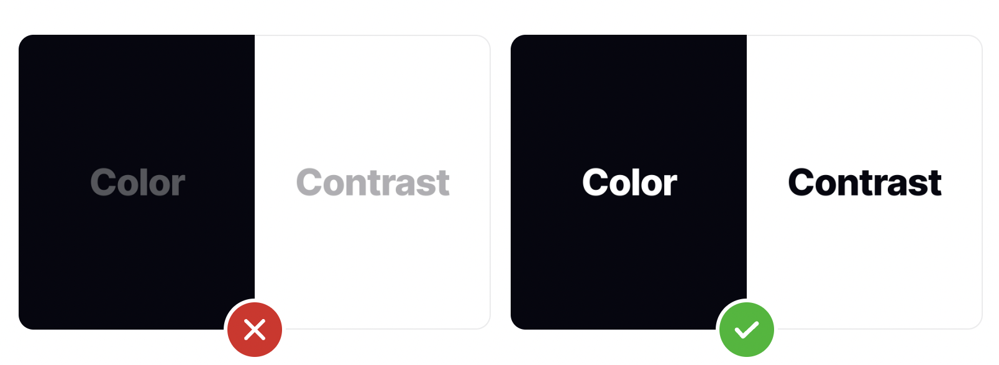

## Hierarchy in Colors

Colours can be used similarly to size and weight to give importance to elements in your design. Brighter colours are typically going to grab the viewer’s attention much more than dull, non-saturated colours.

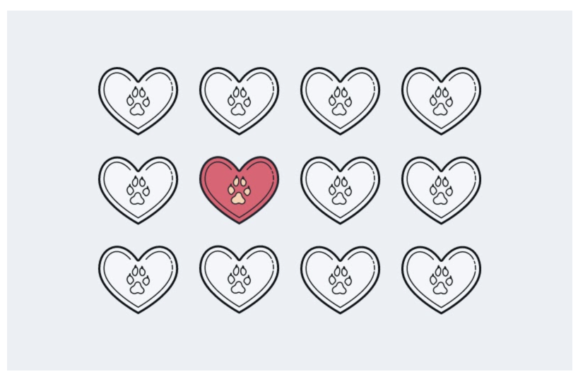

Similarly, colors with higher contrast are going to appear heavier and closer to the viewer, giving them more sense of importance. In the example below, you can see that brighter colors look closer when they’re on a darker background and further away when they’re on a lighter background.

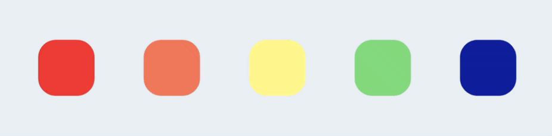

In the example below, as well as with most website navigation, you will notice a primary high contrasting color on buttons that serve as the most crucial call to actions. By helping users understand where you want them to go, you can give them a more pleasant experience and increase conversions in your desired flow.

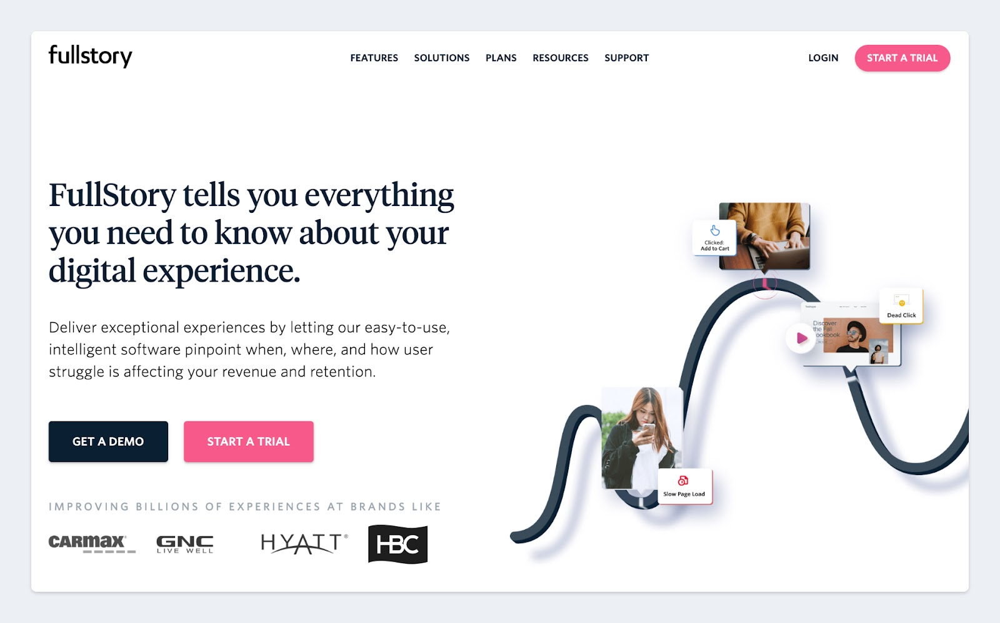

## What is primary color?

The primary color is a color that dominates your design means the great stuff will use your primary color, including logo. Your primary color is the color associated with your brand.

To decide what will be your primary color if it is not derived from the product color you can dive deeper into the meaning and symbolism behind colors, which is different for some cultures. For example, if your company is a banana exporter, then the obvious choice would be yellow and some color which is well paired with yellow, like blue, so it will look good on the labels on your bananas in the supermarkets. As for the meaning of colors, if white in the western culture is considered as pure and clean in some Asian cultures it’s a color of death and mourning.

Carry competitive market research, use sites like [Behance](https://www.behance.net/) or [Dribbble](https://dribbble.com/) for inspiration. While researching, you may find a shade that appeals, grab that color using any color picker tool and create a favorite list that will give you a wide range of options.

Browse through the list of brand’s color palettes used by the world’s famous brands and study their palettes.

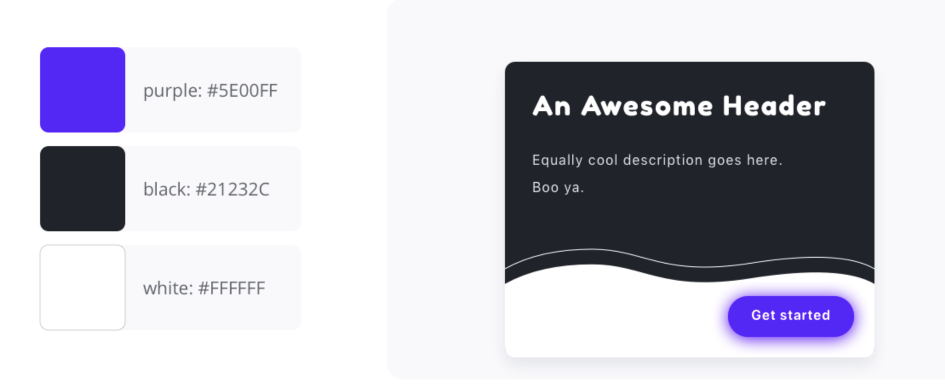

## What is secondary color?

Secondary colors are used occasionally, and consists of accents based on primary. Secondary colors can be used to express system feedback such as task success, error, or warning.

The 60–30–10 rule is an old designer’s rule on how you can use colors in your design. Which describes as you should use primary color 60% referred to as “slack & jacket”, 30% usage of secondary color, which may include two secondary colors 15% each, which is the “shirt” and 10% for the accent color as a “tie”, all in a “business suit”.

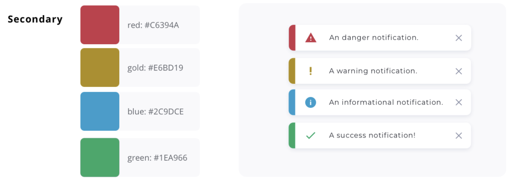

## Dark Mode

A dark mode displays dark surfaces across the majority of a UI. It's designed to be a supplemental mode to a default (or light) mode.

A dark mode is a low-light UI that displays mostly dark surfaces.

The recommended dark mode surface color is #121212. (Google has redifined #121212 as the actual surface color of dark mode)

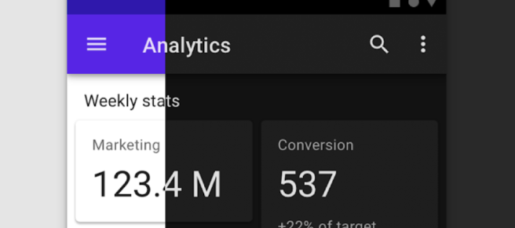

In a light mode, components retain the same default elevation levels and shadows as components in lighter themes. However, in a dark mode, the surfaces of different elevation levels are illuminated differently.

> Higher elevation, lighter surface
> 

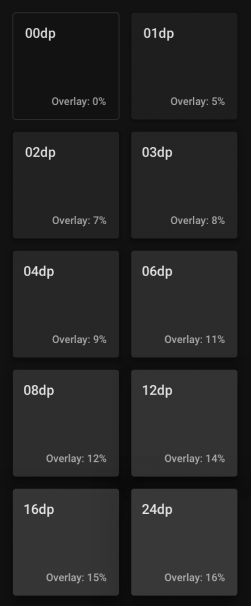

## Color Psicology

Colors have the immeasurable power to inform our mood, emotions, and thoughts. Research conducted by the [**Institute for Color Research**](https://www.colorcom.com/research/why-color-matters) reveals that people make a subconscious judgment about a product within 90 seconds of seeing it, and between 62% and 90% of that assessment is based on color alone.

Emotional responses to colors can depend on a range of personal factors, including gender, cultural experiences, and age. With clarity on your target audience, it’s time to look at the psychology behind your potential brand colors.

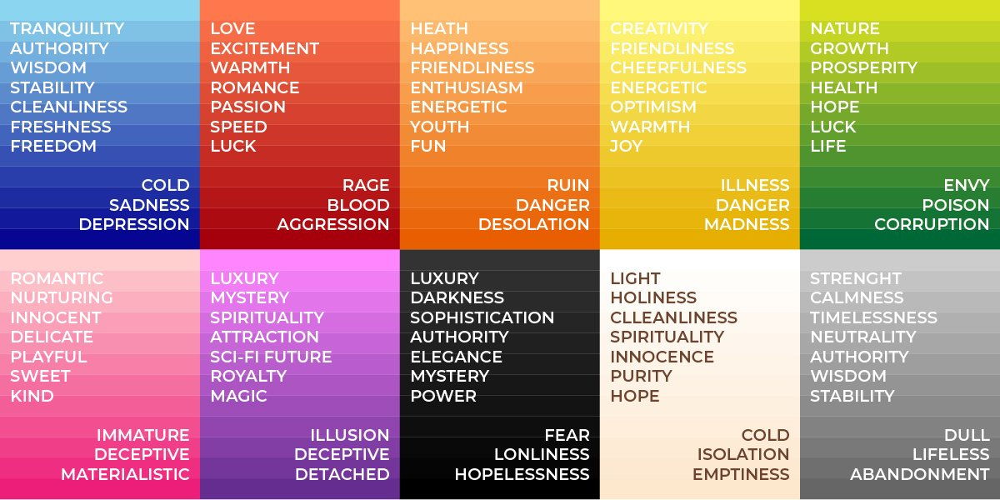

Check out some examples of color psicology here: [https://www.smashingmagazine.com/2010/01/color-theory-for-designers-part-1-the-meaning-of-color/](https://www.smashingmagazine.com/2010/01/color-theory-for-designers-part-1-the-meaning-of-color/)

## Where you could get inspirations?

> Here are some websites to check color harmony & inspo
> 

[Color Hunt:](https://colorhunt.co/)

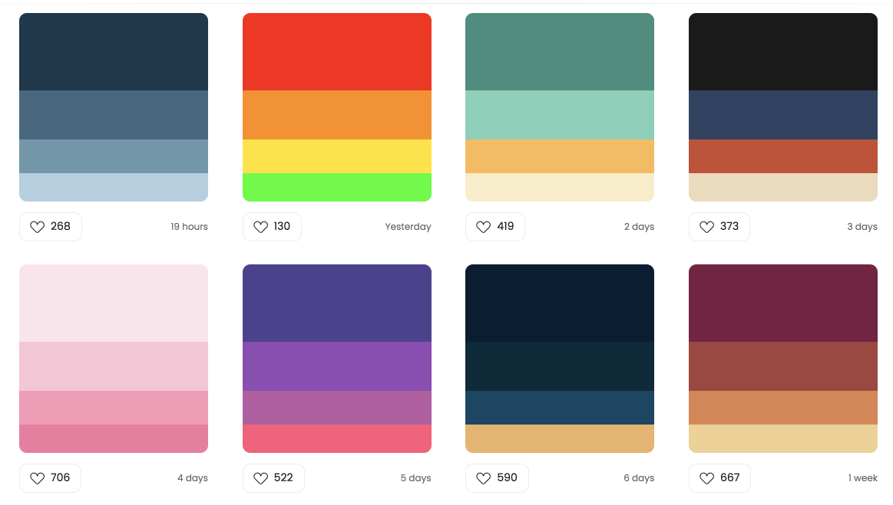

[Adobe Color](https://color.adobe.com/create/color-wheel)

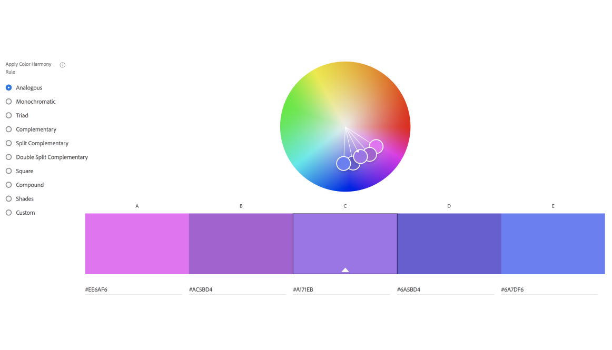

[Picular](https://picular.co)

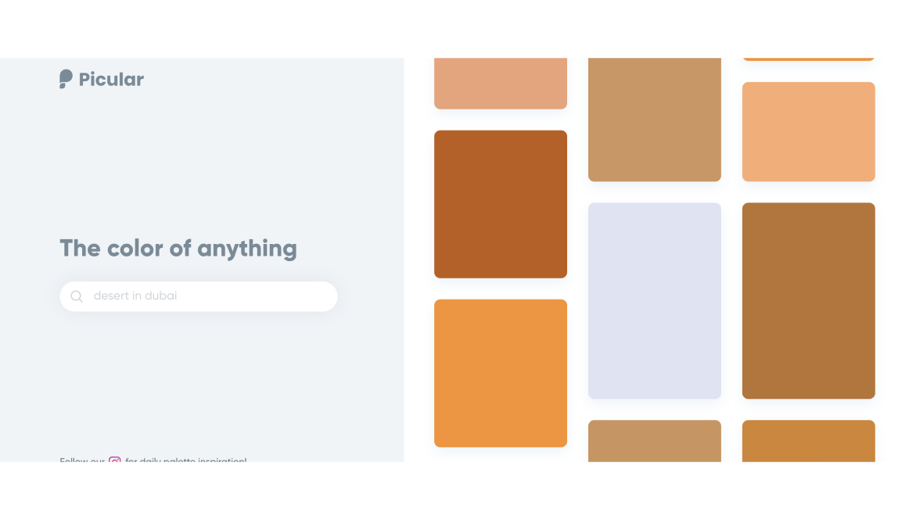

###
