# Design Systems

## Components

Components are the building blocks of an interface. They include buttons, checkboxes, labels, inputs, cards, and many others. Each of them has unique anatomy and implements a specific role to help users achieve their goals.

What is the difference between radio buttons and checkboxes? Cards and containers? Links and hyperlinks? Understanding how each component works and where it should be applied is powerful knowledge. Not only will you feel more relaxed communicating with designers, but you'll also be more confident in your professional skills.

[https://www.figma.com/embed?embed_host=notion&url=https%3A%2F%2Fwww.figma.com%2Fdesign%2FWHDyzsN2WCYlGShWq8OqJN%2FModular%3Fnode-id%3D0-1%26t%3DqfT5RV8wVXJuh1IB-0](https://www.figma.com/embed?embed_host=notion&url=https%3A%2F%2Fwww.figma.com%2Fdesign%2FWHDyzsN2WCYlGShWq8OqJN%2FModular%3Fnode-id%3D0-1%26t%3DqfT5RV8wVXJuh1IB-0)

## Buttons / CTA

In digital products, buttons communicate actions that users can take. They usually consist of a rectangular, square, or circular shape with a label or an icon.

A button can also be represented solely by an icon or label. Text buttons and links may look similar but they do different things. Clicking buttons changes the state of a system (either front or back end), while clicking links redirects you somewhere else and doesn't change the system's state.

Apple recommends that CTAs be at least **44 pixels by 44 pixels** to be touchscreen-friendly. Microsoft recommends 34 pixels by 26 pixels, and goes further to note that there should be at least 8 pixels of space between elements. Be aware that there is a tipping point where the CTA becomes too big as well.

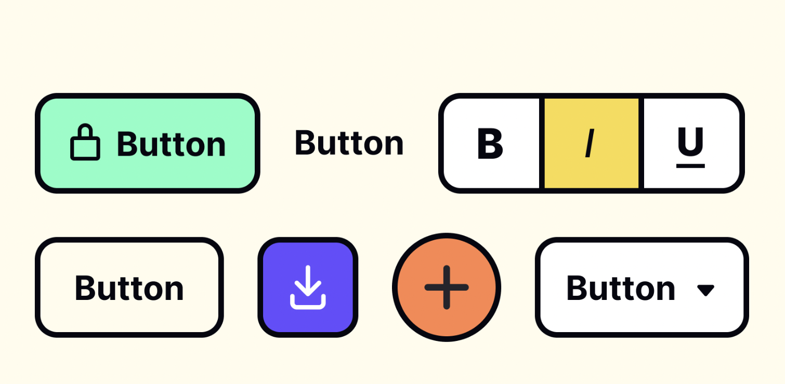

## Navigation components /Nav bar / Header / Tabs

Navigation is the system of how users can move through an app or a website. A product's navigation should be consistent across all pages.

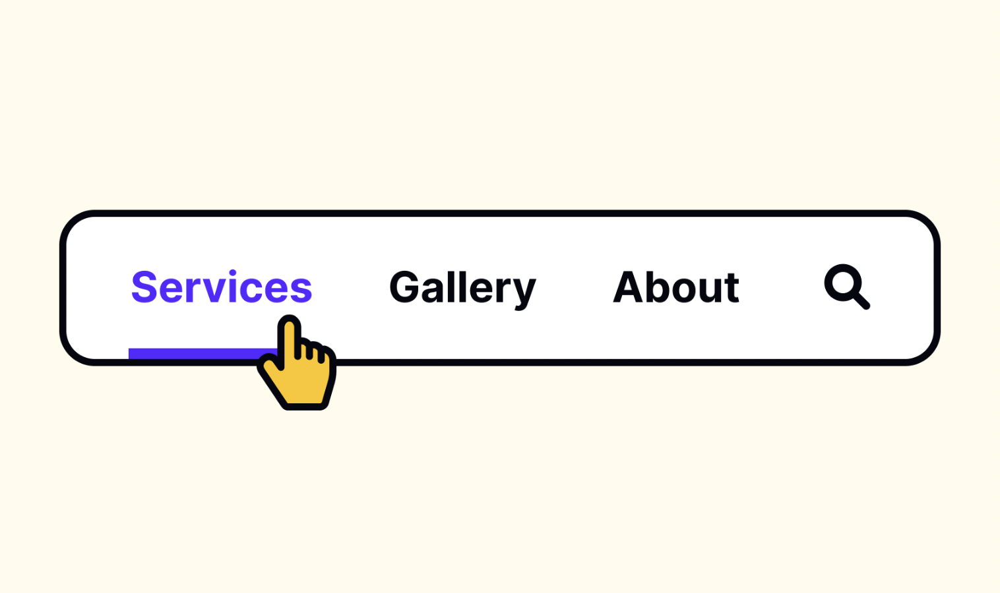

## Hamburger menus

The hamburger menu is the button in websites and apps that opens up into a side menu or navigation drawer. It consists of 3 parallel horizontal strokes that can look like a simplified drawing of a hamburger to hungry people — hence the name

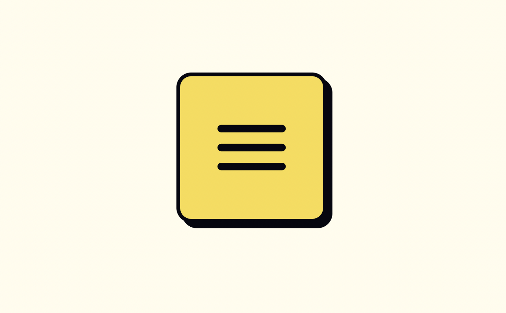

## Breadcrumbs

Breadcrumbs are a secondary navigation element that looks like a row of links separated by dividers, often chevron icons (>). Like in the tale of Hansel and Gretel, breadcrumbs leave a trail to guide users. They show users' current location and help them find their way around the product.

The last element on the trail should be different from the rest of the path since it represents the users' current position.

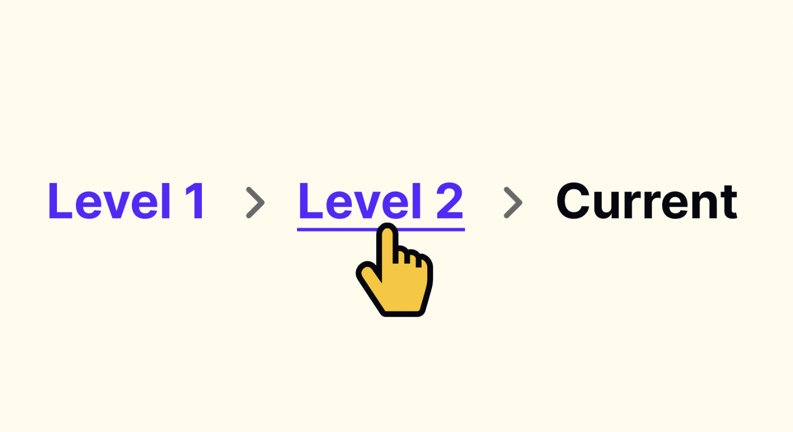

## Cards

A card is a UI component that contains content and actions about a single subject. Cards in UI resemble trading cards in real life — they're rectangular and often include an image and some text. They may also contain interactive elements such as Learn More or Read More buttons.

Pinterest is an excellent example of a website leveraging cards to the fullest extent. 

You will use the cards a lot.

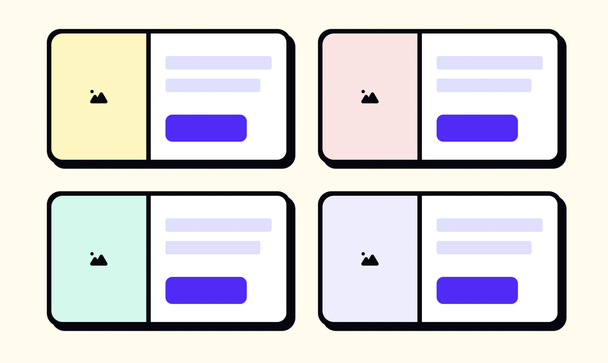

## Check boxes

Checkboxes are UI selection controls commonly found in forms. Single checkboxes are often encountered when asking for users' consent to some option, for example the Terms and Conditions and Privacy Policy. When enabled, they display a small box with a check mark inside. When disabled, they appear as an empty box.

In contrast to radio buttons which are mutually exclusive, checkboxes allow users to select several options at the same time and enable or disable each one of them.

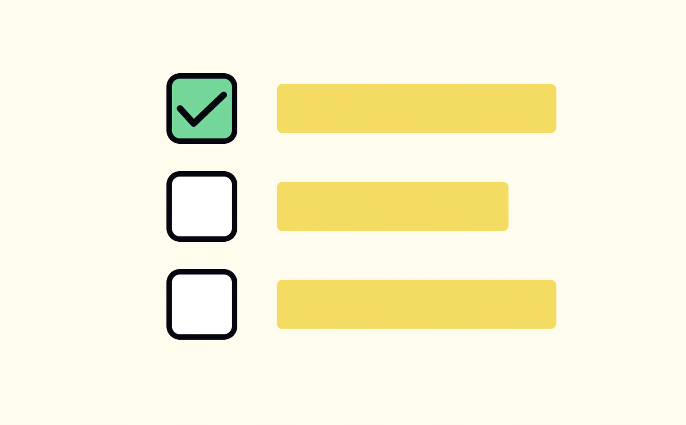

## Menu

A menu displays a list of multiple actions on a UI. It appears when the user interacts with a button, tab, or other control. Navigation menus include navigation bars, hamburger menus, and other types.

The advantage of using menus is that they provide many extra action choices without taking up much screen space.

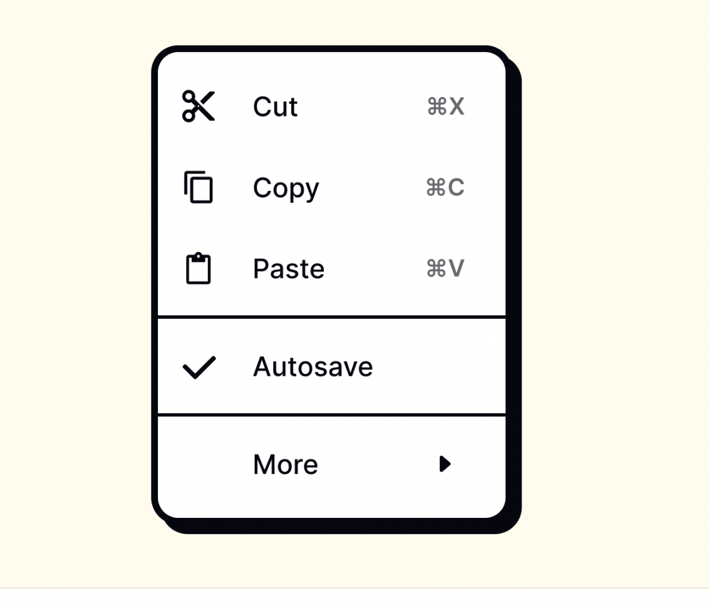

## Toggles

Toggle buttons group 2 functions (sometimes 3) into a single container. In Apple's Human Interface Guidelines, you can encounter a similar component called segmented buttons.

All buttons are usually equal in width. They behave like radio buttons — only one button can be selected at a time in each group. The chosen option is usually highlighted with colors or overlays. In contrast, segmented buttons allow multiple choices

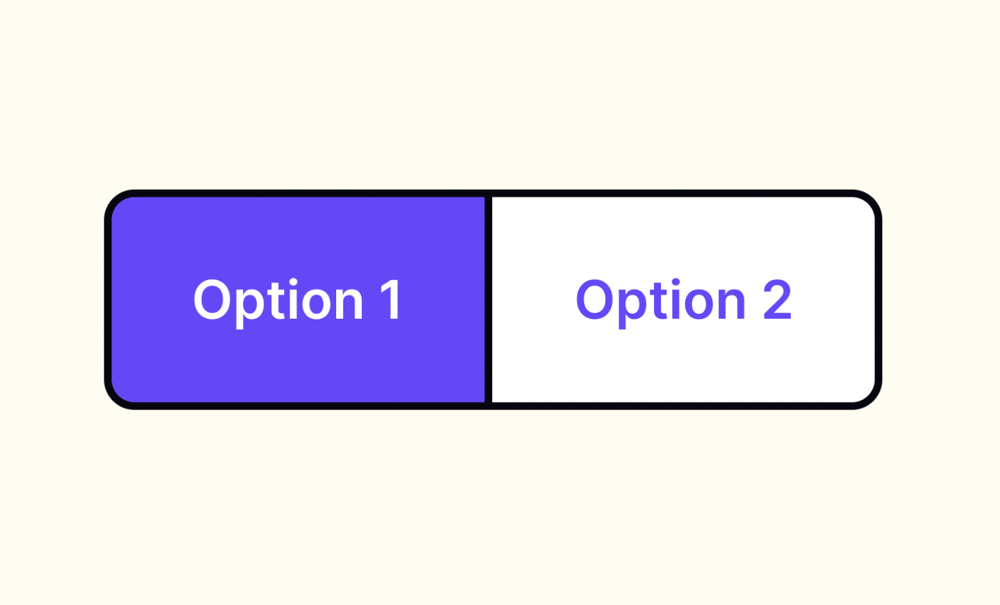

## Inputs:

Input fields (or just "inputs") allow users to enter text into a UI. It could be a name, password, date, time, phone number, email address, or any other form of data. Inputs typically appear in forms and dialogs.

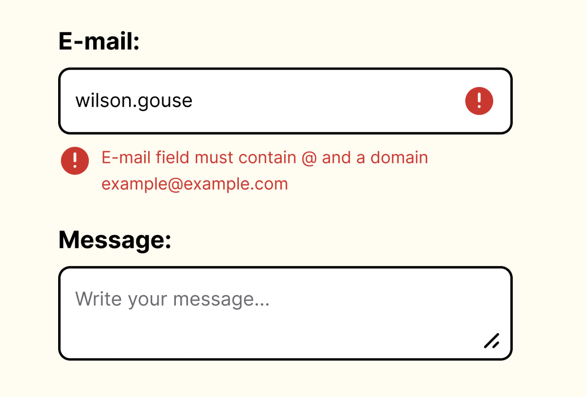

## Radio buttons

Radio buttons are controls that look like outlined circles. They use a dot or solid circle inside to show the selected option.

Unlike checkboxes, radio buttons allow users to select only one option. Once an option is picked, it can't return to the unselected state. To prevent users from being unable to undo their action, provide a "none of the above" or similar option.

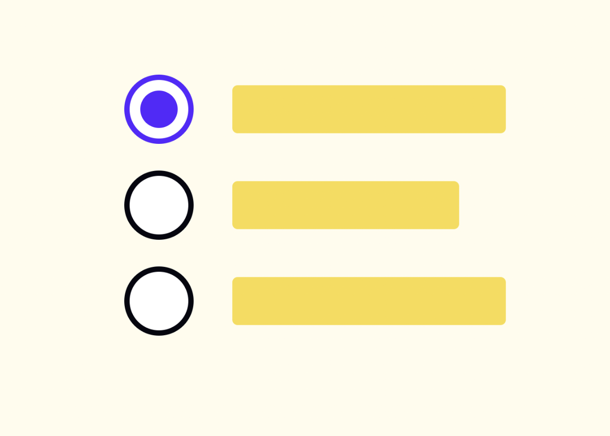

## Hyperlinks

A hyperlink is a word, phrase, or image you can click on to jump to a new page or section within the current page. The text that makes up the link is known as link text, and it's usually immediately recognizable by its bright color and/or underline.

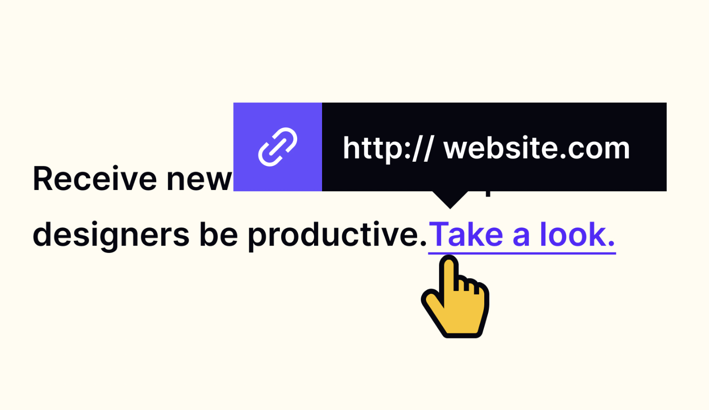

[**https://youtu.be/BISC15OPeGA**](https://youtu.be/BISC15OPeGA)

## What is a design system?

In a nutshell, a design system is a collection of documents, articles, examples, code snippets, screenshots, design guidelines, components, philosophies and other digital assets for a product design company. It's usually hosted online as a website (public or internal). Think of it as a big knowledge-base that is part UI kit, part documentation with instructions, language and coding guidelines all wrapped up together.

##
