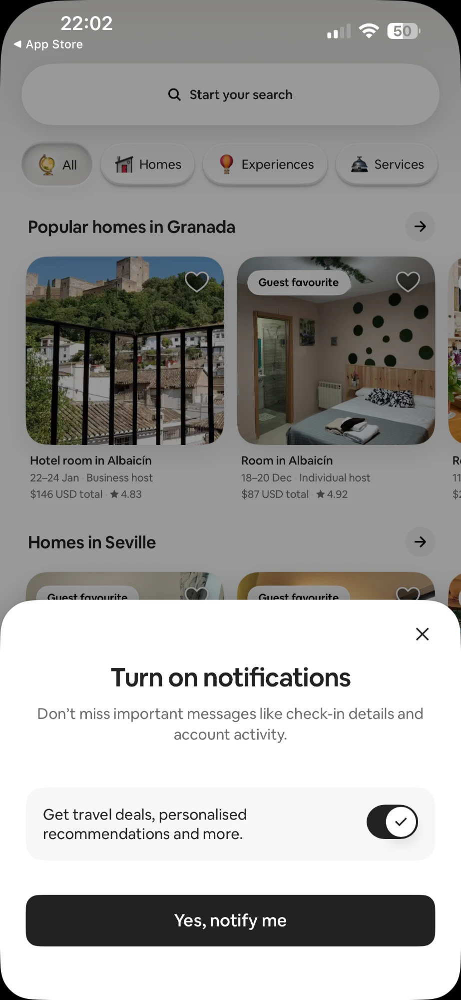
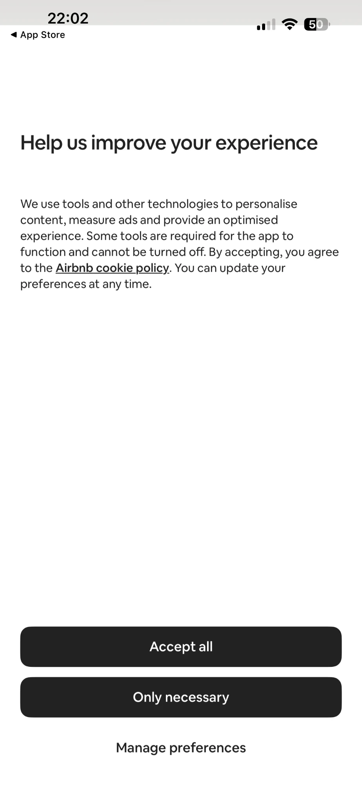
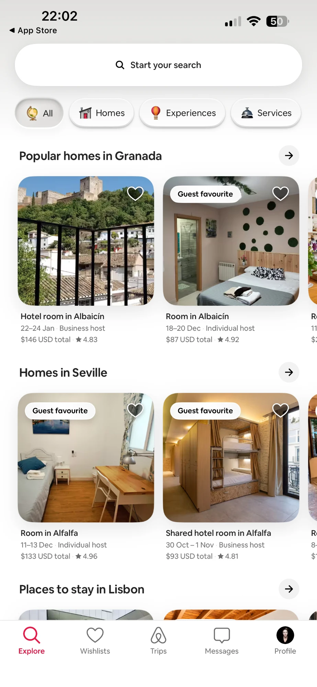
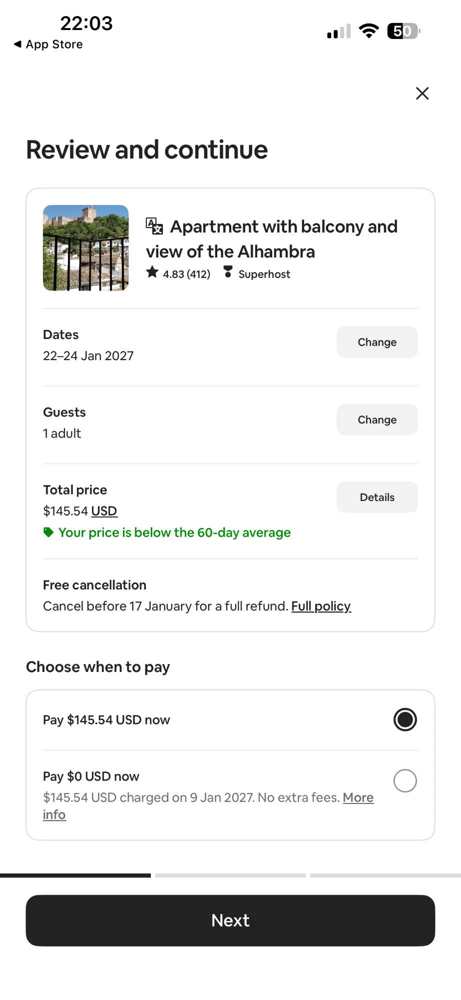
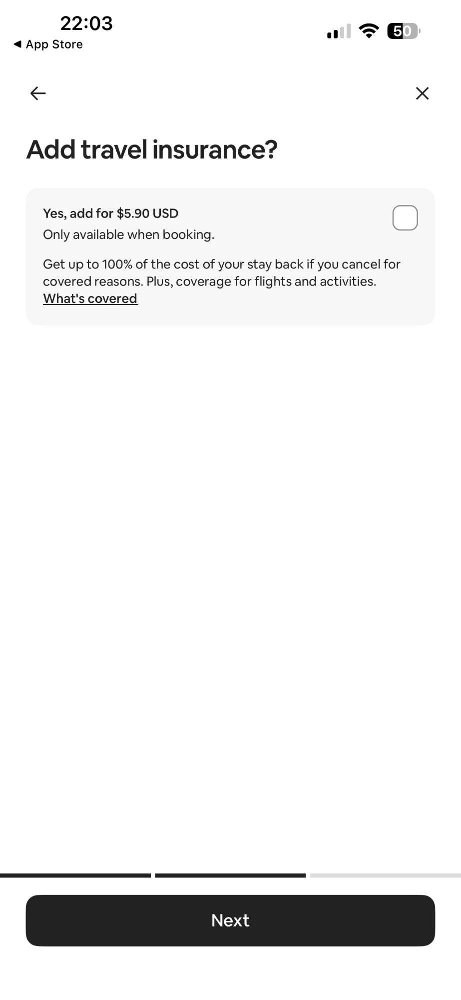
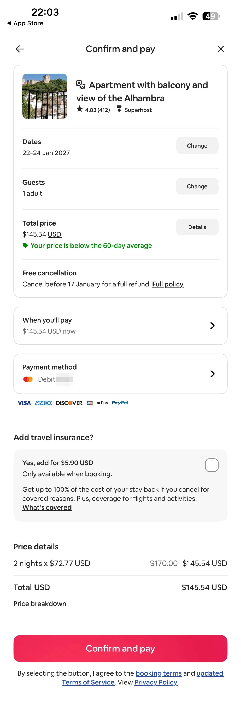

# Airbnb Replica Challenge

<aside>
📝 Welcome to the Airbnb Replica Challenge! Your next stay awaits you!

</aside>

<aside>
🧠 This is a powerful challenge that gets you used to micro-detailing: soft shadows, rounded photos and very precise spacing.

</aside>

<aside>
🔥 Some of this will hurt and feel repetitive but like learning scales on a musical instrument, you must become fluent.

</aside>

<aside>
♻️ Recycle elements often. One listing card, built well, becomes every listing card.

</aside>

**Lesson Title: The UI Replica Project:**

**This exercise is to be completed in tandem with your UX curriculum. Please take your time and copy as many screens as you can until you are competent with Figma tools.**

*Unlocking Figma Mastery through Perfect Replication*

Welcome to the "UI Replica Project," a detailed creative lesson designed to help you gain valuable experience with Figma. In this exercise you will replicate the Airbnb mobile app, screen by screen, with meticulous precision. Airbnb is a great teacher: its interface is built from a small set of very consistent parts (a search pill, category tabs, photo cards, bottom sheets and a sticky booking bar) repeated across every screen.

As the saying goes, "practice makes perfect," and this lesson exemplifies that principle. The key objective here is not just to create a replica but to create a perfect replica.

## The Screens

Seven real screens from the Airbnb iPhone app, in the order you meet them when you book a stay. Long pages have been stitched into one tall screenshot, so you can trace each page in one go.

**How to trace:** in Figma, create an **iPhone 16** frame (393 × 852). Drag a screenshot in and scale it to **393 px wide**: a single screen then fits the frame exactly. For a stitched screen, make the frame as tall as the image. Lock the screenshot, lower its opacity to about 40% and build on top of it. Hide it when you're done and compare.

### 1. Turn on notifications

A bottom sheet over the dimmed Explore screen: a close button, a bold centred title, a toggle row in a grey card and one full-width black button.

### 2. Cookie consent

A full-screen text page: a large left-aligned heading, a paragraph with an underlined link, and three stacked actions at the bottom.

### 3. Explore

The home feed: the search pill, category chips with 3D icons, rows of listing cards that scroll sideways, each with a heading and an arrow button, and the tab bar.

### 4. Listing (stitched)

The full listing page, top to bottom: the photo with round buttons and a counter, the sheet that overlaps it, highlights, host, amenities, the map, reviews, the host card and Things to know, with the sticky Reserve bar at the bottom.

### 5. Review and continue

Step one of checkout: a summary card with a thumbnail, rows with grey Change buttons, a payment choice with radio buttons, a three-part progress bar and the Next button.

### 6. Add travel insurance

Step two: a single grey option card with a checkbox, lots of white space and the same progress bar and Next button.

### 7. Confirm and pay (stitched)

The final step: the summary card again, outlined rows with chevrons, payment logos, the insurance option, price details and the pink Confirm and pay button.

*Screenshots are for teaching only. The card number has been blurred.*

## The Journey Ahead: Manual Replication (Step 1)

**Step 1:** **Basic Replication**

- Start **without** utilizing Figma's auto layout or components.
- Begin by studying the original UI screens.
- Familiarize yourself with the shapes, colors, and typography used.
- Carefully recreate each screen element manually.

**Step 2:** **Layout and Spacing**

- Analyze the spacing, alignment, and relationships between UI elements.
- Use Figma grids and rulers, located on the right hand side to do so.
- Pay close attention to pixel-perfect alignment and spacing: Airbnb leans on generous side margins and consistent gaps.
- Ensure that every detail matches the original screens.

**Step 3:** **Typography and Color**

- Focus on replicating the typography and color schemes accurately.
- Match font sizes, styles, and colors precisely. Most of the interface is near-black and grey on white; the pink is saved for the most important action on each screen.
- Ensure that text and graphics align perfectly.

**Step 4:** **Responsive Design**

- Explore how the original design responds to various screen sizes.
- Make your manually replicated screens responsive by adjusting layouts accordingly.

## Elevating Your Skills with Auto Layout (Step 2)

**Step 5:** **Introduction to Auto Layout**

- Learn about Figma's Auto Layout feature and its benefits.
- Understand how Auto Layout simplifies element management.

**Step 6:** **Applying Auto Layout**

- Convert your manually replicated screens into Auto Layout frames.
- Explore how Auto Layout improves adaptability and responsiveness.

**Step 7:** **Auto Layout Best Practices**

- Implement best practices for using Auto Layout effectively.
- Experiment with nested Auto Layout frames for complex designs: the listing card (photo, then a details stack) and the Reserve bar (price on one side, button on the other) are perfect practice.

## Conclusion

By following these structured steps, you'll have perfected the art of replicating UI screens in Figma, honed your attention to detail, and harnessed the power of Auto Layout. Remember, practice is the key to mastery, and this lesson provides you with the perfect opportunity to apply this principle. Good Luck 🍀 !

Airbnb's own typeface (Airbnb Cereal) isn't free to use. Its closest free alternative is available here:

[Nunito Sans - Google Fonts](https://fonts.google.com/specimen/Nunito+Sans)

Images available here:

[Free travel and home photos on Unsplash](https://unsplash.com/s/photos/apartment-interior)

Icons available here:

[Phosphor Icons](https://phosphoricons.com)

Brand colour: **#FF385C** (Rausch pink). Text: **#222222**. Secondary text: **#6A6A6A**. Lines: **#DDDDDD**.
