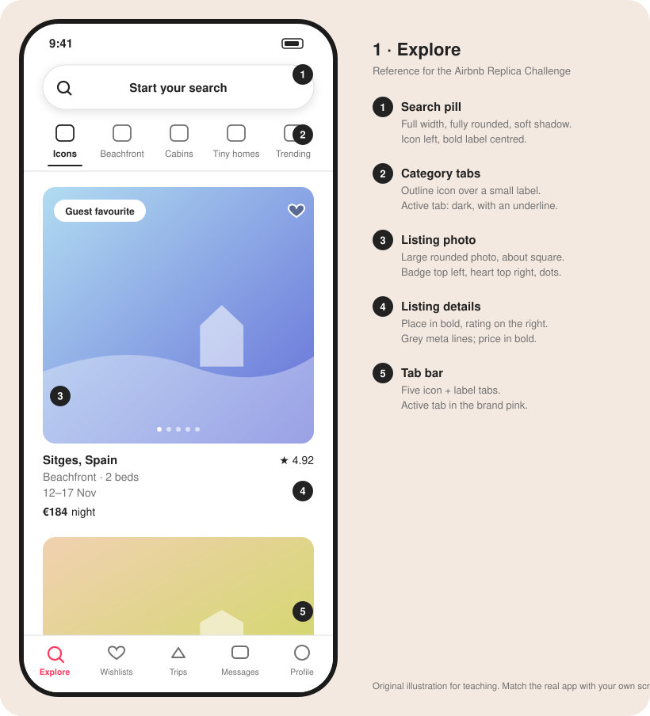
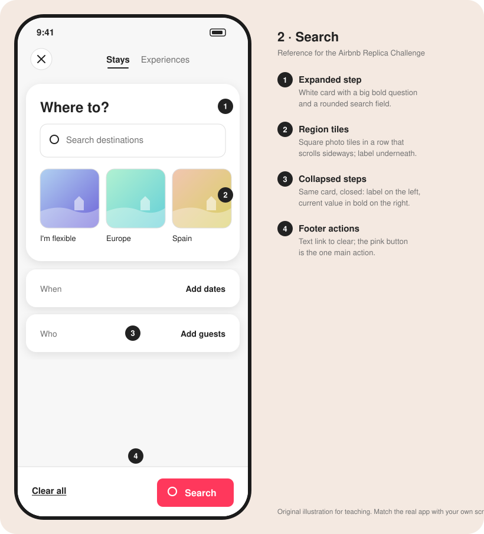
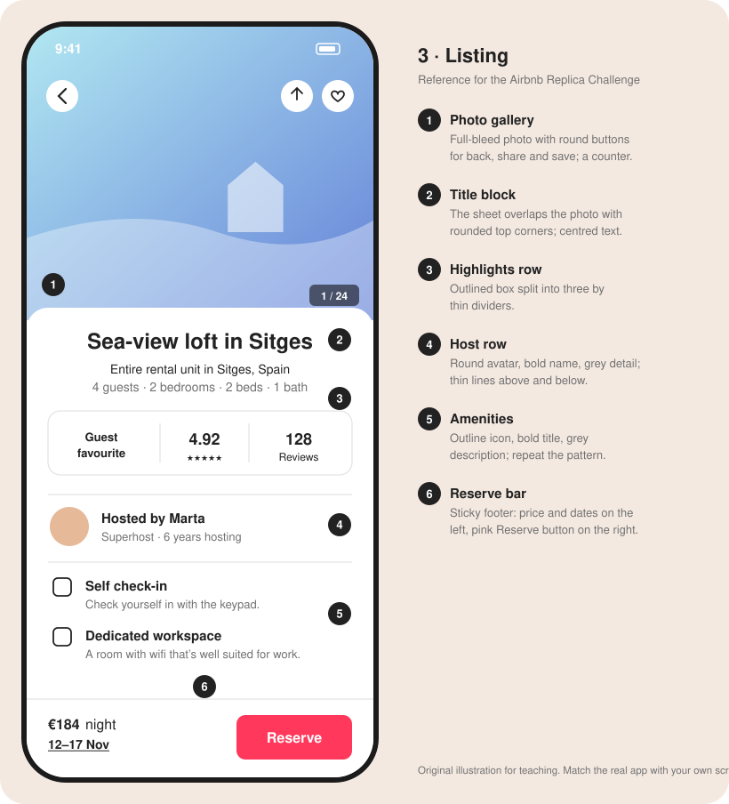
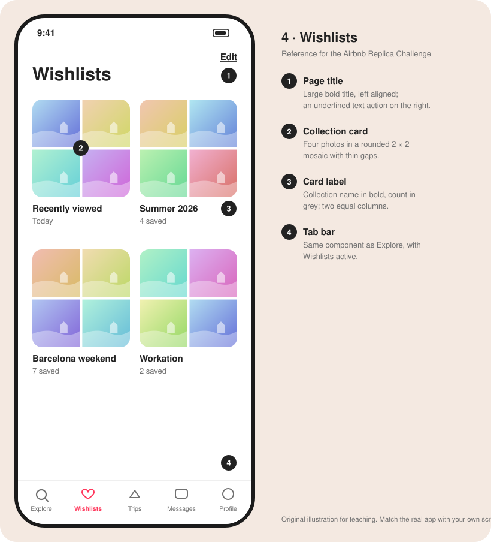

# Airbnb Replica Challenge

<aside>
📝 Welcome to the Airbnb Replica Challenge! Your next stay awaits you!

</aside>

<aside>
🧠 This is a powerful challenge that gets you used to micro-detailing: soft shadows, rounded photos and very precise spacing.

</aside>

<aside>
🔥 Some of this will hurt and feel repetitive but like learning scales on a musical instrument, you must become fluent.

</aside>

<aside>
♻️ Recycle elements often. One listing card, built well, becomes every listing card.

</aside>

**Lesson Title: The UI Replica Project:**

**This exercise is to be completed in tandem with your UX curriculum. Please take your time and copy as many screens as you can until you are competent with Figma tools.**

*Unlocking Figma Mastery through Perfect Replication*

Welcome to the "UI Replica Project," a detailed creative lesson designed to help you gain valuable experience with Figma. In this exercise you will replicate the Airbnb mobile app, screen by screen, with meticulous precision. Airbnb is a great teacher: its interface is built from a small set of very consistent parts (a search pill, category tabs, photo cards, bottom sheets and a sticky booking bar) repeated across every screen.

As the saying goes, "practice makes perfect," and this lesson exemplifies that principle. The key objective here is not just to create a replica but to create a perfect replica.

## The Screens

Start with these four screens. Each reference below names the parts to rebuild; take your own screenshots in the Airbnb app (iPhone, light mode) to match them pixel for pixel.

### 1. Explore

The home feed: a search pill, a row of category tabs, large photo cards and the tab bar.

### 2. Search

The search panel that opens from the pill: one expanded step (Where), the collapsed steps below it, and a footer with the main action.

### 3. Listing

A listing's detail page: a full-bleed photo, a sheet that slides over it, highlights, the host and amenities, and a sticky Reserve bar.

### 4. Wishlists

Saved collections in a two-column grid of photo mosaics.

## The Journey Ahead: Manual Replication (Step 1)

**Step 1:** **Basic Replication**

- Start **without** utilizing Figma's auto layout or components.
- Begin by studying the original UI screens.
- Familiarize yourself with the shapes, colors, and typography used.
- Carefully recreate each screen element manually.

**Step 2:** **Layout and Spacing**

- Analyze the spacing, alignment, and relationships between UI elements.
- Use Figma grids and rulers, located on the right hand side to do so.
- Pay close attention to pixel-perfect alignment and spacing: Airbnb leans on generous side margins and consistent gaps.
- Ensure that every detail matches the original screens.

**Step 3:** **Typography and Color**

- Focus on replicating the typography and color schemes accurately.
- Match font sizes, styles, and colors precisely. Most of the interface is near-black and grey on white; the pink is saved for the most important action on each screen.
- Ensure that text and graphics align perfectly.

**Step 4:** **Responsive Design**

- Explore how the original design responds to various screen sizes.
- Make your manually replicated screens responsive by adjusting layouts accordingly.

## Elevating Your Skills with Auto Layout (Step 2)

**Step 5:** **Introduction to Auto Layout**

- Learn about Figma's Auto Layout feature and its benefits.
- Understand how Auto Layout simplifies element management.

**Step 6:** **Applying Auto Layout**

- Convert your manually replicated screens into Auto Layout frames.
- Explore how Auto Layout improves adaptability and responsiveness.

**Step 7:** **Auto Layout Best Practices**

- Implement best practices for using Auto Layout effectively.
- Experiment with nested Auto Layout frames for complex designs: the listing card (photo, then a details stack) and the Reserve bar (price on one side, button on the other) are perfect practice.

## Conclusion

By following these structured steps, you'll have perfected the art of replicating UI screens in Figma, honed your attention to detail, and harnessed the power of Auto Layout. Remember, practice is the key to mastery, and this lesson provides you with the perfect opportunity to apply this principle. Good Luck 🍀 !

Airbnb's own typeface (Airbnb Cereal) isn't free to use. Its closest free alternative is available here:

[Nunito Sans - Google Fonts](https://fonts.google.com/specimen/Nunito+Sans)

Images available here:

[Free travel and home photos on Unsplash](https://unsplash.com/s/photos/apartment-interior)

Icons available here:

[Phosphor Icons](https://phosphoricons.com)

Brand colour: **#FF385C** (Rausch pink). Text: **#222222**. Secondary text: **#6A6A6A**. Lines: **#DDDDDD**.
