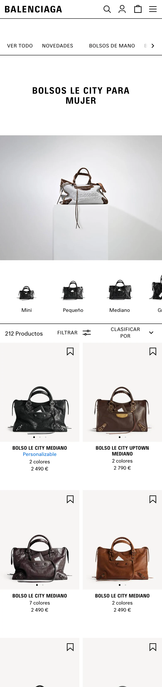
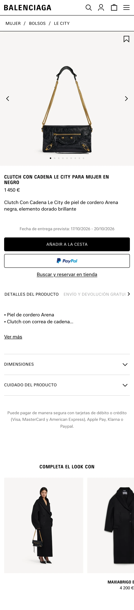
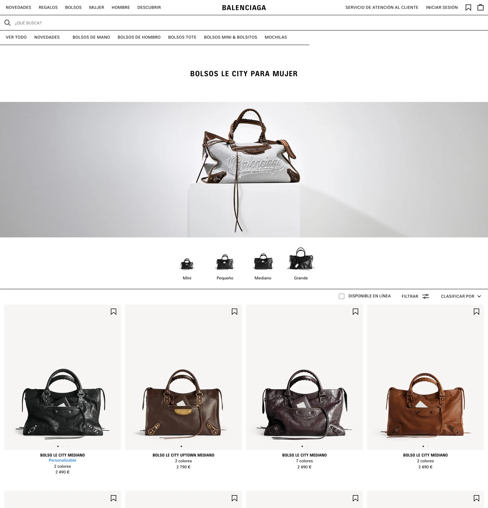
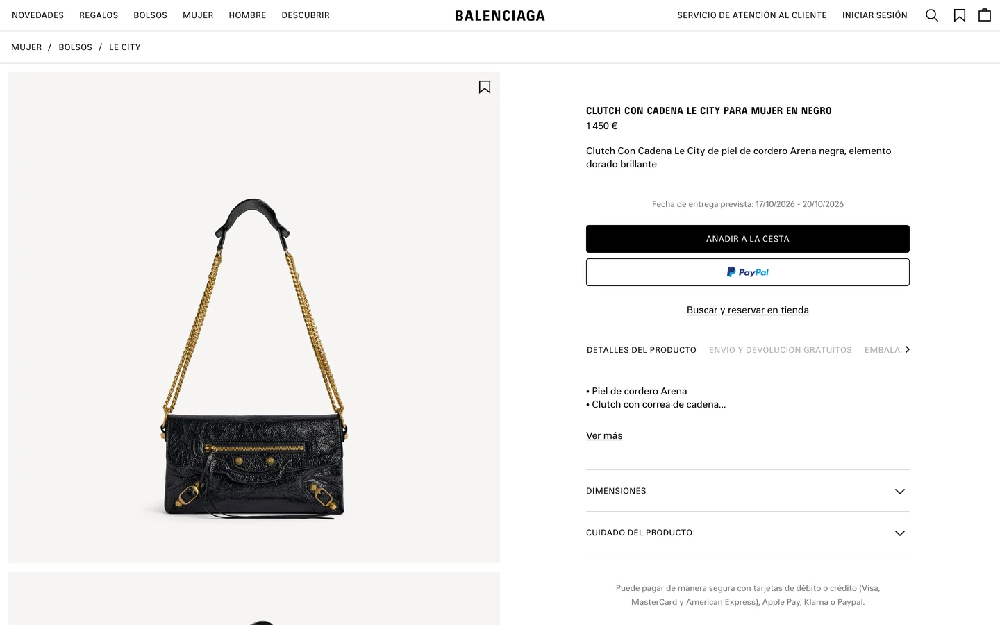

# Balenciaga Replica Challenge

<aside>
🖤 Welcome to the Balenciaga Replica Challenge! Luxury is in the details.

</aside>

<aside>
🧠 This is a powerful challenge that trains your eye for restraint: black and white, uppercase type, huge product photos and very precise spacing.

</aside>

<aside>
🔥 Minimal designs are the hardest to copy. With nothing to hide behind, every pixel of spacing shows.

</aside>

<aside>
♻️ Recycle elements often. One product tile, built well, becomes the whole grid.

</aside>

**Lesson Title: The UI Replica Project:**

**This exercise is to be completed in tandem with your UX curriculum. Please take your time and copy as many screens as you can until you are competent with Figma tools.**

*Unlocking Figma Mastery through Perfect Replication*

Welcome to the "UI Replica Project," a detailed creative lesson designed to help you gain valuable experience with Figma. This time you replicate a **luxury e-commerce website**: Balenciaga's Le City bags page, on both phone and desktop. Unlike the app challenges, this one is responsive: the same content, laid out for two very different screens.

As the saying goes, "practice makes perfect," and this lesson exemplifies that principle. The key objective here is not just to create a replica but to create a perfect replica.

## The Screens

Four real screens from balenciaga.com (Spanish store, Le City bags), two on a phone and two on desktop. The phone pages have been captured top to bottom as one tall image, so you can trace each page in one go.

**How to trace:**
- **Phone screens:** create an **iPhone 16** frame (393 × 852) and make it as tall as the image. Drag the screenshot in and scale it to **390 px wide**.
- **Desktop screens:** create a **Desktop** frame **1440 px wide**; these screenshots are already 1440 px wide, so drop them in at 100%.
- Lock the screenshot, lower its opacity to about 40% and build on top of it. Hide it when you're done and compare.

### 1. Category page (phone, stitched)

The header with the wordmark and four icons, the search bar, the scrolling category tabs, the uppercase page title, the hero photo, size chips (Mini, Pequeño, Mediano, Grande), the filter bar, and a two-column product grid.

### 2. Product page (phone, stitched)

Breadcrumbs, a full-width image carousel with dots, the product name and price, the delivery date, the black Add to basket button with a PayPal button under it, tabs for product details, accordions, and "Complete the look".

### 3. Category page (desktop)

The same page at 1440 px: a full navigation bar with the wordmark centred, a wide hero, centred size chips, the filter bar aligned right and a four-column product grid.

### 4. Product page (desktop)

A two-column layout: a tall image gallery on the left, and the product details and actions on the right.

*Screenshots of balenciaga.com, used for teaching only.*

## The Journey Ahead: Manual Replication (Step 1)

**Step 1:** **Basic Replication**

- Start **without** utilizing Figma's auto layout or components.
- Begin by studying the original UI screens.
- Familiarize yourself with the shapes, colors, and typography used.
- Carefully recreate each screen element manually.

**Step 2:** **Layout and Spacing**

- Analyze the spacing, alignment, and relationships between UI elements.
- Use Figma grids and rulers, located on the right hand side to do so: a 2-column grid on the phone and a 4-column grid on desktop.
- Pay close attention to pixel-perfect alignment and spacing: thin 1 px rules divide every section.
- Ensure that every detail matches the original screens.

**Step 3:** **Typography and Color**

- Focus on replicating the typography and color schemes accurately.
- Match font sizes, styles, and colors precisely. Headings and product names are bold uppercase with wide letter spacing; prices and details are regular weight.
- Ensure that text and graphics align perfectly.

**Step 4:** **Responsive Design**

- Compare the phone and desktop versions of the same page. What stays the same? What moves, grows or disappears?
- Make your replica work at both sizes, using the same components.

## Elevating Your Skills with Auto Layout (Step 2)

**Step 5:** **Introduction to Auto Layout**

- Learn about Figma's Auto Layout feature and its benefits.
- Understand how Auto Layout simplifies element management.

**Step 6:** **Applying Auto Layout**

- Convert your manually replicated screens into Auto Layout frames.
- Explore how Auto Layout improves adaptability and responsiveness.

**Step 7:** **Auto Layout Best Practices**

- Implement best practices for using Auto Layout effectively.
- Experiment with nested Auto Layout frames for complex designs: the product tile (image, then a centred text stack) and the buy box (title, price, buttons, tabs, accordions) are perfect practice. Build the tile once as a component and use it in both grids.

## Conclusion

By following these structured steps, you'll have perfected the art of replicating UI screens in Figma, honed your attention to detail, and harnessed the power of Auto Layout. Remember, practice is the key to mastery, and this lesson provides you with the perfect opportunity to apply this principle. Good Luck 🍀 !

Balenciaga's own typefaces aren't free to use. Close free alternatives:

[Barlow Semi Condensed - Google Fonts](https://fonts.google.com/specimen/Barlow+Semi+Condensed) (bold, uppercase headings)

[Inter - Google Fonts](https://fonts.google.com/specimen/Inter) (body text and prices)

Icons available here:

[Phosphor Icons](https://phosphoricons.com)

Colours: **#000000** (text, buttons and rules), **#FFFFFF** (background), **#F7F6F4** (product photo background), **#6A6A6A** (secondary text), **#AAAAAA** (inactive tabs).
