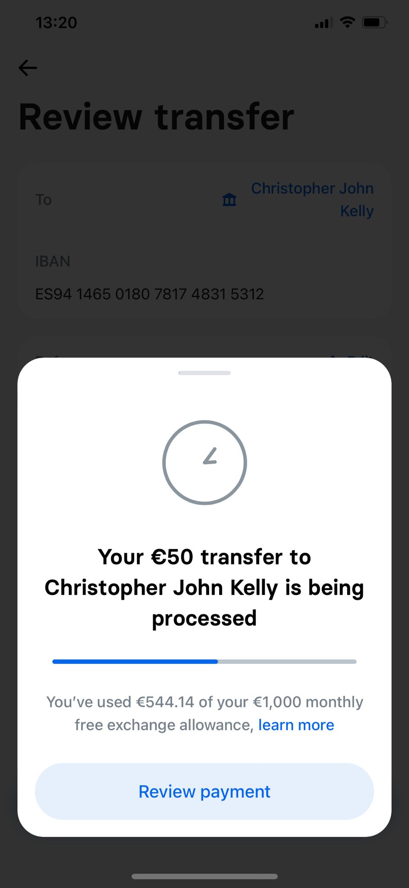
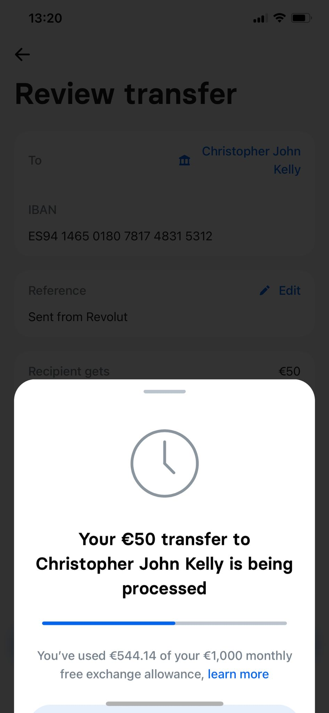
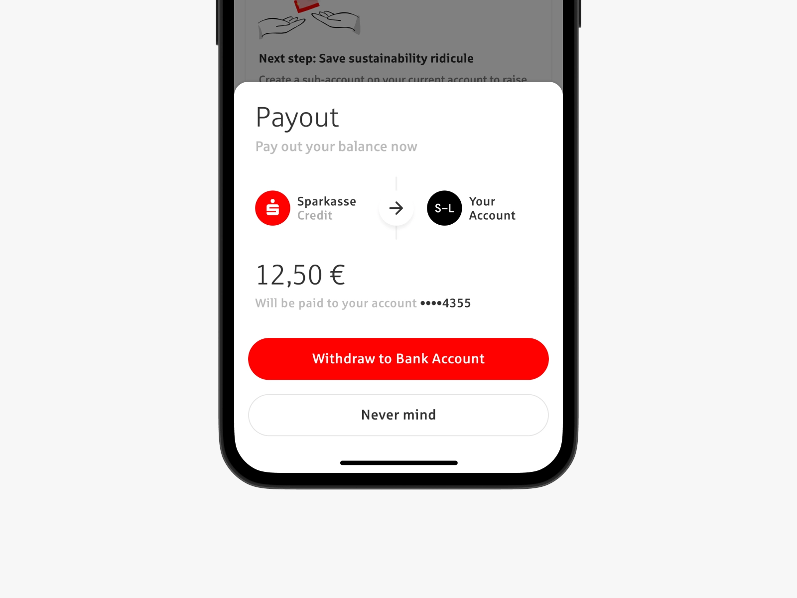

# Bottom Sheet

## Bottom Sheet

This UI Challenge is all about feedback from an action. Imagine you are part of a design team for a Fintech digital bank called Neobank. 

You have been charged with the task of creating a Bottom Sheet which informs a user when their money has been transferred successfully to a friend. 

---

## Potential Inclusions

1. Amount Transferred
2. Sender
3. Receiver 
4. Logo
5. Payment Review   

## Inspiration

Source: [https://dribbble.com/leanderlenzing](https://dribbble.com/leanderlenzing)

---

## Difficulty Level ⭐️⭐️⭐️
