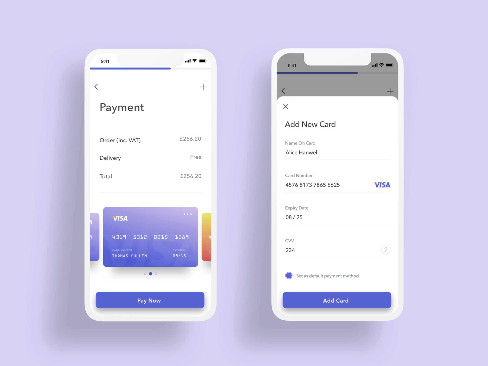
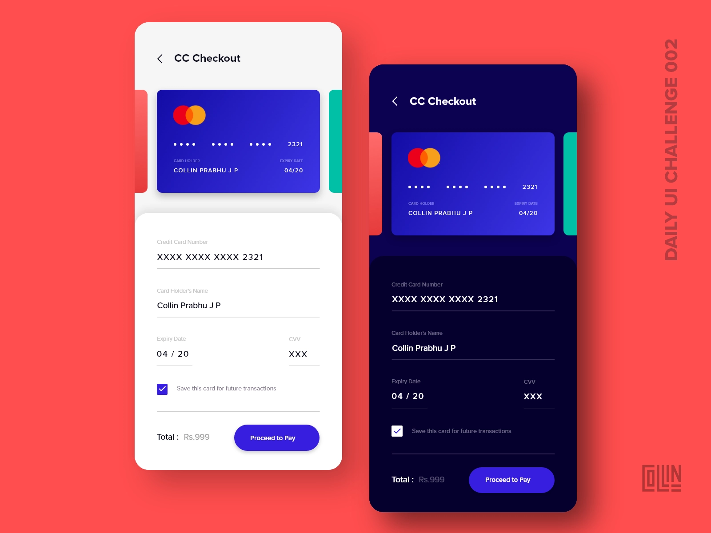
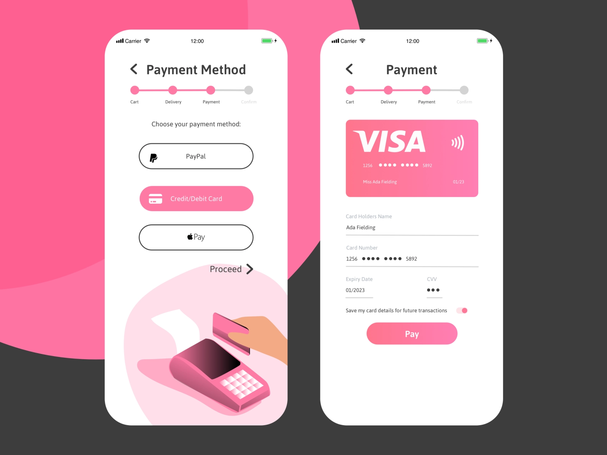

# CC Checkout

## **Credit/Debit Card Checkout**

This one is a classic UI challenge and really helps you to become familiar with inputs and actions. Imagine you are part of a team on an e-commerce app. Put yourself in the shoes (No pun intended 😅) of a user who is buying a pair of funky tennis shoes from The Sneaker Warehouse. Imagine you are ready to purchase your cool new shoes and you just need to punch in your credit card info! Make a Payment Checkout for the brand! 

Source: [https://dribbble.com/theacheang](https://dribbble.com/theacheang)

## Potential Inclusions

1. Name of Card
2. Card Number
3. Expiry Date
4. CVV  
5. Pay Now Button
6. Back Button
7. Total
8. Subtotal
9. Delivery Fee 

## Inspiration

Source: [https://dribbble.com/davidcollinpaul](https://dribbble.com/davidcollinpaul)

Source: [https://dribbble.com/ifrhvuiux](https://dribbble.com/ifrhvuiux)

## Difficulty Level ⭐️⭐️⭐️
