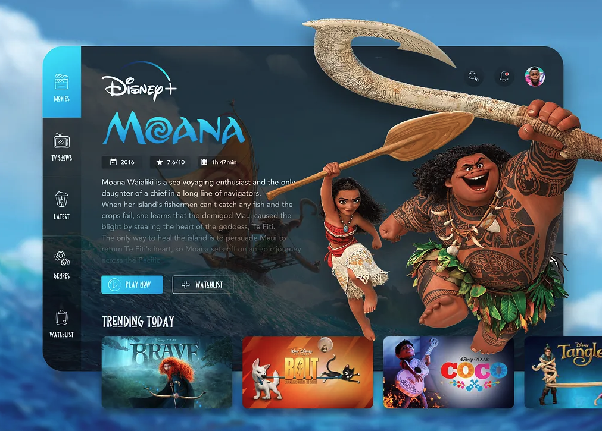
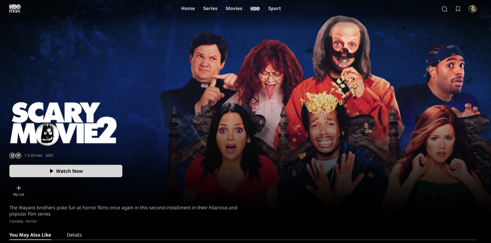

# Choose A Movie

## The brief

Back at **Flicker**, the streaming service. Before people press play, they land on a film's intro page. Design a movie trailer intro page that makes people want to watch.

*Source not recorded.*

## Deliverable

- One film intro page in an **iPhone 16** frame (393 × 852) in Figma, on the 8-point grid.

## Must include

1. Film title
2. Watch now / play button
3. Drop-down (or expandable section) with further details

## Nice to have

- Director
- Cast
- Star rating or reviews
- You may also like

## Inspiration

*Source not recorded.*

*Source not recorded.*

Source: [https://dribbble.com/am-designer](https://dribbble.com/am-designer)

## Time box

**Time box:** 3 hours

**Difficulty:** ⭐️⭐️⭐️

## Before you submit

☐ Frame is iPhone 16 (393 × 852) and spacing follows the 8-point grid

☐ Every *Must include* item is on the screen

☐ The play button is the most prominent element

☐ Details are tucked away until the user asks for them

☐ Text is readable and colour contrast passes (4.5:1 for body text)

☐ Layers are named and grouped; repeated elements are components

☐ Shared the Figma link and a PNG export with your instructor
