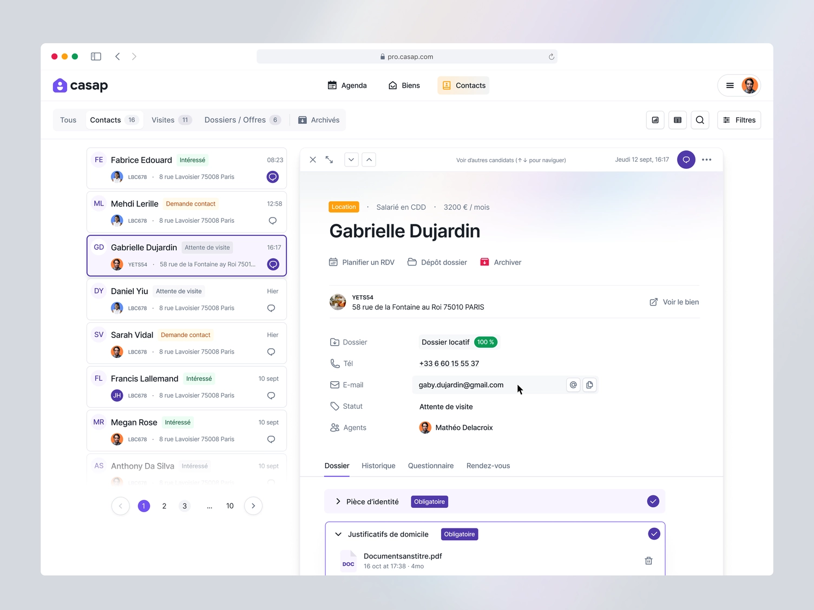
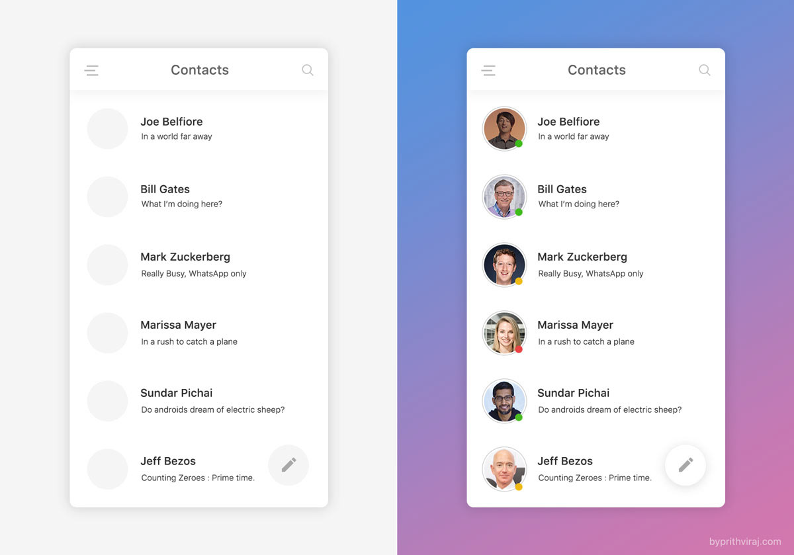
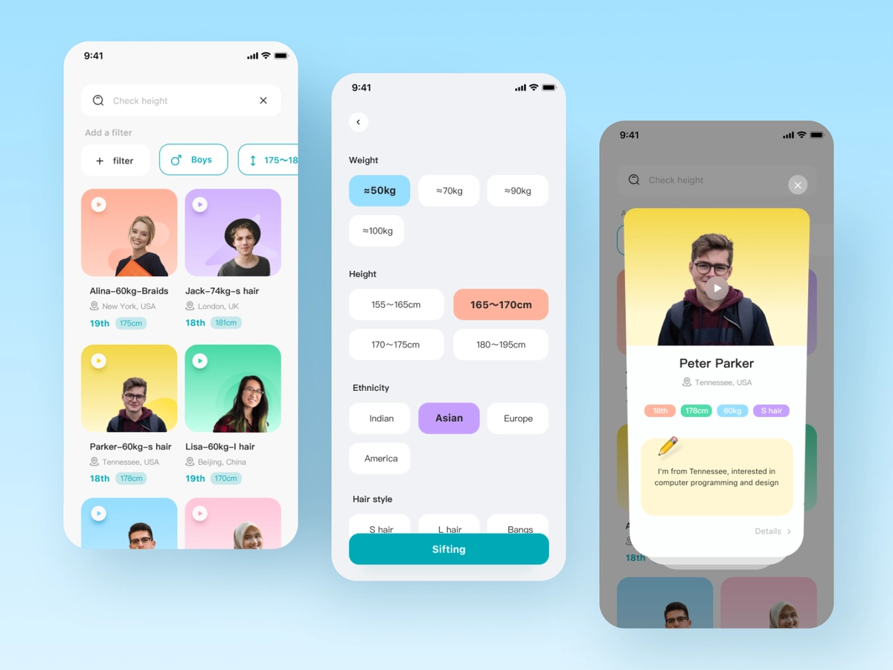
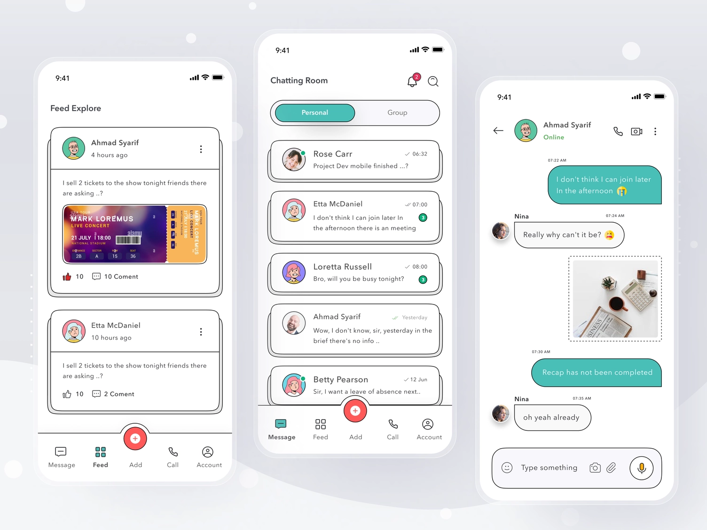

# Friends List

## The brief

This challenge is about fast access. You've started work as a freelancer on **Huddle**, an app for a global community of sport enthusiasts who love to get together and play. Design a list of contacts that is quick to scan and easy to act on.

Try the [User Profile](https://www.figma.com/community/plugin/749945157855564842/User-Profile) Figma plugin to fill your list with realistic people fast.

Source: [https://dribbble.com/jubeo](https://dribbble.com/jubeo)

## Deliverable

- One friends list screen in an **iPhone 16** frame (393 × 852) in Figma, on the 8-point grid, with at least eight contacts.

## Must include

1. Name
2. Profile thumbnail
3. Online status indicator

## Nice to have

- Status message
- Search or filter
- Quick action (message or invite to play)

## Inspiration

Source: [https://www.behance.net/101prithviraj](https://www.behance.net/101prithviraj)

Source: [https://dribbble.com/rddstudio](https://dribbble.com/rddstudio)

Source: [https://dribbble.com/sultonhand](https://dribbble.com/sultonhand)

## Time box

**Time box:** 2 hours

**Difficulty:** ⭐️⭐️

## Before you submit

☐ Frame is iPhone 16 (393 × 852) and spacing follows the 8-point grid

☐ Every *Must include* item is on the screen

☐ Online status doesn't rely on colour alone

☐ Each row is a component with the same height and spacing

☐ Text is readable and colour contrast passes (4.5:1 for body text)

☐ Layers are named and grouped; repeated elements are components

☐ Shared the Figma link and a PNG export with your instructor
