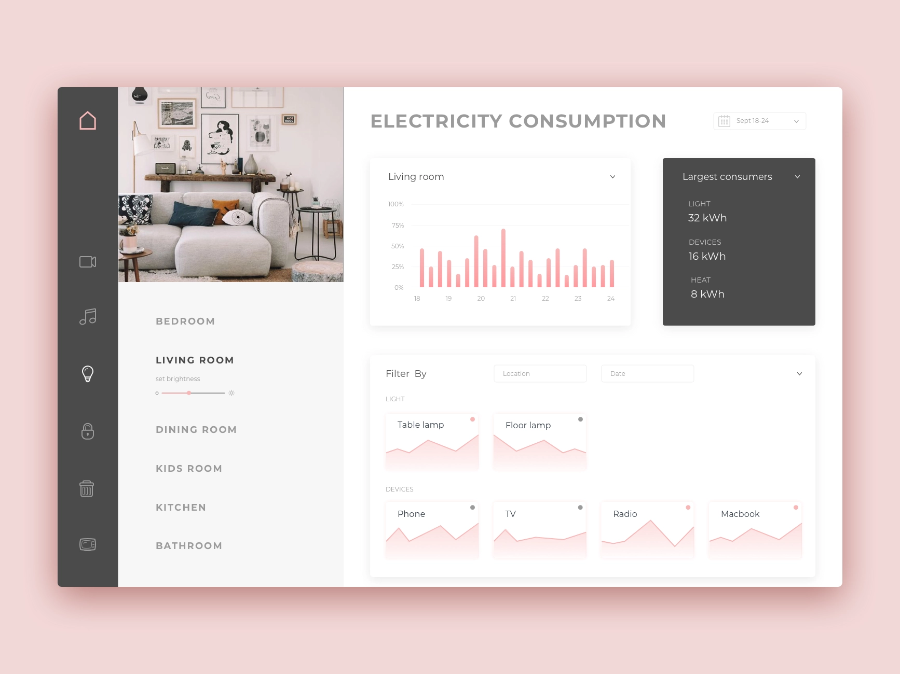
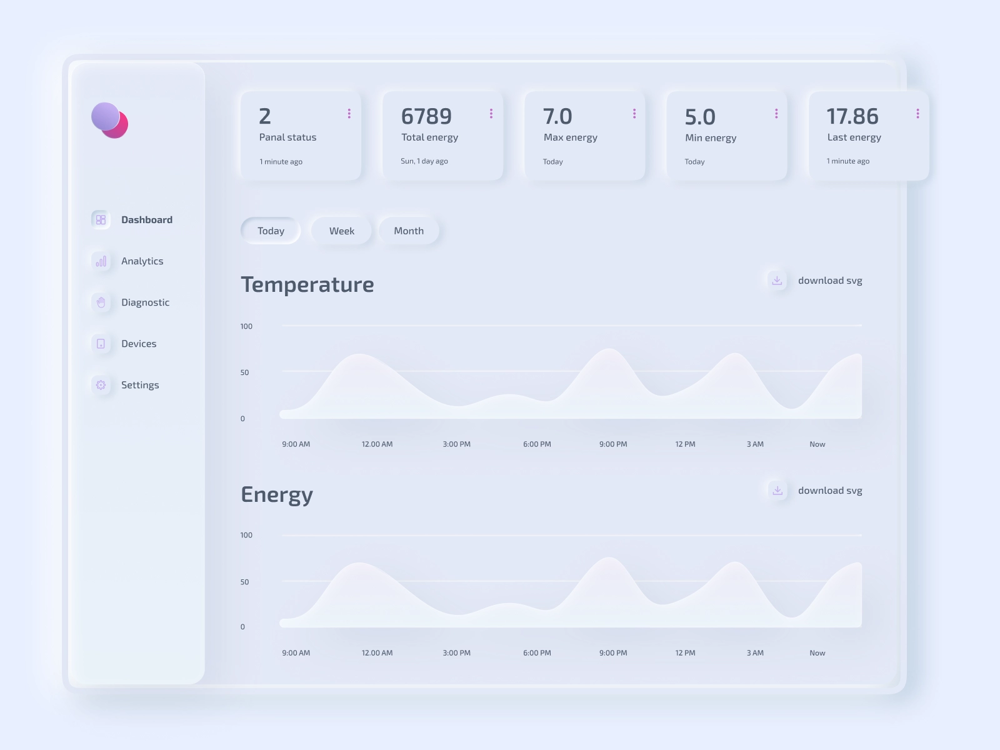
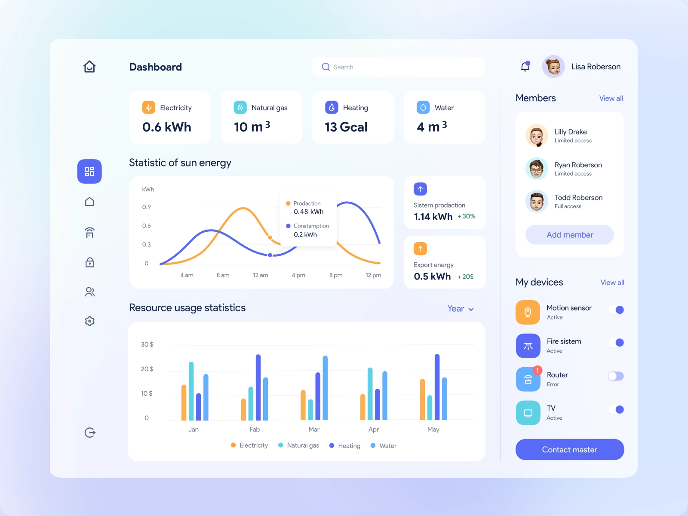
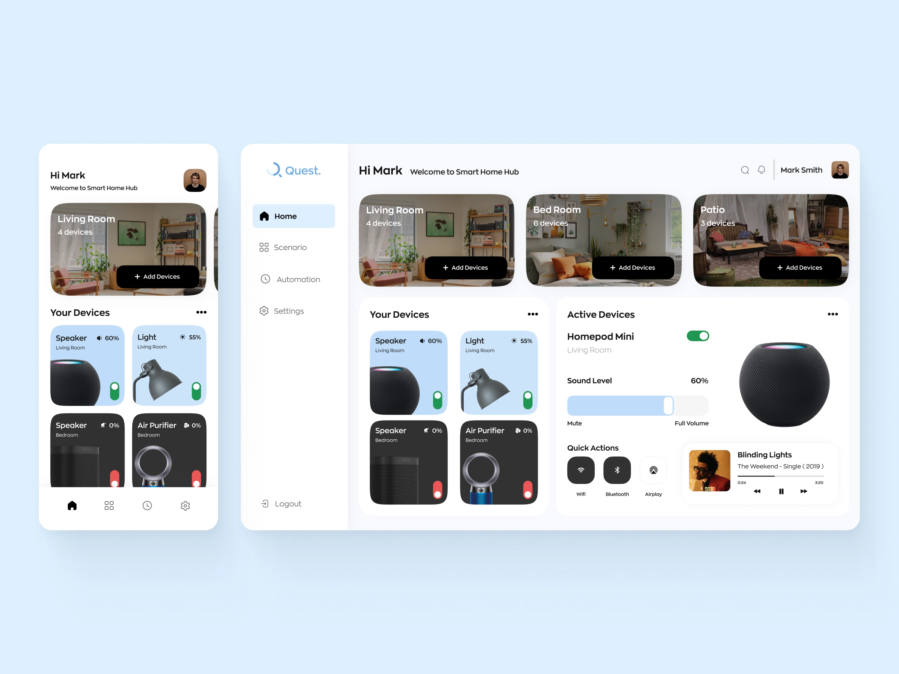

# Home Monitor Dash

## In App Smart Home Monitor

Modular design is everywhere these days and it allows developers to do amazing things with responsive web. As a designer, it’s so helpful to think and build in a modular way. 

You’ll have to use a combination of former skills you’ve picked up along the way because this is a real challenge!

For this UI challenge, create a modular UI dashboard which provides a useful way to track and measure consumption of one or two household utilities.

Take a look at the list of potential inclusions and design an app which appeals to the modern family.   

---

## Potential Inclusions

1. Lighting
2. Temperature
3. Nanny Cams
4. Air Conditioning
5. Refrigeration  
6. Gas 
7. Electricity

## Inspiration

Source: [https://dribbble.com/OlgaSaff](https://dribbble.com/OlgaSaff)

Source: [https://dribbble.com/cleveroad](https://dribbble.com/cleveroad)

Source: [https://dribbble.com/Atulya_26](https://dribbble.com/Atulya_26)

## Difficulty Level ⭐️⭐️⭐️⭐️⭐️
