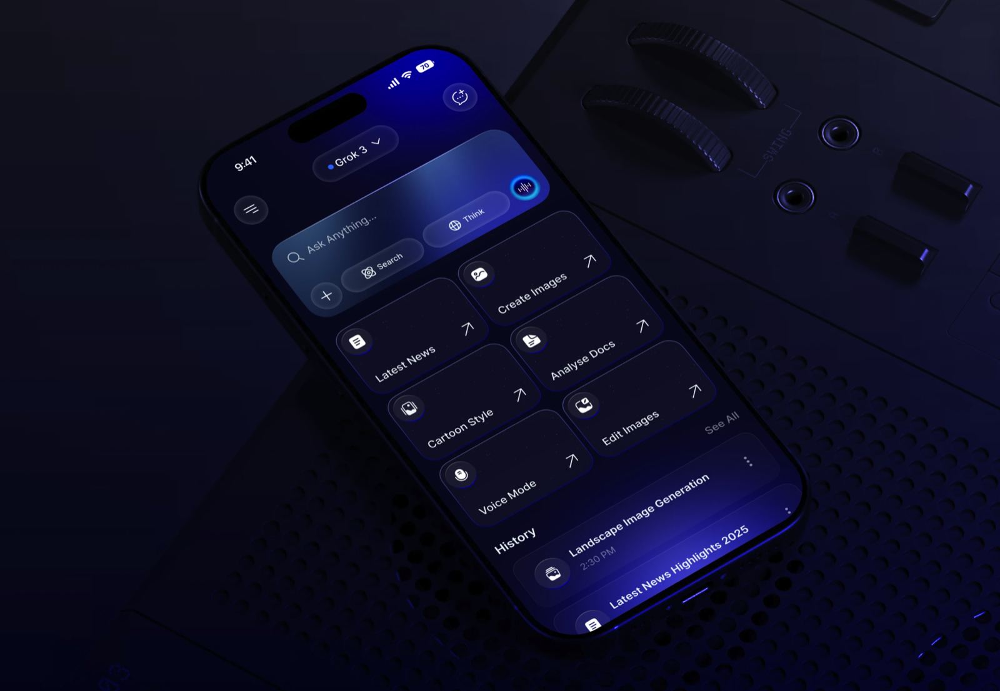
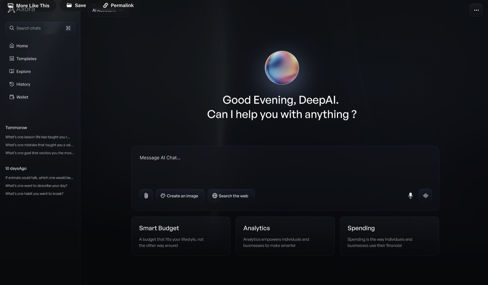
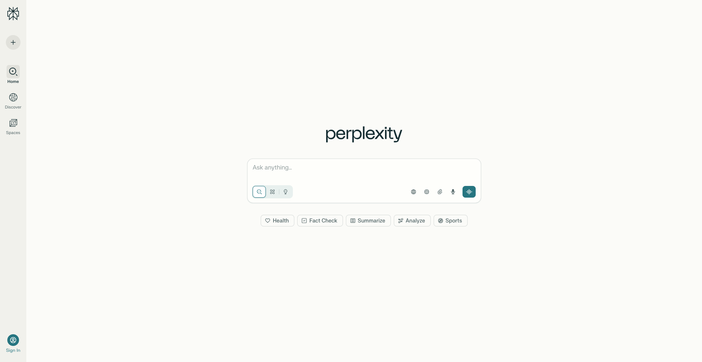

# Make an AI Interface

## Challenge Title

Design an **AI interface** that allows users to interact naturally with an intelligent assistant. Think beyond a simple chat box — how can your design make the AI feel smart, human, and useful and yet still meets users existing mental models and existing expectations. 

---

## Potential Inclusions

- **Text input field** — main area to type or paste prompts/questions.
- **Send button / paper-plane icon** — to submit a message.
- **Conversation thread** — scrollable list showing user and AI messages.
- **Message bubbles** — distinct visual styles for user vs. AI responses.
- **“AI is thinking…” indicator** — animated dots or pulse while processing.
- **Voice input button** — optional microphone icon for voice prompts.
- **Upload / attach button** — to share images, files, or documents.
- **Quick action chips** — suggested follow-up actions (e.g., “Summarize,” “Explain more”).
- **Avatar or assistant icon** — subtle identity marker for the AI.
- **Empty state prompt** — placeholder like “Ask me anything…” when chat is blank.

## Inspiration

## Difficulty Level ⭐️⭐️⭐️
