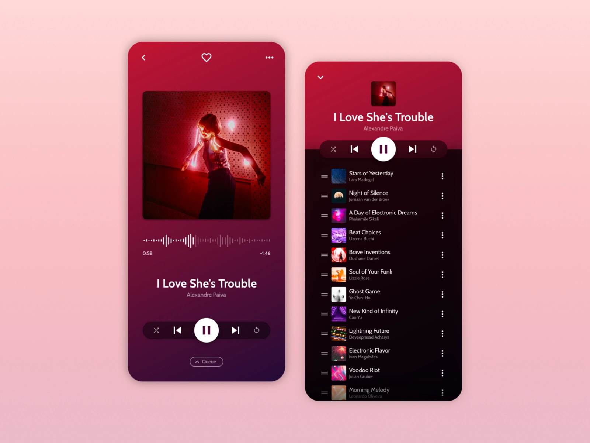
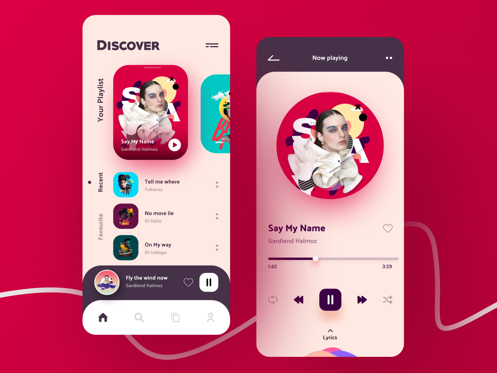
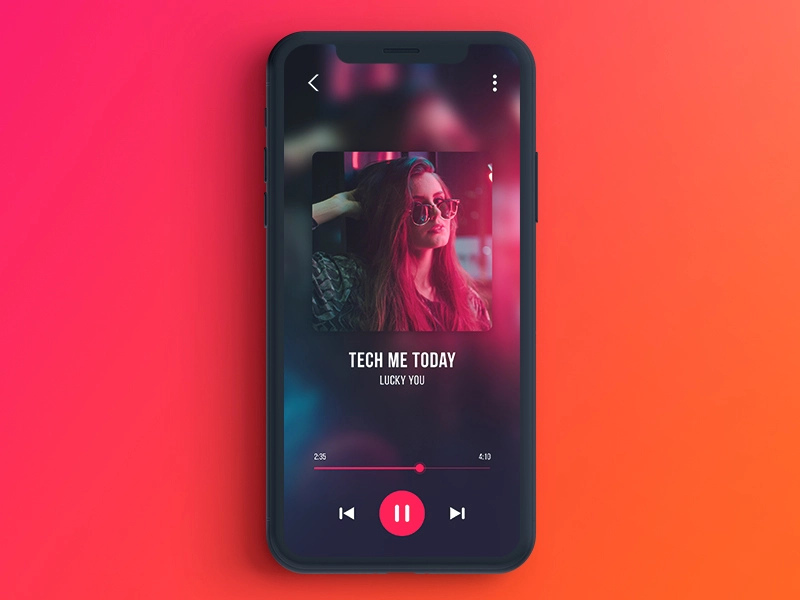
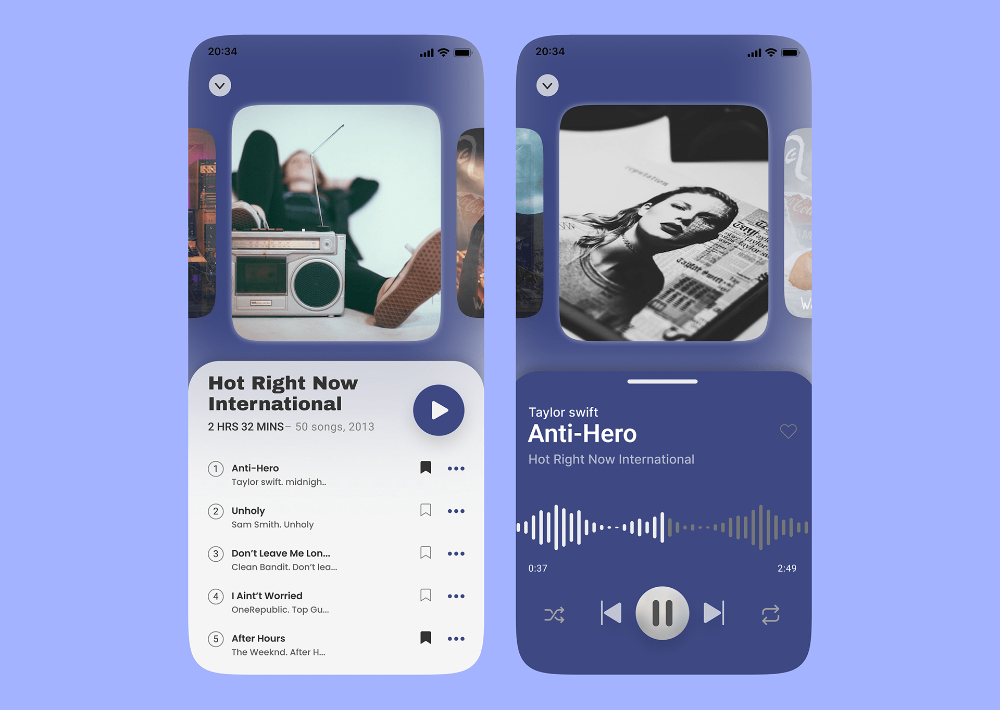

# Music Player

## **Music Player**

This one is really going to help you wrap your head around lists. 

Imagine you’ve just joined a brand new start up called Bop. It’s a new music streaming service aimed to rival Spotify’s expensive premium price tag. 

Imagine a new user is out for a jog and they bump into an old friend. They want to hit the pause button on the app to stop and have a chat with their friend. What do they see when they look down?  

Create a UI which allows a user to pause and play audio on the application. 

Source: [https://dribbble.com/adommeti](https://dribbble.com/adommeti)

---

## Potential Inclusions

1. Track List
2. Media Playback
3. Sound wave Bar
4. Artist Thumbnail
5. Track Details  
6. Upcoming Track 
7. Playlist

## Inspiration

Source: [https://www.uplabs.com/posts/music-player-app-ui-design-concept](https://www.uplabs.com/posts/music-player-app-ui-design-concept)

Source: [https://dribbble.com/rayhansumon](https://dribbble.com/rayhansumon)

Source: [https://www.behance.net/mitaliw?tracking_source=search_projects|Music+Player](https://www.behance.net/mitaliw?tracking_source=search_projects%7CMusic+Player)

## Difficulty Level ⭐️⭐️⭐️⭐️
