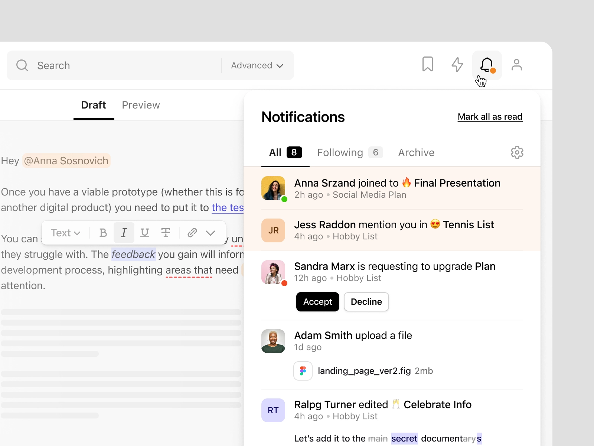
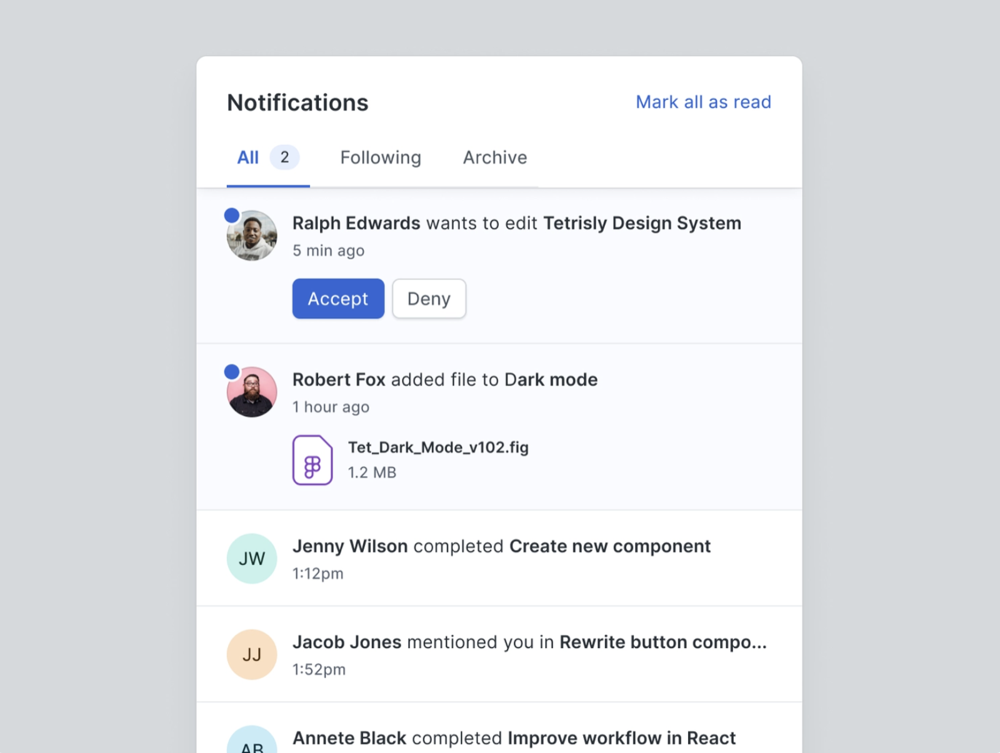
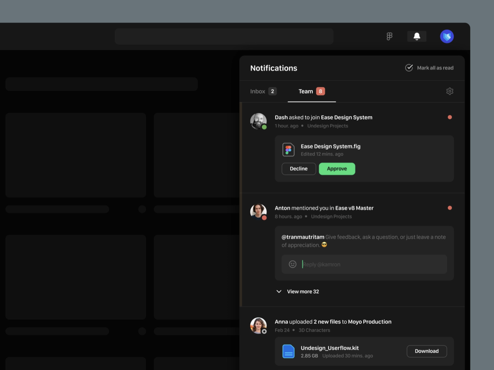
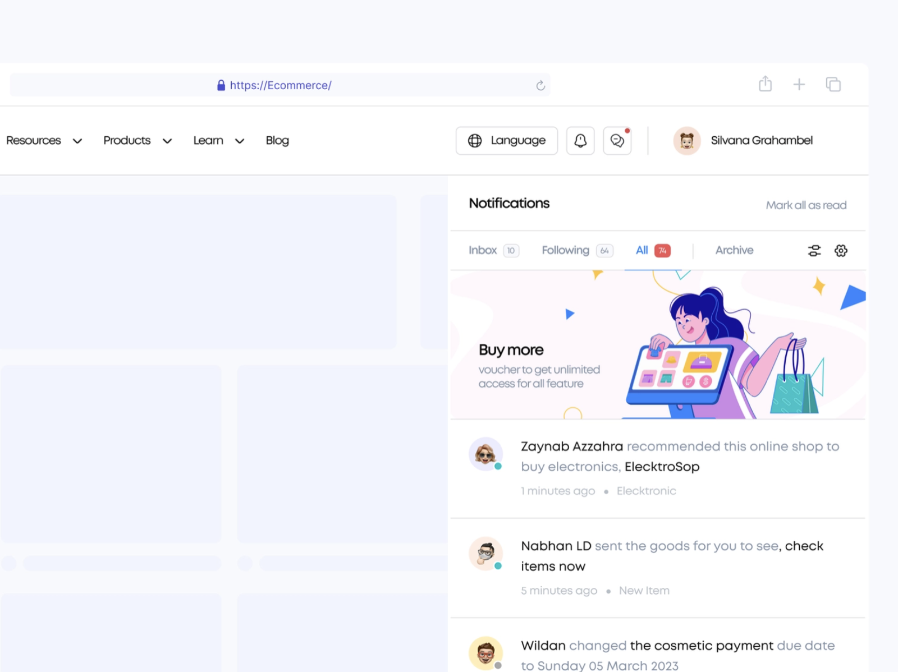

# New Notification

## The brief

You'll be a caption whizz by the end of this one. You're the UI designer at **Fireballs**, a brand-new social network for fantasy gamers. Design the notifications panel that shows the latest messages from friends, fans and followers.

Source: [https://dribbble.com/Shuma87](https://dribbble.com/Shuma87)

## Deliverable

- One notifications panel in an **iPhone 16** frame (393 × 852) in Figma, on the 8-point grid, with at least five notifications of different types.

## Must include

1. Who it's from
2. When it was sent
3. Read / unread status
4. Notification type

## Nice to have

- Notification action (e.g. Reply, Accept)
- Attachment preview
- Sender online / offline
- Reply input

## Inspiration

Source: [https://dribbble.com/ilnicki](https://dribbble.com/ilnicki)

Source: [https://dribbble.com/tranmautritam](https://dribbble.com/tranmautritam)

Source: [https://dribbble.com/NorchStudio](https://dribbble.com/NorchStudio)

## Time box

**Time box:** 3 hours

**Difficulty:** ⭐️⭐️⭐️

## Before you submit

☐ Frame is iPhone 16 (393 × 852) and spacing follows the 8-point grid

☐ Every *Must include* item is on the screen

☐ Unread notifications stand out from read ones

☐ Captions are short and scannable

☐ Text is readable and colour contrast passes (4.5:1 for body text)

☐ Layers are named and grouped; repeated elements are components

☐ Shared the Figma link and a PNG export with your instructor
