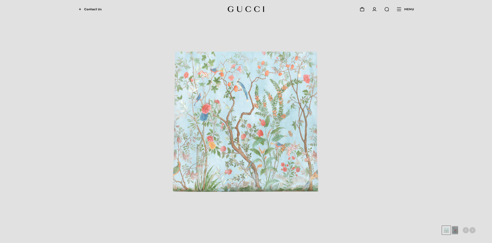
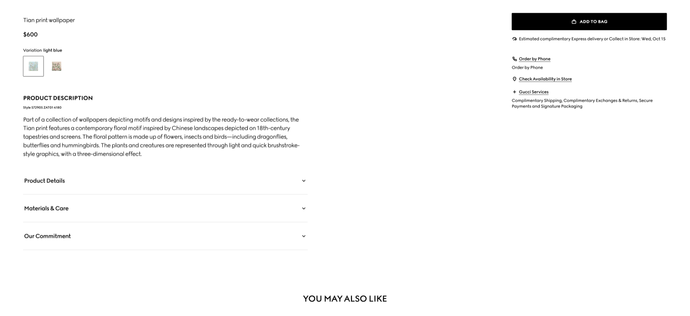
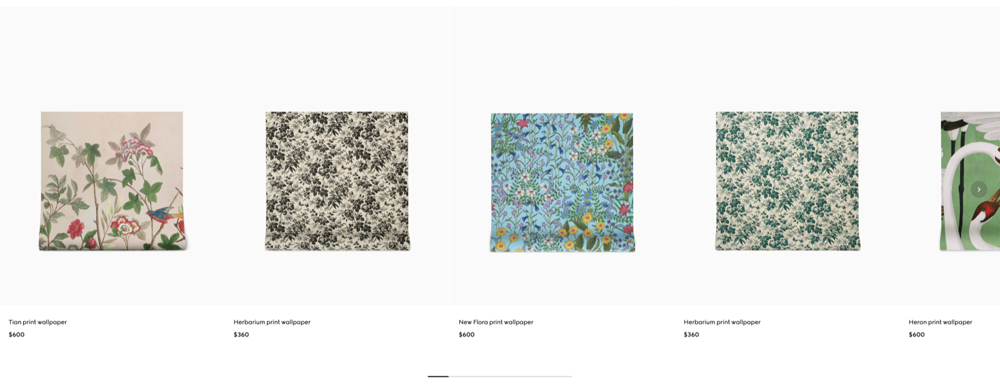

# Product Card

## The brief

Design a product card for **Papel**, an online wallpaper shop. The card should show the essential information at a glance while feeling visually rich, on-brand and easy to interact with. Balance aesthetic appeal with clarity: make the wallpaper feel tactile and desirable, while matching what people expect from e-commerce.

*Source not recorded.*

## Deliverable

- The product card in a grid of three, in an **iPhone 16** frame (393 × 852) in Figma, on the 8-point grid.
- Extra challenge: the expanded card or product page it opens.

## Must include

1. Product name
2. Main product image
3. Price (and sale price)
4. Add to cart button
5. Favourite / wishlist icon

## Nice to have

- Product code (SKU)
- Gallery thumbnails
- Product details (material, roll size, pattern repeat)
- Care instructions
- Share button
- You might also like

## Inspiration

*Source not recorded.*

*Source not recorded.*

## Time box

**Time box:** half a day (about 4 hours)

**Difficulty:** ⭐️⭐️⭐️⭐️

## Before you submit

☐ Frame is iPhone 16 (393 × 852) and spacing follows the 8-point grid

☐ Every *Must include* item is on the screen

☐ The card is a component, used three times with different content

☐ Price and Add to cart are the clearest elements

☐ Text is readable and colour contrast passes (4.5:1 for body text)

☐ Layers are named and grouped; repeated elements are components

☐ Shared the Figma link and a PNG export with your instructor
