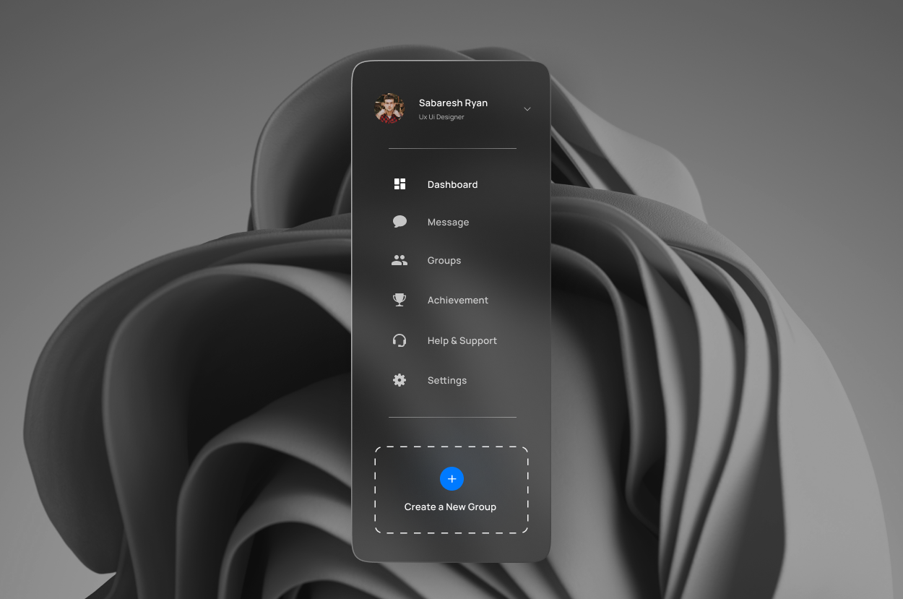
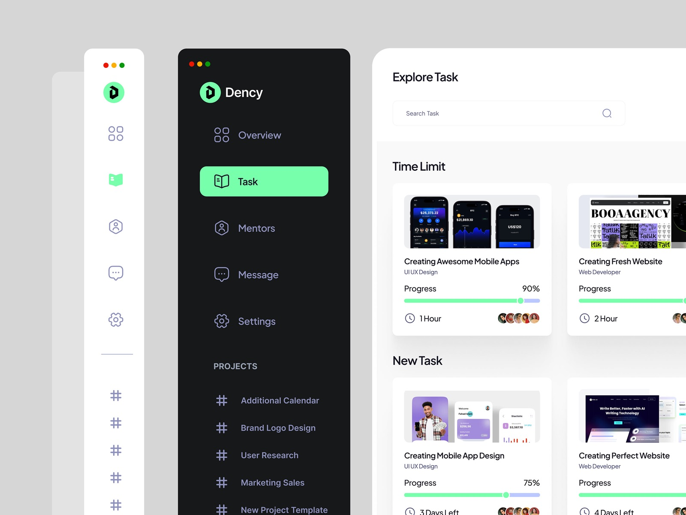
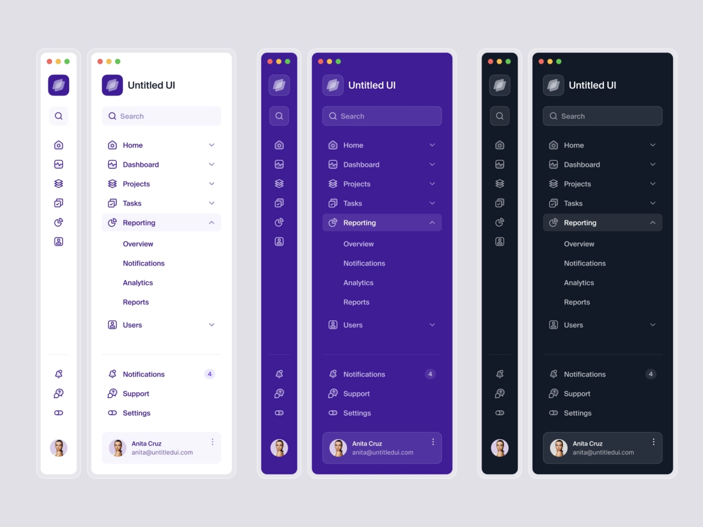
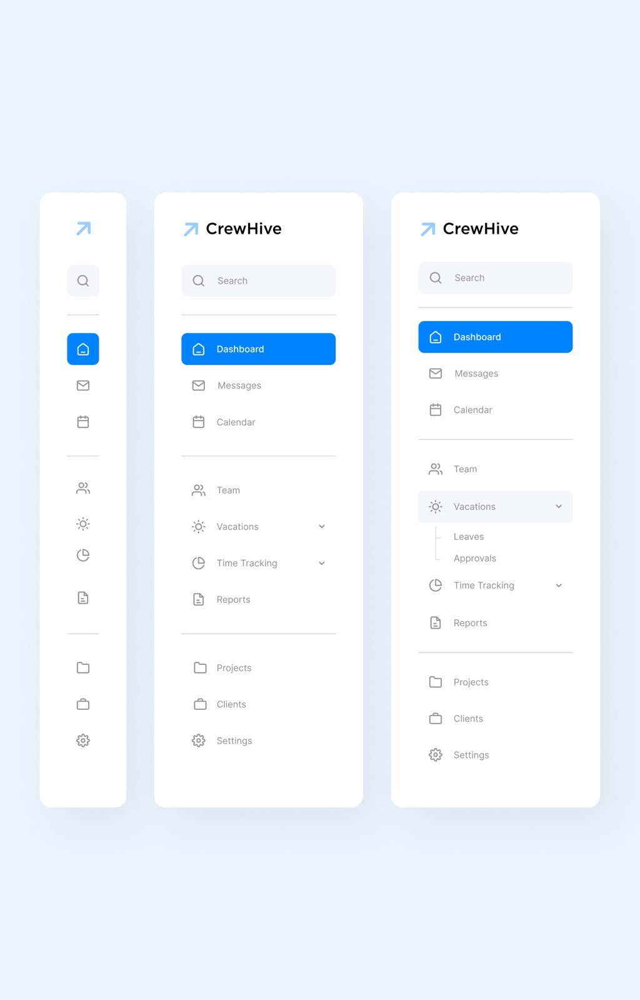
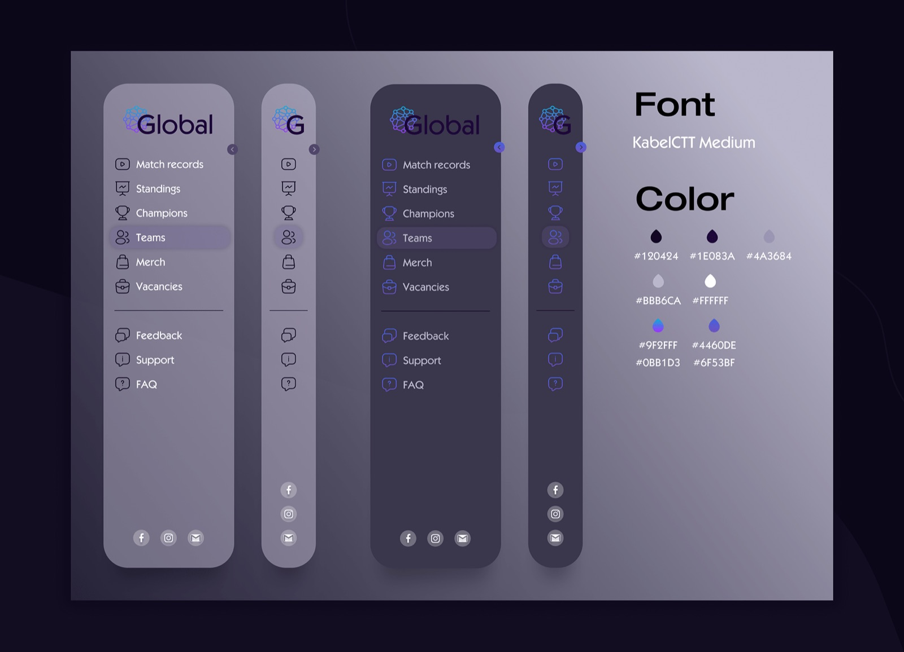

# Sidebar

## The brief

As we are learning, good orientation is a staple of the UX diet: how users move from page to page is a cornerstone of good UI.

**Bubble** is a company that helps people write scripts for films. Design the sidebar rail for its writing app, so writers can jump between their projects and tools: make a new entry, search their topics, send their story, change the colour scheme.

*Source not recorded.*

## Deliverable

- The expanded sidebar, in a desktop frame (1440 × 1024).
- The collapsed version for mobile, in an **iPhone 16** frame (393 × 852) in Figma, on the 8-point grid.

## Must include

1. Icons
2. Create new entry
3. Categories
4. Active tab
5. Mobile collapsed version

## Nice to have

- Profile thumbnail
- Dark mode

## Inspiration

*Source not recorded.*

Source: [https://dribbble.com/jordanhughes](https://dribbble.com/jordanhughes)

Source: [https://www.behance.net/robinjoseph3](https://www.behance.net/robinjoseph3)

Source: [https://www.behance.net/kristinash9335](https://www.behance.net/kristinash9335)

## Time box

**Time box:** 2 hours

**Difficulty:** ⭐️⭐️

## Before you submit

☐ Frame is iPhone 16 (393 × 852) and spacing follows the 8-point grid

☐ Every *Must include* item is on the screen

☐ The active tab is obvious at a glance

☐ Every icon has a label, or a tooltip in the collapsed version

☐ Text is readable and colour contrast passes (4.5:1 for body text)

☐ Layers are named and grouped; repeated elements are components

☐ Shared the Figma link and a PNG export with your instructor
