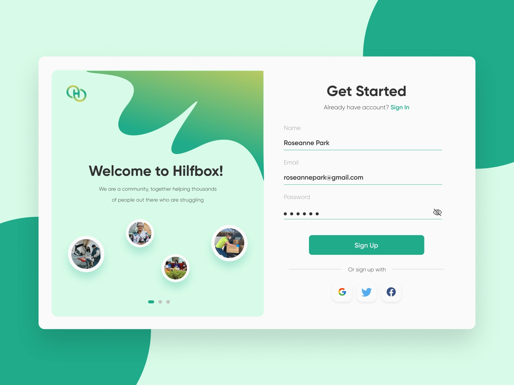
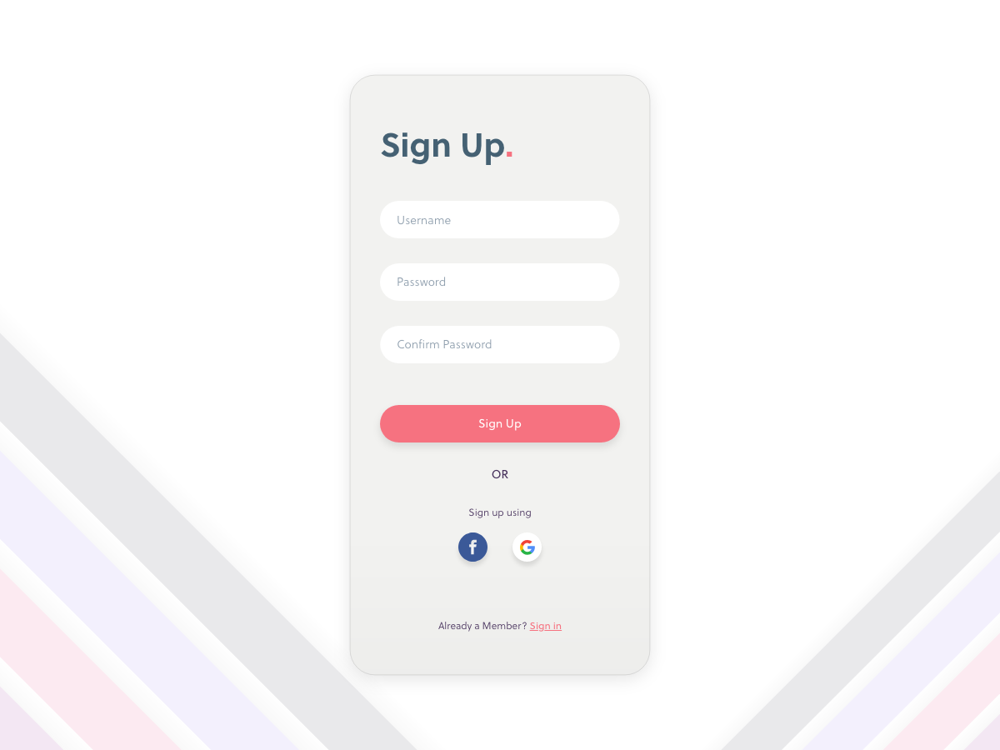
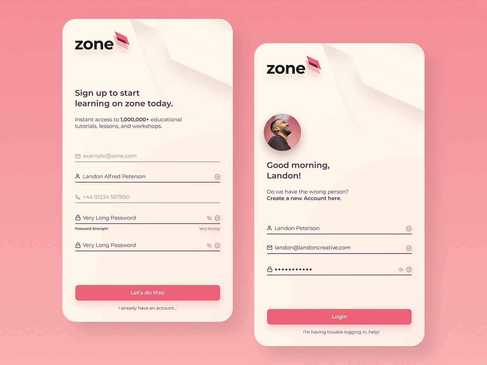

# Sign In

## Sign In Registration Form

The bedrock of good UI is understanding how data transits from state to state. Basically that’s all we do. We move data! No more is this process exemplified that in the classic sign in page. 

Design an effective Sign In page or pop up for a community called Nomad which allows people to find people to travel the world with!  

Source: [https://dribbble.com/christinesoules](https://dribbble.com/christinesoules)

---

## Potential Inclusions

1. Username
2. Email
3. Password
4. Confirm Password
5. Sign In With Social Media
6. Create New Account
7. Forgot Password  
8. Hide / See Password
9. Social Media Icons 
10. Title Text
11. Logo
12. Imagery

## Inspiration

Source: [https://dribbble.com/nandaaafw](https://dribbble.com/nandaaafw)

Source: [https://www.uplabs.com/posts/ui-challenge-day-1-dailyui](https://www.uplabs.com/posts/ui-challenge-day-1-dailyui)

Source: [https://dribbble.com/Jawfy](https://dribbble.com/Jawfy)

---

## Difficulty Level ⭐️⭐️⭐️

As an added challenge, try to follow through with multiple screens. What this means will be explained by your instructor but we would like it if you could imagine the user at different positions in the user journey. Before, during and after they have entered their data.
