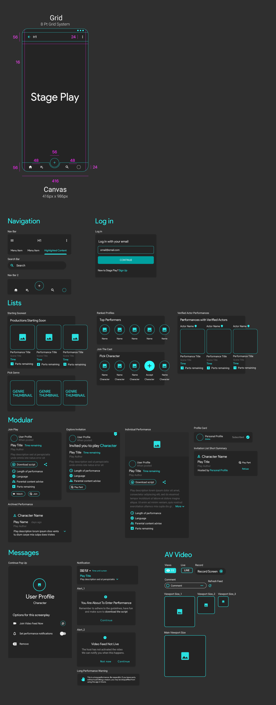

# Stage Play

## The brief

**Stage Play** is an app for amateur actors and theatre lovers. People browse plays that are about to start, pick a character, download the script and perform together live on video, while others watch. As a team, you will design the Stage Play interface from the schema below: the navigation, sign-in, lists, modular cards, messages and live-video screens.

This is a **UI team project**. The UX is decided for you; the challenge is to build a consistent, component-driven interface as a team, the way design teams work on real products.

## Team roles

Work in teams of three or four. Agree these roles on day 1 (one person can hold two):

- **Design system lead:** owns the colour and type styles, the grid and the master components. Every change to a component goes through them.
- **Screen designers (2):** build the screens from the components, split by section of the schema.
- **Prototype and QA lead:** links the screens into a clickable flow and checks every screen against the parameters before the presentation.

## Directives

Working as a team, produce a UI from the schema provided. Follow these parameters:

- Use master components
- Use the canvas provided (416 × 986 px)
- Use the 8-point grid system
- Use nested containment
- Use Auto Layout
- Use text properties
- Use swap properties

## Deliverables

1. **One shared Figma file** with pages for the design system, the components and the screens.
2. **A design system page:** colour styles, text styles, grid and spacing tokens.
3. **Master components** for every element in the schema, with variants and properties.
4. **At least eight screens**, covering every section of the schema: navigation, log in, lists, modular cards, messages and AV video.
5. **A clickable prototype** of one flow: sign in → find a play → pick a character → join the live performance.
6. **A five-minute team presentation** of the system and the flow.

## Day-by-day plan

| Day | Focus |
| --- | --- |
| 1 | Agree roles, read the schema together, set up the file, styles and grid |
| 2 | Build the master components: navigation, buttons, inputs, list items, cards |
| 3 | Build the screens from the components: log in, lists, modular cards |
| 4 | Messages and AV video screens; link the prototype |
| 5 | QA against the parameters, polish, and present |

## Schema

The reference below sets out the canvas and grid (416 × 986 px, 8-point grid) and the components to build: navigation, log in, lists, modular cards, messages and AV video. Click it to open it full size.

## Checklist

☐ Roles agreed and written at the top of the file

☐ Colour and text styles defined, and nothing on any screen is unstyled

☐ Every repeated element is an instance of a master component

☐ Components use Auto Layout, text properties and swap properties

☐ All screens use the 416 × 986 canvas and the 8-point grid

☐ The prototype flow works end to end

☐ Layers and pages are named so another team could pick up the file

## Assessment

Your team is assessed on:

- **System quality (40%):** clean styles, well-built components with properties and variants, consistent spacing.
- **Fidelity to the schema (30%):** every section covered, matching the canvas, grid and parameters.
- **Prototype (15%):** the core flow works and feels like one product.
- **Teamwork and presentation (15%):** clear roles, a tidy shared file and a confident five-minute presentation.
