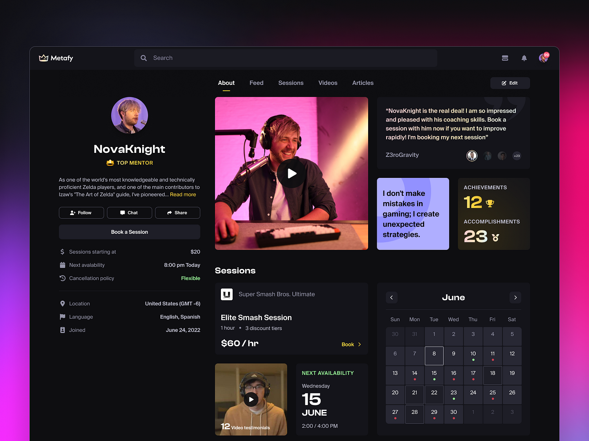
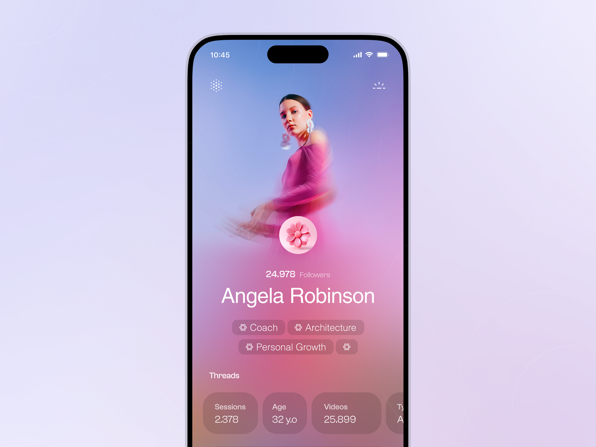
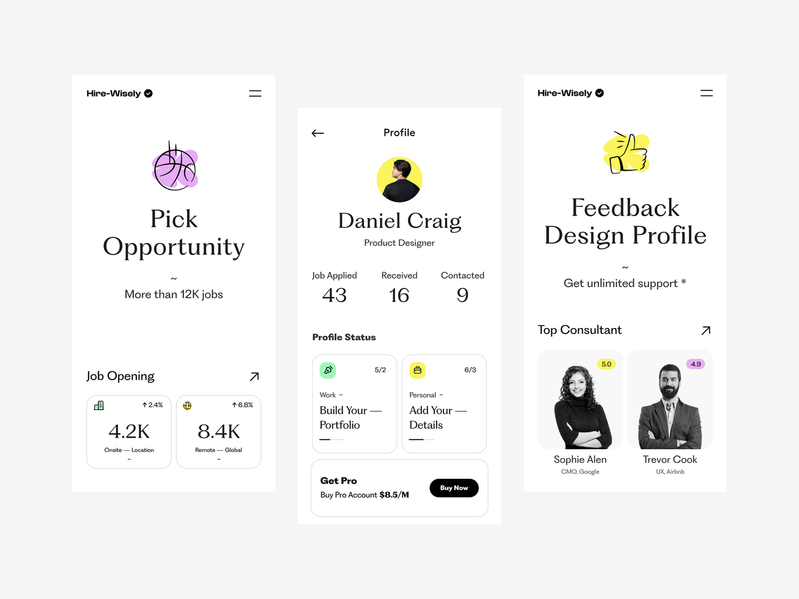
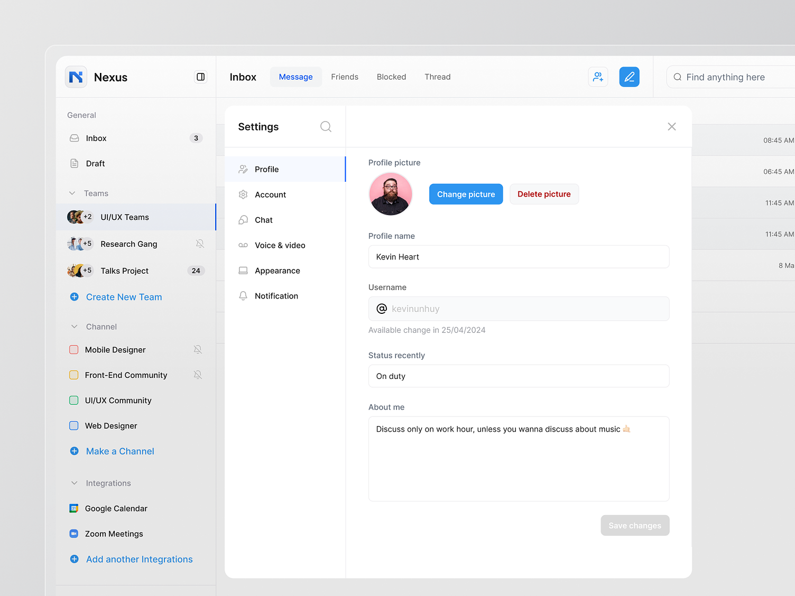

# User Profile Page

## The brief

Design the profile page for **Crew**, a professional network for freelance creatives. It should showcase a person's personal and professional details in a clean, organised layout that looks great and is easy to use.

*Source not recorded.*

## Deliverable

- One profile page in an **iPhone 16** frame (393 × 852) in Figma, on the 8-point grid. Scrolling is fine: make the frame as tall as you need.

## Must include

1. Profile picture, full name and username
2. Job title and location
3. Short bio
4. Edit profile button
5. Followers / following count

## Nice to have

- Contact and social links
- Work history and skills
- Recent activity
- Portfolio or gallery
- Badges or achievements
- Light / dark mode

## Inspiration

Source: [https://www.behance.net/search/projects/user%20profile](https://www.behance.net/search/projects/user%20profile)

Source: [https://www.behance.net/search/projects/user%20profile](https://www.behance.net/search/projects/user%20profile)

Source: [https://www.behance.net/search/projects/user%20profile](https://www.behance.net/search/projects/user%20profile)

## Time box

**Time box:** 3 hours

**Difficulty:** ⭐️⭐️⭐️

## Before you submit

☐ Frame is iPhone 16 (393 × 852) and spacing follows the 8-point grid

☐ Every *Must include* item is on the screen

☐ The most important information is visible without scrolling

☐ Sections have clear headings and consistent spacing

☐ Text is readable and colour contrast passes (4.5:1 for body text)

☐ Layers are named and grouped; repeated elements are components

☐ Shared the Figma link and a PNG export with your instructor
