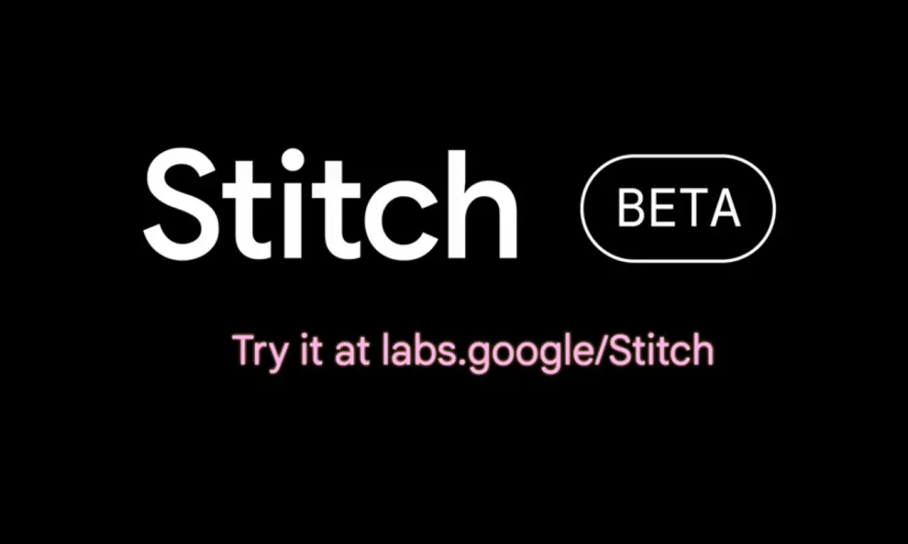

# UX x AI: One Brief, Many Tools

## The brief

AI design tools are multiplying fast, and every one of them claims to design for you. In this exercise you find out for yourself what they're actually good at. You give **the same brief to several AI tools**, screenshot what each one produces, and discuss the pros and cons as a class.

The brief: **SafeWalk**, an app that helps people get home safely at night. It should let someone share their route with a friend, see well-lit and busy streets, and call for help quickly.

You are not designing the app today. You are the judge.

*Google Stitch. Source: [stitch.withgoogle.com](https://stitch.withgoogle.com/)*

## The tools

Use at least **three** of these (your instructor will tell you which are available):

- **[Google Stitch](https://stitch.withgoogle.com/):** generates mobile and web UI screens from a prompt, and exports to Figma.
- **[Claude](https://claude.ai/):** builds working interactive prototypes as artifacts, from a prompt or a sketch.
- **[Gemini](https://gemini.google.com/):** generates designs and front-end code in its Canvas workspace.
- **[OpenAI Codex](https://openai.com/codex/):** a coding agent that can turn a brief into a working front end.
- **[Figma Make](https://www.figma.com/make/):** turns a prompt or a Figma design into a working prototype inside Figma.
- **[v0](https://v0.app/)** or **[Lovable](https://lovable.dev/):** generate full web app interfaces from a prompt.

## How to run it

1. **Write one prompt** and use it, word for word, in every tool. Start from the brief above and add your rules: iPhone screens, three screens (home, share route, emergency), accessible contrast.
2. **Run it** in each tool. Don't fix or re-prompt yet: you're comparing first attempts.
3. **Print the screen.** Screenshot every result and paste them side by side on one FigJam or Figma board, labelled with the tool's name.
4. **Re-prompt once** in each tool to fix the biggest problem, and screenshot the second attempt too.
5. **Score each tool** with the table below.

| Tool | Speed | Visual quality | Generic or specific? | Accessible? | Editable / exportable? | Best for… |
| --- | --- | --- | --- | --- | --- | --- |
| Stitch | | | | | | |
| Claude | | | | | | |
| … | | | | | | |

## Pros and cons

As a class, go through the board tool by tool and discuss:

- **What did it do well?** Speed, layout ideas, working interactions, code.
- **What went wrong?** Generic "AI slop" styles, invented content, accessibility problems, broken flows.
- **Who stayed in control?** Where did you have to make the decision yourself?
- **Where would you use it in a real sprint?** Inspiration, quick prototypes for testing, hand-off, or nowhere at all?

Finish with one sentence each: *"I'd use ___ for ___, but never for ___."*

## Before you submit

☐ Used the same prompt in at least three tools

☐ Screenshotted every first attempt and second attempt on one board, labelled by tool

☐ Filled in the score table for every tool

☐ Wrote your one-sentence verdict

☐ Shared the board link with your instructor

**Difficulty:** ⭐️⭐️
