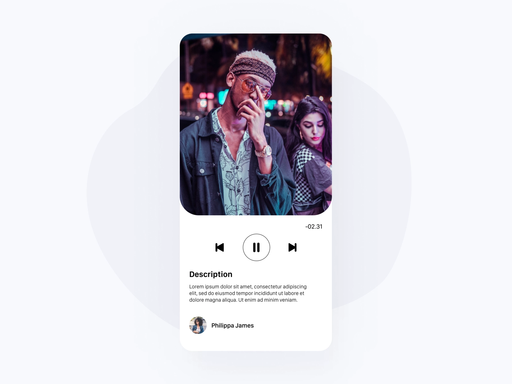
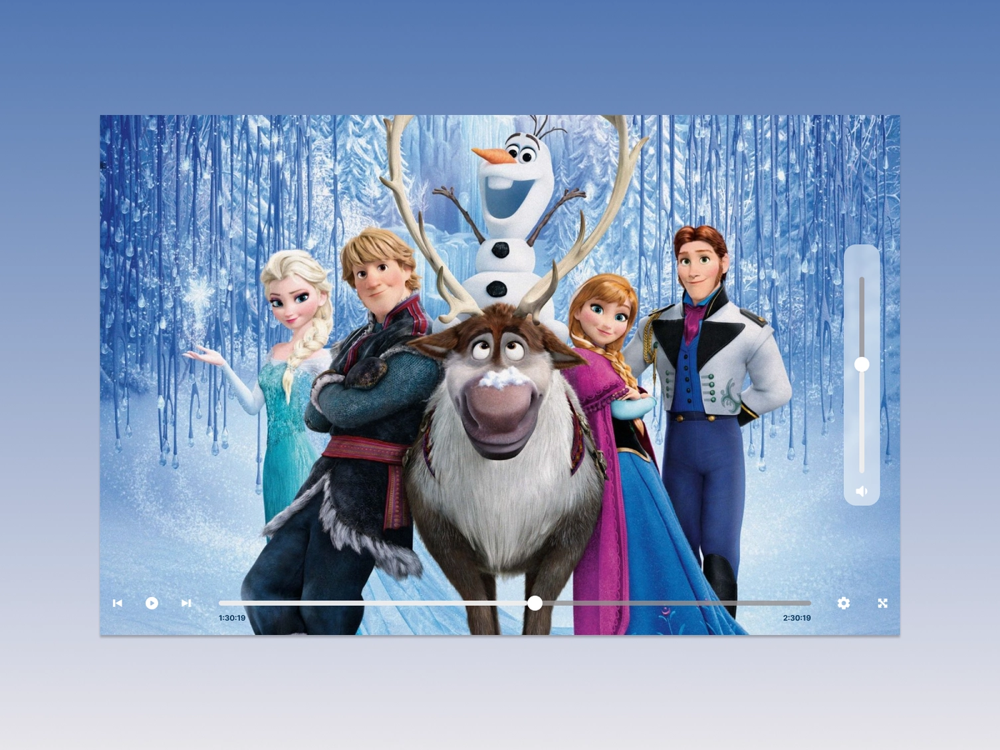
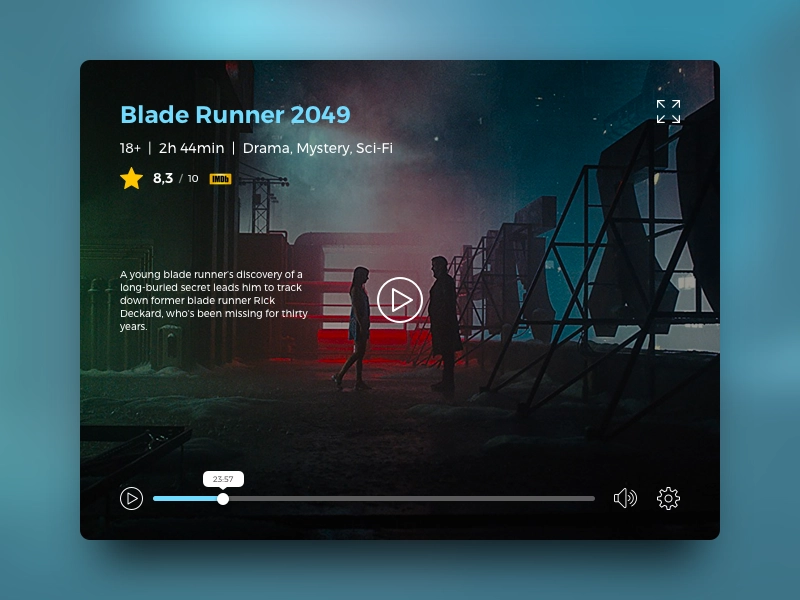

# Video Player

## Video Player

Imagine you just got a new job as a UI designer with a streaming service which shows movies! Create a simple UI which invites people to watch the movie!  

Good UI assets are simple, recognisable, require no cognitive strain. They are universally recognised!

Source: [https://dribbble.com/rebeccanoren](https://dribbble.com/rebeccanoren)

---

## Potential Inclusions

1. Media Playback
2. Media Details
3. Volume Control
4. Expand Screen Mode
5. Time Stamp
6. Time Line
7. Subtitles / Language Setting
8. Video Description
9. Rating
10. Coming Next
11. Credits 
12. Contributor 

## Inspiration

Source: [https://dribbble.com/uxmadhuridesign](https://dribbble.com/uxmadhuridesign)

Source: [https://dribbble.com/Atulya_26](https://dribbble.com/am-designer)

## Difficulty Level ⭐️⭐️⭐️
