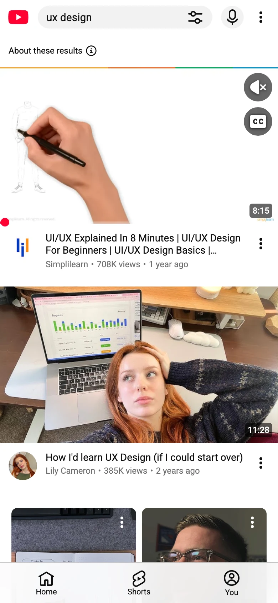
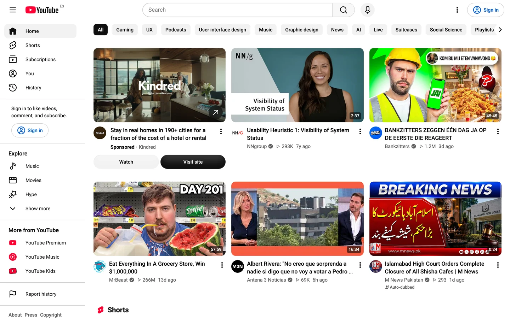
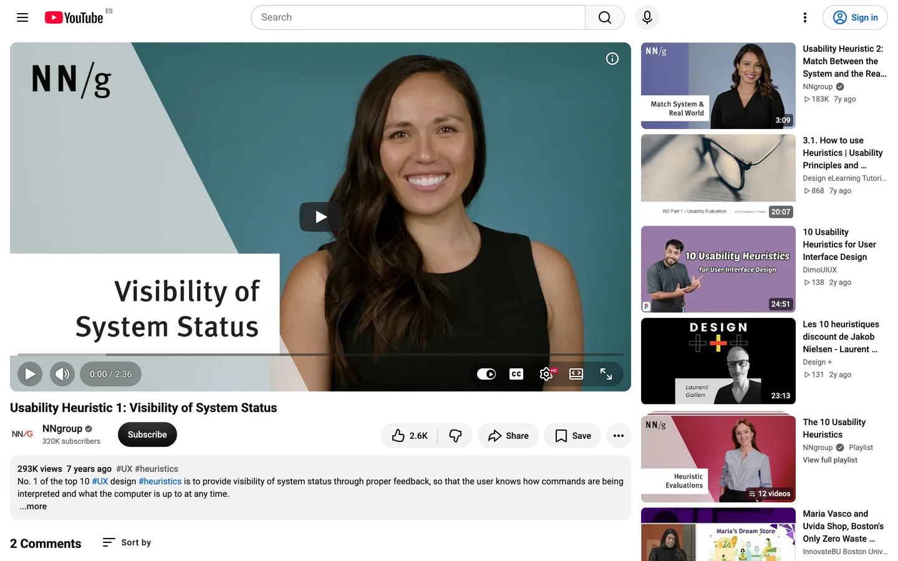

# YouTube Replica Challenge

<aside>
📝 Welcome to the YouTube Replica Challenge! Your destiny awaits you!

</aside>

<aside>
🧠 This is a powerful challenge that gets you used to micro-detailing: thumbnails, metadata lines and a lot of tiny icons.

</aside>

<aside>
🔥 Some of this will hurt and feel repetitive but like learning scales on a musical instrument, you must become fluent.

</aside>

<aside>
♻️ Recycle elements often. One video card, built well, becomes the whole feed.

</aside>

**Lesson Title: The UI Replica Project:**

**This exercise is to be completed in tandem with your UX curriculum. Please take your time and copy as many screens as you can until you are competent with Figma tools.**

*Unlocking Figma Mastery through Perfect Replication*

Welcome to the "UI Replica Project," a detailed creative lesson designed to help you gain valuable experience with Figma. In this exercise you replicate **YouTube** on a phone and on desktop. YouTube is a lesson in density: hundreds of pieces of information on one screen, kept readable by a strict grid, consistent cards and very careful type.

As the saying goes, "practice makes perfect," and this lesson exemplifies that principle. The key objective here is not just to create a replica but to create a perfect replica.

## The Screens

Four real YouTube screens, two on a phone and two on desktop. The phone watch page is captured top to bottom as one tall image.

**How to trace:**
- **Phone screens:** create an **iPhone 16** frame (393 × 852); for the tall screen, make the frame as tall as the image. Drag the screenshot in and scale it to **390 px wide**.
- **Desktop screens:** create a **Desktop** frame **1440 px wide** and drop the screenshot in at 100%.
- Lock the screenshot, lower its opacity to about 40% and build on top of it. Hide it when you're done and compare.

### 1. Search results (phone)

The search bar with filters and voice input, video cards with a duration badge, channel avatar, title and metadata line, and the bottom tab bar.

### 2. Watch page (phone, stitched)

The player, title, channel row with Subscribe, the action buttons (like, dislike, share, save), comments and the list of up-next videos.

### 3. Home (desktop)

The top bar with search, the left navigation rail, category chips and a grid of video cards.

### 4. Watch page (desktop)

The large player with its controls, the title and channel row, the description box and the up-next column on the right.

*Screenshots of youtube.com, signed out, used for teaching only.*

## The Journey Ahead: Manual Replication (Step 1)

**Step 1:** **Basic Replication**

- Start **without** utilizing Figma's auto layout or components.
- Begin by studying the original UI screens.
- Familiarize yourself with the shapes, colors, and typography used.
- Carefully recreate each screen element manually.

**Step 2:** **Layout and Spacing**

- Analyze the spacing, alignment, and relationships between UI elements.
- Use Figma grids and rulers, located on the right hand side to do so.
- Pay close attention to pixel-perfect alignment and spacing.
- Ensure that every detail matches the original screens.

**Step 3:** **Typography and Color**

- Focus on replicating the typography and color schemes accurately.
- Match font sizes, styles, and colors precisely. Notice how few colours YouTube uses: almost everything is black, grey and white, with red only for the logo and the progress bar.
- Ensure that text and graphics align perfectly.

**Step 4:** **Responsive Design**

- Compare the phone and desktop versions of the same page. What moves, what disappears, what grows?
- Make your replica work at both sizes, using the same components.

## Elevating Your Skills with Auto Layout (Step 2)

**Step 5:** **Introduction to Auto Layout**

- Learn about Figma's Auto Layout feature and its benefits.
- Understand how Auto Layout simplifies element management.

**Step 6:** **Applying Auto Layout**

- Convert your manually replicated screens into Auto Layout frames.
- Explore how Auto Layout improves adaptability and responsiveness.

**Step 7:** **Auto Layout Best Practices**

- Implement best practices for using Auto Layout effectively.
- Experiment with nested Auto Layout frames for complex designs: the video card (thumbnail, then avatar beside a title and metadata stack) is perfect practice. Build it once as a component with a vertical (phone) and horizontal (up next) variant.

## Conclusion

By following these structured steps, you'll have perfected the art of replicating UI screens in Figma, honed your attention to detail, and harnessed the power of Auto Layout. Remember, practice is the key to mastery, and this lesson provides you with the perfect opportunity to apply this principle. Good Luck 🍀 !

YouTube font available here:

[Roboto - Google Fonts](https://fonts.google.com/specimen/Roboto)

Images available here:

[Beautiful Free Images & Pictures | Unsplash](https://unsplash.com)

Icons available here:

[Material Symbols - Google Fonts](https://fonts.google.com/icons)

Logo available here:

