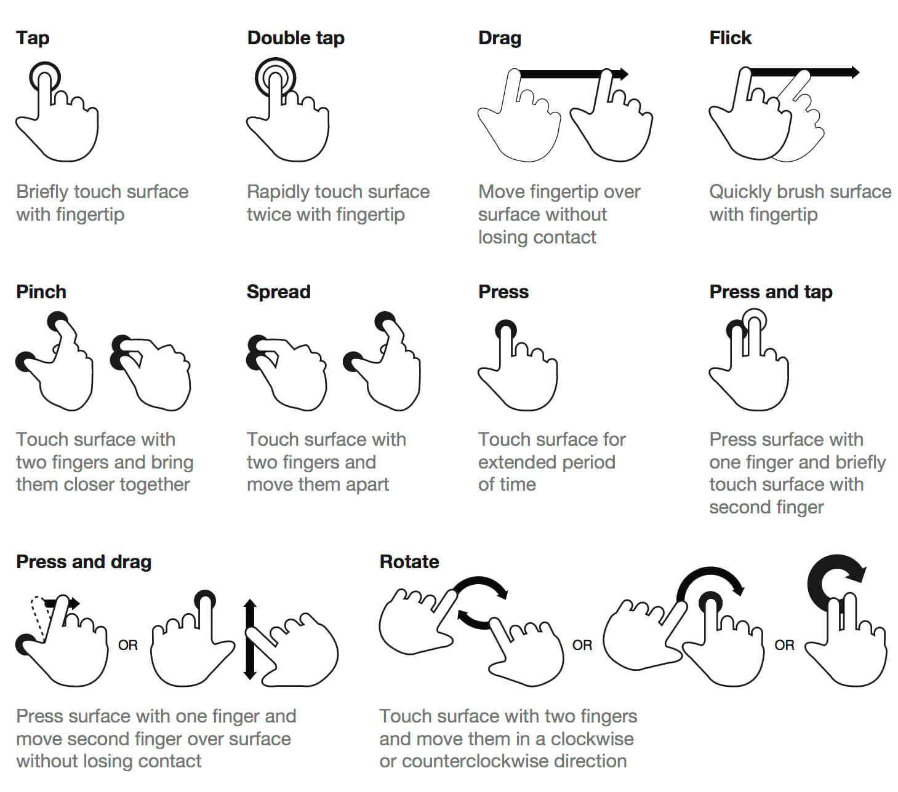

# Gestures

## Mobile

- **Single Tap**: A quick touch on the screen with one finger.
- **Double Tap**: Two quick, consecutive taps on the screen with one finger.
- **Scroll**: Moving a finger up or down on the screen to navigate through content.
- **Swipe**: A quick, horizontal or vertical movement of a finger across the screen.
- **Long Press**: Touching and holding a finger on the screen for a longer duration.
- **Pinch**: Bringing two fingers together on the screen, often used to zoom out.
- **Spread**: Moving two fingers apart on the screen, often used to zoom in.
- **Drag**: Touching and holding an item on the screen while moving it to a different location.
- **Flick**: A quick, short swipe, typically used for faster navigation or to scroll through lists.
- **Rotate**: Using two fingers to rotate an object on the screen, typically used in photo editing or map applications.

---

---

### VR

- **Pointing**: Extending a finger to select or interact with objects.
- **Grabbing/Pinching**: Using a pinching motion or a full hand grasp to pick up and move objects.
- **Throwing**: A motion mimicking throwing an object, used to propel virtual items.
- **Pushing**: A forward motion with the hand or finger to push objects away.
- **Pulling**: A backward motion with the hand to draw objects closer.
- **Hand Wave**: Waving the hand to signal or interact with virtual characters or interfaces.
- **Thumbs Up**: Making a thumbs-up gesture to express agreement or to trigger specific actions.
- **Fist Bump**: Making a fist and moving it towards another object or character, often used for interactions or social gestures.
- **Open Hand**: Holding the hand open to interact with virtual menus or interfaces.
- **Hand Clap**: Clapping hands together to trigger actions or interactions.
- **Hand Shake**: Moving the hand as if shaking hands with a virtual character or object.
- **Gesture Combos**: Combinations of gestures, such as a grab followed by a throw, for more complex interactions.
