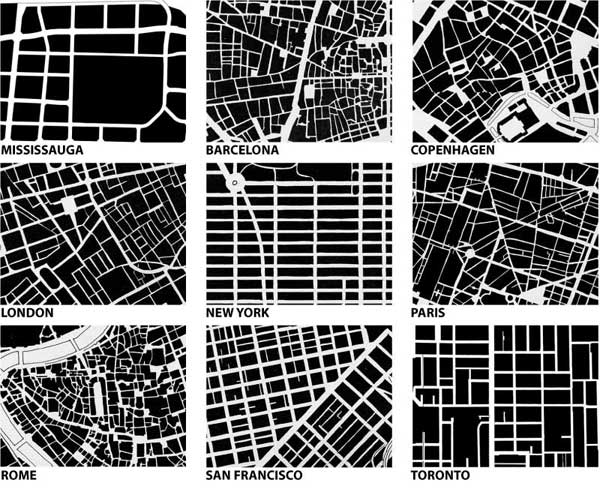
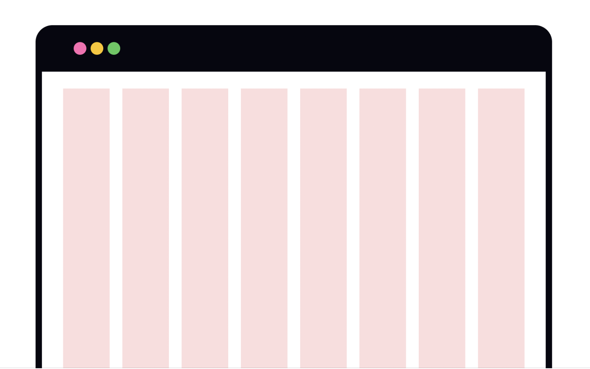
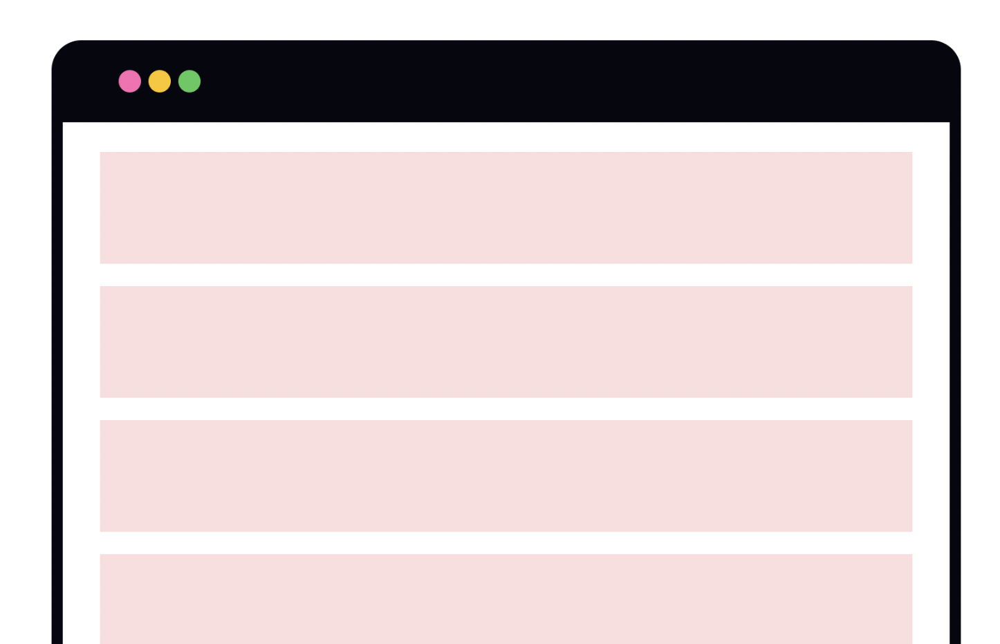
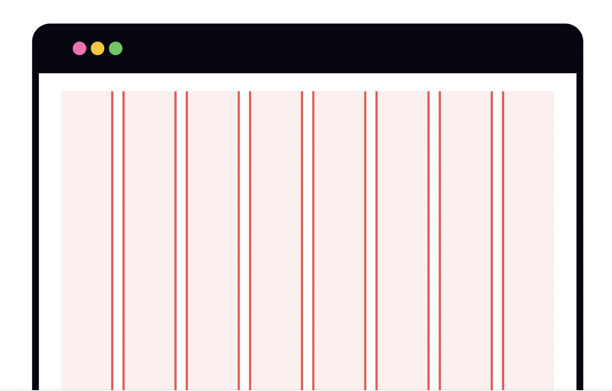
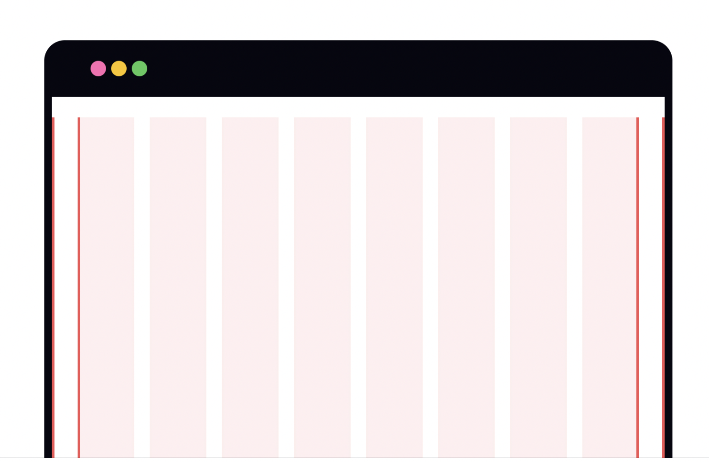
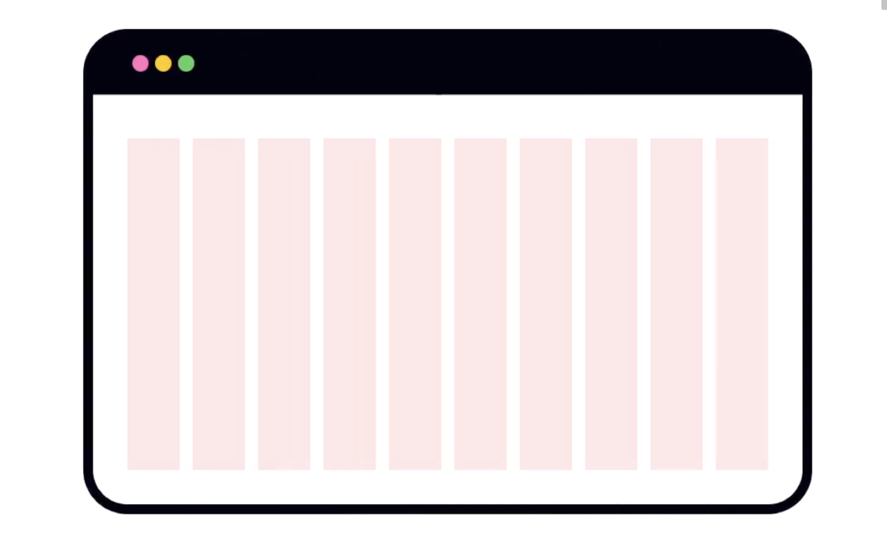
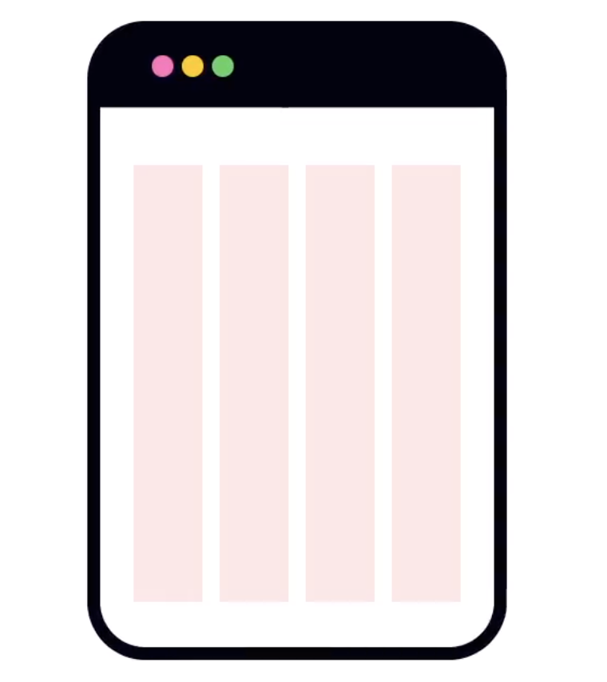

# Grid

Many things around us, from architecture, nature or art works are settled in grids.

Grids are one of the fundamental building blocks of a well-structured, organised design. They lend order to every other element in your design and guide you through creating a layout. Think of grids as guidelines for creating your layout.

Understanding how the grid works is key to creating dynamic UI and a better user experience. And on the contrary, gridless designs can feel disordered, confusing, and cluttered.

**In digital design, the grid is a network of straight vertical and horizontal lines laid out in a pattern.** It's a key component in creating logical, organised layouts.

Grids help designers align and structure content consistently throughout the project. They help maintain balance from page to page, enhance the visual hierarchy and make layouts look visually appealing.

## Columns

**Columns are vertical spatial areas that hold content within the grid.** They are the most basic building blocks of a grid. The number of columns is defined upfront and may vary based on the device's size — desktop, tablet, or mobile.

Depending on the grid's exact specs, the column's width scales proportionally to the available screen space. All content usually falls within the bounds of the columns (though content often bridges more than one column).[[1]](https://app.uxcel.com/#anchor-1) Some elements can "break the grid" to draw attention, but in most cases, try to align all of the grid's contents to a column.

> A 12-column grid is the most common grid layout.
> 

## Rows

**Rows are horizontal columns that can be used to create rhythm on your page.** Their size can vary based on the content they contain. Rows aren't used as often as columns but can still provide a lot of structure. 

The reason rows are usually less important to define is that it’s normal behaviour for the user to scroll content down and up would it be web or mobile, but it’s unusual to scroll horizontally, usually it’s a no-no unless done on purpose and whole layout of your app is fit into the device screen height and navigation is done via horizontal scrolling.

## Gutters

Between each column or row, you’ll find gutters (also called grid gaps in web development). **Gutters are the spaces between columns and rows.** They separate content and provide white space within your design, giving it room to breathe. Elements may bridge gutters when they occupy multiple columns or rows, but as a general rule, an element should not end in a gutter.

To maintain a visual balance, gutters should always be equal between columns or rows. There are 3 gutter sizes: compact, cozy, and comfortable, each roomier than the previous one. You might be familiar with these terms from the display options in Gmail’s interface. Be careful using compact gutters, as they can add tension to your design.

## Margins

**Margins are the empty spaces between the edges of the format and the content.** They create white space around the content and vary according to screen size, either expanding or shrinking as it changes. The margin size gives the content a general shape, usually a rectangle.

## Responsive grid

Responsive grids change dynamically based on the screen size. Up to a point, columns change the size to fill available space. A breakpoint is the specific range of screen sizes where the layout readjusts to the available screen size for the best possible layout view. Column structure, column widths, gutter widths, and margins depend upon breakpoint.

## **The 8-Point Grid**

Prototyping tools allow you to create visions of what UI could look like. But when it comes to digital product design, a mockup’s sole purpose is to clearly communicate a proposed solution to stakeholders and developers. In the end, only what a developer can reproduce in code can make it to production: consistent and scalable spacing helps both **designer and developer** to work much faster on a project.

> *The principle of 8pt Grid is the use multiples of 8 (8, 16, 24, 32, 40, 48, 56, etc.) to layout, dimensions, padding, and margin of elements.*
> 

### What are the benefits?

- **Consistent  & efficient UI**: When all of your measurements follow the same rules, you automatically get a more consistent UI.
- The **best system of communication** between designers and developers: a developer can easily understand and eyeball 8pt increment instead of having to measure each time.
- **Multi-platform design**: Regardless of form-factor, most popular screen sizes are divisible by 8 on at least one axis - usually both.
