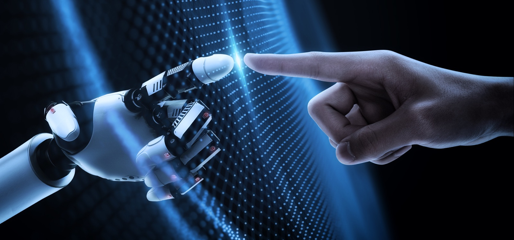

# Haptics

Haptics refers to the science and technology of transmitting and understanding information through touch. It encompasses a range of applications, from simple mechanical vibrations to complex tactile feedback systems. 

### Derived from the Greek word "haptikos," meaning "able to touch or perceive”.

Haptics formulate the key part of how humans interact with technology and are primarily part of the feedback heuristic. Common haptics we all take for granted are things like: 

**Haptics**

Morning Alarm Clock Sound 

Microwave End Alert

Oven Timer Alert

Washing Machine Cycle Completion

Dishwasher End-of-Cycle Signal

Car Seatbelt Reminder

Haptics plays a crucial role in enhancing user experiences across various fields by providing a more intuitive and engaging way to interact with digital systems and devices and with apps, we will frequently integrate haptics like: 

**Audio**

Locking device click

Deleting items swoosh (email, messages)

Scrolling clicks 

Keyboard keypress click 

Sent ding 🛎️ 

**Vibration**

Incoming Call Vibration

Text Message Vibration

Notification Vibration

Subtle Keyboard Feedback

Alarm Vibration

Silent Mode Activation

Camera Shutter Vibration

Gesture Feedback

Generally it’s good to know what haptics are and how they play a vital role in human computer interaction. There is an entire field devoted to haptic design and whilst we don’t necessarily have the technology in Figma to include haptics, when you are building your portfolio websites, Framer very much includes this technology.
