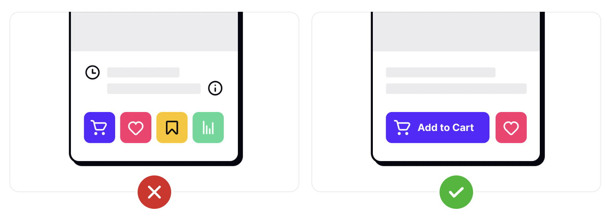
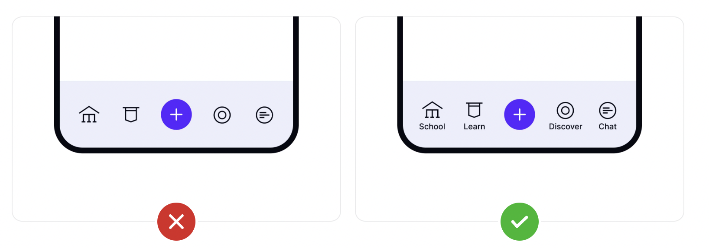
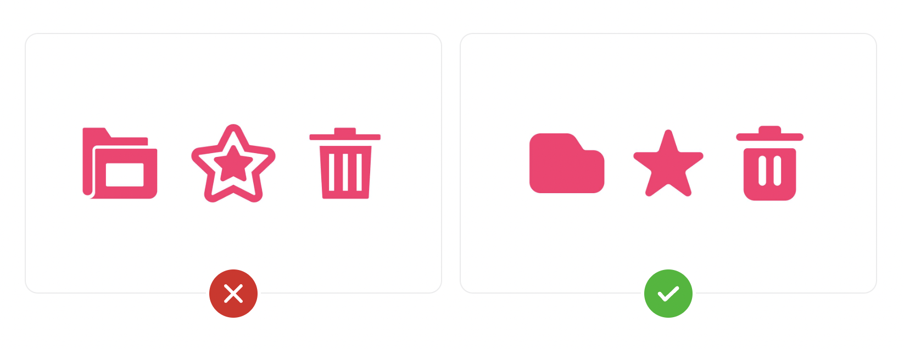
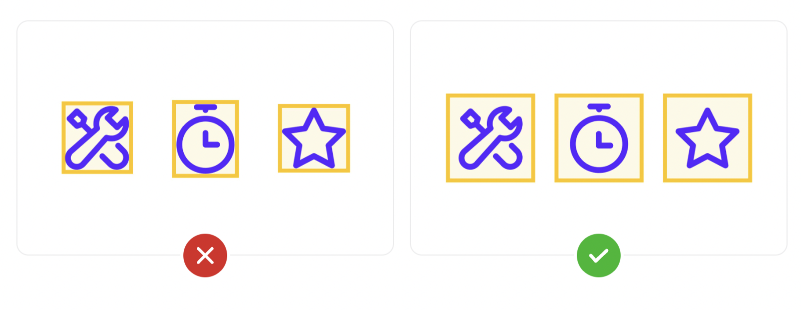
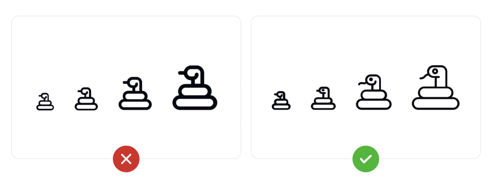
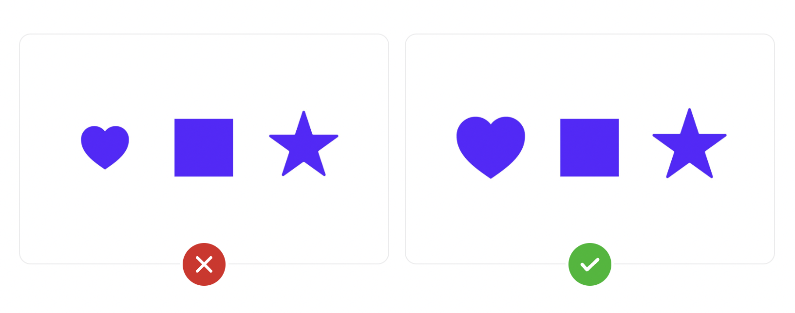
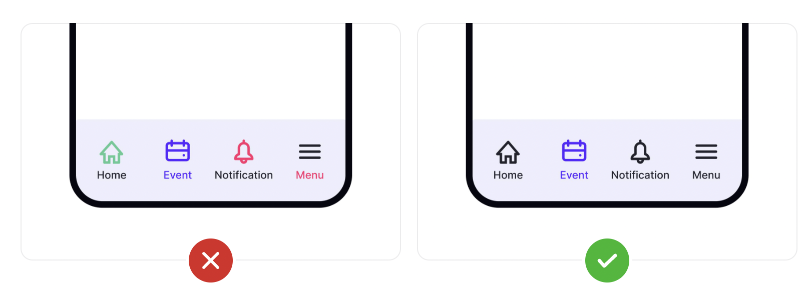

# Icons

An icon is a symbol that represents a larger idea. It should concisely capture the idea that it represents.

Icons can enhance the usability of your interface by giving users immediate visual cues, while also enhancing the aesthetic appeal of your design. Naturally, they are vital to creating user-friendly designs.

Icons are especially useful on mobile apps, where screen real estate is at a premium. But even on websites and desktop apps, icons can be more immediately recognizable to users than text-based interface elements.

## Icon purposes

Every icon in your design should serve a single purpose. Avoid using the same icon to mean different things, or using different icons to mean the same thing. That just confuses your users. For example, if you use a shopping cart icon in your header, don’t use a shopping bag elsewhere in your design.

## Icons should communicate meaning

Icons must communicate meaning in your design — that’s their entire function. Icons that properly convey their meaning make a UI faster for users to interact with (particularly if they use your product regularly). If the icons you’re using aren’t adding value, remove them.

You can check here some of the most common icons and their semantics: 

[https://semantic-ui.com/elements/icon.html#/icon](https://semantic-ui.com/elements/icon.html#/icon)

## Provide icon labels

When using icons that are not universally recognizable, icon labels minimize ambiguity. Don’t assume that all users will immediately understand the purpose of an icon. When in doubt, include a label.

Labels should be short (1-3 words are usually best) and provide clear meaning to the icon. Action words are often best, telling the user what will happen when they interact with the icon (such as "search" or "add").

## Use consistent icon geometry

One of the most important things to remember is to maintain consistent geometry in the style of your icons. For example, if some of your icons have crisp, sharp corners, then all of your other icons should too.

Use round shaped ones with round shaped ones + Use icons from same family 

## Make icons simple

Keep your icons as simple as possible while conveying what you want them to convey. Think twice before adding details. Simplicity is almost always the better option. This is particularly applicable when your icons are small.

## Provide consistent containers

Not all icons are created equal, so it’s important to wrap containers around them for consistency. Add a little container padding around each icon, too, to leave room for it to breathe within your design. These containers aren’t visible to users, but they’re invaluable in helping you align your icons.

## **Provide an accessible touch target to icons**

Touch targets are arguably some of the most important spacing elements in an interface. When a user has to try to tap multiple times on a button to get it to work, it’s frustrating and may cause some users to simply assume your UI is broken. When tappable elements are grouped too closely together, this amplifies the problem.

Touch target is the on-screen area that responds to user interaction. In general, they should extend beyond the visual boundaries of the element being tapped, as it enhances both usability and accessibility for users with certain physical impairments. Material Design guidelines recommend a touch target size of at least 48x48px, while iOS guidelines specify a slightly smaller minimum of 44x44px.

## **Ensure your icons scale correctly**

Not all icons are the same size. That’s why it’s important to keep icon scaling in mind when designing your icon set. Smaller size icons fit fewer details while larger icons can include more detail.

Design your icons in multiple sizes whenever possible, with each slightly more detailed than the previous one. Smaller icons can also be wrapped in larger containers to give them more visual weight without increasing their size.

No time to design more icons? No problem. You can always wrap smaller icons in larger containers to increase their visual weight without increasing their size

## **Provide balanced icon sizing**

The size of icons used together needs to be **balanced**

Depending on the shape and visual weight of your icons, balanced size doesn’t necessarily mean they need to be the exact same dimensions. A solid square, for example, has a heavier visual weight than a solid star, making it *appear* larger. Therefore, making the star slightly larger than the square can give it the same visual weight

## Use consistent colors for your icons

Make sure you use consistent colors for your icons. In general, one color for the active or most important icon and a single different color for the rest of your icons will look best. Whatever you choose, be consistent in your color choices.

## **Tips for Designing with Icons**

If you decide to include icons in your interface, **do your research first**! Familiarize yourself with **icons used by your competitors** and with icons commonly used **on the platforms that you target**, as those will be most recognizable to your users.

If you must design new icons, strive to make them easy to recognize and memorize by following these guidelines:

- Keep the design **simple and schematic**. Reduce the amount of graphic details by focusing on the basic characteristics of the object rather than creating a highly realistic image in order to speed up recognition. (Intricate details are difficult to distinguish at smaller sizes.)
- Use the **5-second rule**: if it takes you more than 5 seconds to think of an appropriate icon for something, it is unlikely that an icon can effectively communicate that meaning.
- **Test the icons:** ask people what they expect the icons to stand for.
- **Test the icons for memorability**: ask a repeat set of users if they can remember the icon’s meaning after being told what it represented a couple weeks earlier.

[https://www.youtube.com/watch?v=ZF_25i-be8k](https://www.youtube.com/watch?v=ZF_25i-be8k)

### 

###
