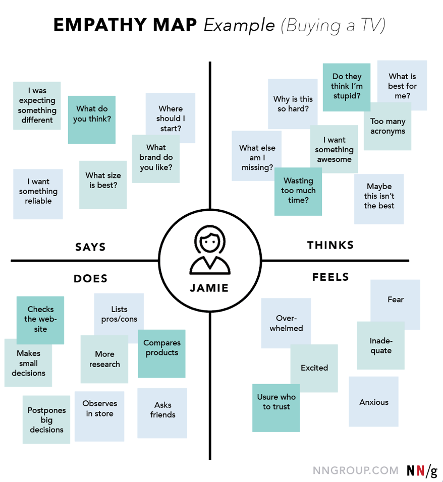

# Interview Taking Notes

So a note taker has one job, to take notes, That’s it but we have special methods! It’s best in the case of an individual to record the interview with your phone. You should be looking for key information that will help you contextualise the user in relation to the problem space. 

## Demographics

- Their name
- Job
- Occupation
- Interests
- Frequency of contact with problem

---

## What you are looking out for

There are two types of signals that you will be looking out for 

1. Explicit Signals 

- What They Say.
- What They Do.

1. Implicit Signals

- What They Think.
- What They Feel.

If you have someone to help you, advise them that when watching for explicit signals, they should be capturing useful quotes as well as observing if the subject struggled at any particular stage or if they moved swiftly through a particular part of the process. 

Whilst watching implicit signals, they are looking for non-verbal cues and signs of distress, confusion, discomfort or otherwise times when they stutter, pause, laugh or show some visual which clearly demonstrates a frame of mind or temperamental disposition.

It is often the case that a subject will say one thing and the look or expression on their face will reveal something completely different. 

If you have the advantage of another person, you can decide to use the above Empathy Map model to record the individuals responses. There after you will want to identify themes which run consecutively from person to person based on bother their implicit and explicit signals. Optionally if you prefer to simply taking notes based on two signal types and correlate the overlapping responses, this is perfectly acceptable, as you like it.
