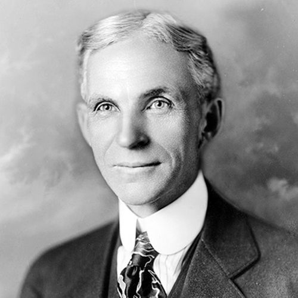

# Key Figures: Henry Ford

Henry Ford was an American industrialist, inventor, and founder of Ford Motor Company.

Ford revolutionised the automobile industry with his innovations in manufacturing and production methods. 

Ford's manufacturing innovations increased efficiency and productivity, significantly reducing the time it took to build a car. This led to the development of a large middle class and transformed the transportation industry. 

Ford's introduction of the Model T and its mass production techniques made automobiles more accessible and affordable to the general public. This shift in approach recognized the importance of designing products that meet the needs and desires of a wider audience. 

Ford's success can be attributed to his focus on meeting the needs and preferences of his customers. He aimed to create an automobile that was reliable, practical, and easy to use. This user-centric approach aligns with our own core principles in UX design, which prioritize understanding and addressing the needs, goals, and expectations of users. By placing the user at the center of the design process, products and services can be tailored to deliver a positive and satisfying user experience.

Field: **UX Industrial Designer**

Major Contribution: Ford Model T

Worked: Ford Motor Company

Era: 1908

Best Quote: "Whether you think you can, or you think you can't – you're right. … While there is a temptation to tailor our world to our own preferences, it is often in the diverseness of experiences and perspectives that true growth and understanding are found.”
