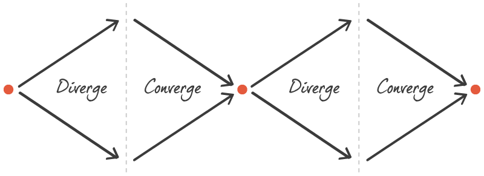

# Converge / Diverge

This is really when we start to meet as a team and decide to either rumble or go all in. Ultimately, as a team. Should we diverge onto different paths or converge together. Presenting alternatives can be beneficial and it often serves the common good as we have a multiple good ideas but perhaps we have done enough work and combine a number of ideas into one prototype.

- Decide as a class if you want to combine sketches into a single prototype (All-In-One) or develop different ideas and test them separately (Rumble).

- In you **converge**, you will have to work out which specific parts of the application each person is responsible for building. You will have to observe the journey map and even further break down each screen, attributing it individually.

- If you choose to **diverge**, you will need to consider how to present the opposing ideas to your users. This also means that you will need to conduct 5 sets on interviews each. We must in that case really focus on the MVP and allow extra time for interviews
