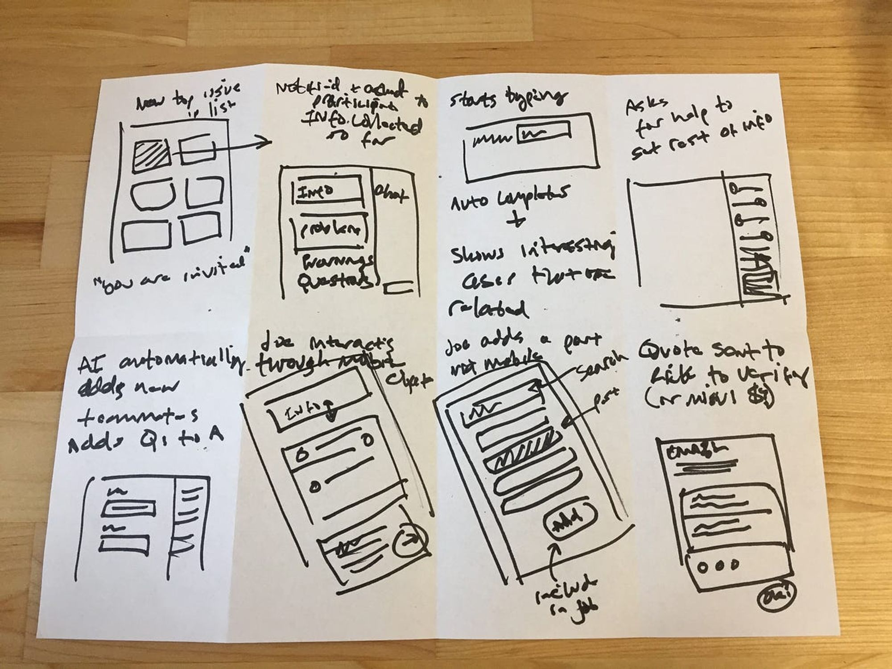

# Crazy 8’s with AI

**🧠⚡ Crazy 8’s with AI as a Sparring Partner**

*A rapid-fire ideation exercise where you sketch — and AI pushes your thinking.*

As designers, we all know the trap: the moment we see a UI problem, our brain rushes to a polished visual solution. The “first idea bias” is powerful — and usually wrong. Jake Knapp’s Crazy 8’s technique forces designers to break past their initial instincts by rapidly sketching eight distinct ideas in eight minutes, revealing surprising, original, and more useful alternatives.

In this module, we take Crazy 8’s **one step further**:

You’ll use **AI as a sparring partner**, challenging your assumptions, prompting alternative angles, and generating eight conceptual variations based on your initial design brief.

You still do the sketching.

AI simply removes creative blind spots and helps you leap further than instinct alone.

Let’s get into it.

---

# 🪜 Stage: Ideation

Ideation – diverging on possible solutions before prototyping.

---

# 👋 Context

You’ve completed the understanding phase of the sprint. Now you need breadth — not depth. Crazy 8’s helps break away from your “first solution” and explore more innovative, lateral ideas.

Using AI as a sparring partner gives you:

- externalised thinking
- faster variation
- ideas you would never produce on autopilot
- friction — the good kind

---

# 🎯 Goal / Learning Outcome

- Push beyond your initial concept and generate a wide range of possibilities.
- Use AI intelligently to widen creative thinking — without letting it do the design for you.
- Capture fast, scrappy sketches based on AI’s variations.
- Develop flexibility in how you visualise, interpret, and communicate ideas.

---

# 🛠️ Main Exercise

**Step 1 — Write your own design brief**

You choose the challenge. Define the UI/feature/problem in 1–2 sentences.

**Step 2 — Give it to AI**

Feed your brief into ChatGPT and ask for **8 variations**, delivered **one at a time**, using your tailored prompt.

**Step 3 — Sketch each idea**

Fold your paper into eight sections.

Sketch one idea per minute as AI feeds them to you.

- Fast, ugly, rough = good
- One concept per box
- Full screens, UI fragments, components — anything goes
- The aim is variety, not correctness

AI gives the idea.

**You** interpret and sketch it.

---

# ⏱️ Estimated Duration

~15 minutes

- 8 minutes sketching
- 7 minutes sharing, reflecting, and choosing promising directions

---

# 👉 Extra Notes

- It's normal for your “middle” ideas (4, 5, 6) to be the most surprising and useful.
- Don’t let AI over-design — keep its prompts simple.
- Let AI push you, not replace you.
- Imperfect sketches are expected.

---

# 🏞️ Template

(Fold paper into 8 rectangles, one sketch per box.)

| 1 | 2 | 3 | 4 |
| --- | --- | --- | --- |
| 5 | 6 | 7 | 8 |

---

# ⚡ Tips

- When in doubt, simplify.
- Focus on big ideas — behaviour, layout, interactions, structure.
- Ask AI for “radically different” or “weirder” variations if ideas feel repetitive.
- Treat AI like a creative boxing partner — it throws the punch, you counter with a sketch.

---

# 📚 Resources

- Overview: *Crazy 8’s Method*
- Timer or stopwatch
- Blank A4 paper
- ChatGPT (or similar LLM)
- Pens/markers

---

# ✅ Checklist

- [ ]  Design brief written
- [ ]  Paper folded into 8 sections
- [ ]  AI prompt ready
- [ ]  Timer set
- [ ]  8 sketches completed
- [ ]  Top ideas reviewed and discussed
- [ ]  Strongest concepts selected for further development

---

# 📝 Summary

Crazy 8’s with AI as a Sparring Partner gives you **the best of both worlds**:

- The speed, scrappiness, and breakthrough power of traditional Crazy 8’s
- The breadth, variety, and left-field creativity of AI ideation

You will surprise yourself.

Your AI-generated variations will surprise you even more.

This exercise expands your range, helps you challenge your assumptions, and sets you up with multiple promising design directions — not just the instinctive first one.

