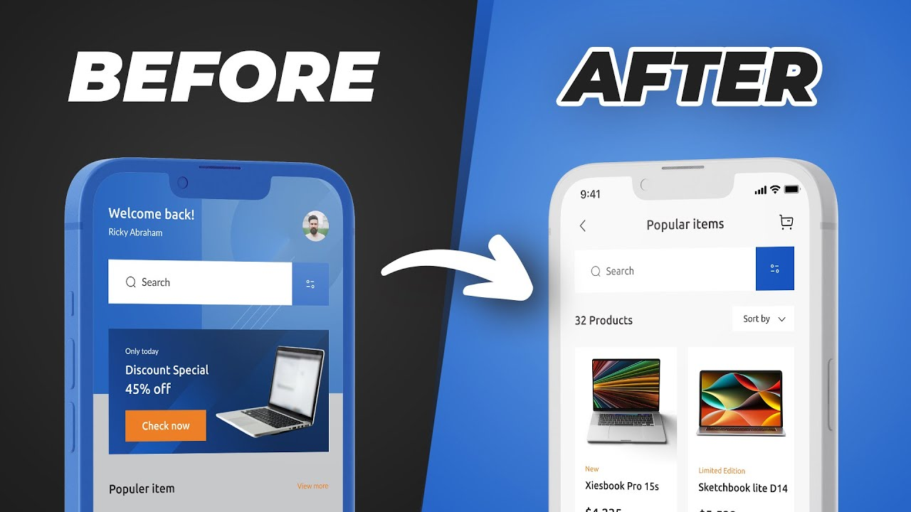

# Design Iteration

# 🪜 Stage: Validation

# 👋 Context

So now we’ve competed 5 **usability tests**, we’ll have a collection of notes, recordings, and patterns that reveal where users struggle or succeed. The next step is to turn those insights into **design changes**.

This process is called **design iteration**. Instead of trying to “fix everything” at once, the goal is to **identify the 2–3 most impactful issues**, make targeted changes, and test again or in your case demonstrate inside a case study. 

Iteration ensures the design evolves in response to real user feedback rather than assumptions and it is really here that matters to senior UX designers. How did you interpret the patterns coming from the interview, and how did you use those insights to develop the design further. 

The best way to think (and present) this penultimate part of section of the sprint is to think of it as creating x3 *before-and-after snapshots* of your product.

# 🎯 Goal / Learning Outcome

By the end of this activity, students will have **translated usability findings into x3 clear design changes** and documented them with before-and-after comparisons to guide the next prototype or release. 

# 🛠️ Main Exercise

### **Step 1 – Distill the Findings**

**Instructions:**

1. **Review Usability Themes:**
    - Use the patterns identified in Step 3 of the Usability Test.
    - Prioritise based on frequency, severity, and business impact.
2. **Select Top Issues:**
    - Choose the **2–3 usability issues** that, if fixed, would create the greatest improvement.
    - Example: “Users can’t find the checkout button,” “Onboarding is too long,” “Error messages are unclear.”

---

### **Step 2 – Propose Design Changes**

**Instructions:**

1. **Map Issues to Solutions:**
    - For each issue, brainstorm potential fixes.
2. **Stay Grounded in Evidence:**
    - Base solutions on what users actually struggled with, not on personal opinion.
    - Reference direct quotes or observed behaviors to justify design decisions.
3. **Sketch or Prototype:**
    - Create a quick low- or mid-fidelity mockup of the proposed changes.
    - Keep it light and flexible — these are experiments, not final designs.

---

### **Step 3 – Capture Before-and-After Snapshots**

**Instructions:**

1. **Document the “Before”:**
    - Show the original screen or flow where the issue occurred.
    - Highlight exactly where users got stuck.
2. **Show the “After”:**
    - Present the revised version with the proposed changes.
    - Call out how the update directly addresses the usability issue.
3. **Tell the Story:**
    - Link the evidence (“3 out of 5 users missed the checkout button”) → to the decision (“We moved and relabeled it”).

---

### **~~Step 4 – Plan for the Next Test~~**

**~~Instructions:~~**

1. **~~Integrate Changes into Prototype:~~**
    - ~~Update your design with the new iteration.~~

**~~Outcome:** A refined design backed by evidence, captured in before/after snapshots, and ready for the next round of user validation.~~

# ⏱️ Duration

- ~1 hour

# 👉 **Extra Notes**

- DO NOT introduce these changes into your prototype
- Link each change to a reoccurring theme, reoccurring statement or **pain point.**
- Don’t just take one thing, one user said. It’s about identifying themes

# ⚡ Tips

- You can reiterate just the component as opposed to an entire screen if it suits.

# ✅ Checklist

### **Preparation**

- [ ]  Reviewed usability themes and notes.
- [ ]  Prioritise 2–3 key issues.
- [ ]  Created x3 updates.
- [ ]  Set each visual before and after iteration

# 📝 Summary

**Design Iteration** closes the loop between testing and improvement. By focusing on the **2–3 most impactful issues**, making targeted updates, and documenting before-and-after snapshots, teams ensure their design evolves responsively to user needs. Iteration is not about perfection in one step — it’s about steady, evidence-driven progress.
