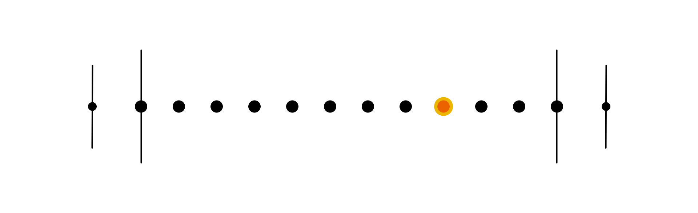

# Emotional Journey Map

# 🪜 Stage: Discovery

Walk one user through one goal, step by step, and map how they feel at every moment.

# 👋 Context

Before you can improve an experience, you need to see it the way your user does. An **emotional journey map** follows **one user** as they try to reach **one goal**, and plots how they feel at each step: where they're confident, where they're confused and where they want to give up.

In Discovery, you map the journey **as it is today**. It's a quick, visual way to put everything you've heard in interviews and site visits into one line, and to spot where the real problems sit. Later, in Define, a fuller [User Journey Map](user-journey-map.html) turns those findings into a richer picture of the whole experience.

Build it as a team, on one wall or one FigJam board, around a single user. One user and one goal keep the map honest: the moment you try to map everyone, it stops telling you anything.

*Read the line from left to right: the **entry** point, the **start**, each **step** as a dot, the **completion state** (highlighted), the **end** and the **exit**.*

# 🎯 Goal / Learning Outcome

- Map one user's journey to one goal, from entry to exit.
- Identify the completion state: the moment the user gets what they came for.
- Plot the user's feelings at every step, and find the pain points.
- Turn pain points into opportunities for your design.

# 🛠️ Main Exercise

1. **Choose the goal 🥅.** What is the user trying to achieve? Write it as one clear objective.
2. **Choose the user 🤠.** Who is it? A new user, an expert, someone returning after a long break, a casual user? Pick your most valuable user.
3. **Start at the end 🏁.** Draw the end point first: what does "done" look like?
4. **Fill in the steps 🪜.** Work back from the end and write every step in between, one per sticky note, each starting with a verb.
5. **Mark the completion state ⭐️.** At which step does the user actually reach their goal? This is the most valuable point in the journey: highlight it.
6. **Set the entry and exit ⏪ ⏭.** How does the user arrive (an advert, a friend, a notification)? How do they leave, and does anything bring them back?
7. **Set the stages.** Split the line into a beginning, a middle and an end.
8. **Add feelings 🤍.** Above the line for good moments, below it for bad ones. Join the dots to make the emotional curve. Use real quotes from your research where you have them.
9. **Add pain points 🤬.** Where might the user get confused, stuck, worried or bored? Mark every dip in the curve.
10. **Find opportunities 💡.** For each pain point, write one idea that could turn it around. These are your *Minimum Desirable Product* ideas: what would make the journey feel great, not just work.

# ⏱️ Estimated Duration

- 45 minutes

# 👉 Extra Notes

**Practice brief:** as a team, map the journey for this goal and user before you try it on your own project.

- **Goal:** share a property deed
- **User:** Carlas
- Start at the end, fill in the steps, find the completion state, set the entry and exit, split the stages, then add feelings, pain points and opportunities.

Pay special attention to the entry and exit points: they often lead to the most surprising findings.

# 🏞️ Template

- 🥅 **Goal:** …
- 🤠 **User:** …
- ⏪ **Entry:** how they arrive
- 🪜 **Steps:** beginning → middle → end
- ⭐️ **Completion state:** the step where the goal is reached
- ⏭ **Exit:** how they leave
- 🤍 **Feelings:** the emotional curve, above and below the line
- 🤬 **Pain points:** every dip in the curve
- 💡 **Opportunities:** one idea per pain point

# ⚡ Tips

- One user, one goal, one map. If you need another user, make another map.
- Start at the end: knowing the destination makes the steps easier to find.
- Back feelings with evidence: a quote, an observation or a survey answer.
- The dips matter more than the peaks. That's where your design can help.
- Keep it rough. This is a thinking tool for the team, not a poster.

# 🎥 Media

[https://www.youtube.com/watch?v=nQQBeV2iP7A](https://www.youtube.com/watch?v=nQQBeV2iP7A)

[https://www.youtube.com/watch?v=PIw-ooBJLS0](https://www.youtube.com/watch?v=PIw-ooBJLS0)

# 📚 Resources

[Journey Mapping 101 – Nielsen Norman Group](https://www.nngroup.com/articles/journey-mapping-101/)

[User Journey Map](user-journey-map.html)

# ✅ Checklist

☐ Chose one goal and one user

☐ Started at the end and filled in every step

☐ Marked the completion state, entry and exit

☐ Plotted feelings at every step, backed by research

☐ Marked the pain points and wrote an opportunity for each

# 📝 Summary

An **emotional journey map** follows one user towards one goal and plots how they feel at every step. Start at the end, mark the completion state, then add feelings, pain points and opportunities. The dips in the curve show you exactly where your design can make the biggest difference.
