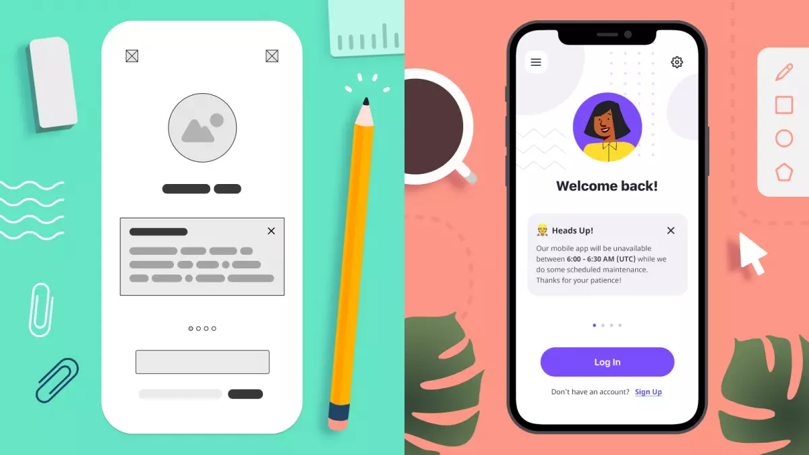

# Hi-Fi

# 🪜 Stage: Ideation

From wireframes to polished, interactive prototypes.

# 👋 Context

Now that you’ve built your low-fidelity wireframes, the next step is to transform them into high-fidelity prototypes in Figma. This stage focuses on visual design, branding, and realistic interactions to simulate the final product experience.

# 🎯 Goal / Learning Outcome

By the end of this activity, students will have:

- Translated wireframes into **pixel-perfect, high-fidelity screens**.
- Applied **typography, colours, branding, and imagery**.
- Created [**interactive points**](http://help.figma.com/hc/en-us/articles/360040314193-Guide-to-prototyping-in-Figma#:~:text=Glossary,the%20prototype%20in%20Presentation%20view.) that mimic user flows.

# 🛠️ Main Exercise

1. **Open Figma** and duplicate your low-fidelity wireframes.
2. Apply **visual design elements** (color palette, fonts, logos, spacing).
3. Replace placeholders with **real content and images**.
4. Add **interactivity using Figma prototyping tools** (links, transitions, animations).
5. Build out **the full task flow** as a clickable prototype.

# ⏱️ Estimated Duration

- ~3 hours

# 👉 Extra Notes

- The word ‘fidelity’ means ‘faithfulness’. High-fidelity prototypes should as *faithful* to to the real app or website as possible.
- Use your **style guide** for consistency.
- Use the same screen size for consistency
- Keep [Hi-Fi](hi-fi.html) **realistic but simple** — avoid overcomplicating.

# 🏞️ Template

*On the right hand side we can see the high fidelity version of the early lo-fi screen.*

# ⚡ Tips

- Don’t just make it “pretty” — ensure the task **flow remains strong**.

# ✨ AI Assist

You can upload your low fidelity screen and ask stitch to: ‘Make high fidelity screens’ and export into Figma (In Beta)

[Stitch - Design with AI](https://stitch.withgoogle.com/projects/9160201339317693902)

# 📝 Summary

High-fidelity prototypes bring your product vision to life by combining visual design and interactive flows. They help teams and users experience the product in a realistic way, providing valuable feedback before development begins. This stage ensures your design is polished, consistent, and testable, bridging the gap between concept and implementation.
