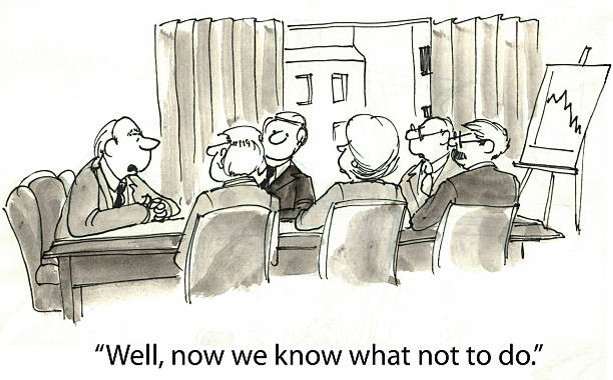
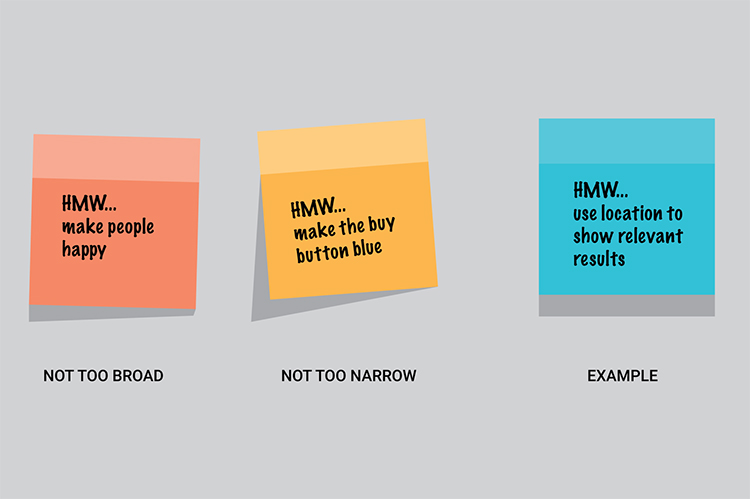

# How Might We

# 🪜 Stage: Define

Turn your fears and problems into questions that invite ideas.

# 👋 Context

Most startups fail, and everybody fails sometimes. It is essential that we stay objective and face that reality early: the most important thing is to name our fears head on, while there is still time to do something about them.

So we start pessimistically. Imagine it's five years from now and the project has failed. Why? Write down every reason you can think of. This is about challenging our assumptions as early as we can and kicking over the proverbial rock of failure.

Then we flip it. **How Might We** (HMW) is a reframing technique: each fear or problem becomes an open question that starts with "How might we…". *How* assumes there is a solution, *might* says we don't know it yet, and *we* says we'll find it together. It's about attitude, not altitude.

# 🎯 Goal / Learning Outcome

- Surface the team's fears and assumptions early.
- Reframe problems and fears as open, actionable How Might We questions.
- Judge whether a HMW is too broad, too narrow or just right.
- Choose the HMWs that will guide the rest of the sprint.

# 🛠️ Main Exercise

1. **Imagine failure (10 min, silently).** Each person writes, one per sticky note: "If this project fails in five years, it will be because…"
2. **Share the fears (10 min).** Read them out and group similar ones.
3. **Reframe (15 min, silently).** Rewrite each fear or problem as a question starting **"How might we…"**. One per note. Example: *"Tourists won't trust a beach locker"* becomes *"How might we make a locker feel as safe as a hotel safe?"*
4. **Check the scope.** For each HMW, ask:
    - **Too broad?** "How might we fix tourism?" stays abstract and leads nowhere.
    - **Too narrow?** "How might we make the button pink?" already contains the solution.
    - **Just right?** It leaves room for many ideas and leads somewhere actionable.
5. **Organise and vote (10 min).** Cluster the notes into themes on the wall, then dot-vote (two votes each) for the HMWs that matter most.
6. **Pick your targets.** Move the top three HMWs onto your map or journey; they shape your ideation.

# ⏱️ Estimated Duration

- ~1 hour

# 🏞️ Template

- 😟 Fear or problem: "…"
- 💡 How might we… ?
- ✅ Scope check: too broad / too narrow / just right

# ⚡ Tips

- Write silently first, then discuss: it stops the loudest voice deciding.
- Keep the solution out of the question.
- Use the users' words from your research, not company language.
- Quantity first. You'll throw most of them away, and that's fine.

# ✨ AI Assist

Give Claude your list of fears and ask for three HMW versions of each: one broad, one narrow, one in between. Discuss which feels right, and why, as a team.

# 🎥 Media

[https://www.youtube.com/watch?v=sRGk5oKXgCk](https://www.youtube.com/watch?v=sRGk5oKXgCk)

[https://www.youtube.com/watch?v=sngs6wj8tEY](https://www.youtube.com/watch?v=sngs6wj8tEY)

# 📚 Resources

[User Need Statements – Nielsen Norman Group](https://www.nngroup.com/articles/user-need-statements/)

[The Design Sprint – GV](https://www.gv.com/sprint/)

# ✅ Checklist

☐ Listed the reasons the project could fail

☐ Rewrote fears and problems as How Might We questions

☐ Checked each HMW for scope

☐ Clustered, voted and chose the top three

# 📝 Summary

**How Might We** turns fear into opportunity. By naming how the project could fail and reframing each risk as an open question, the team gets a set of focused, optimistic challenges that guide the ideas to come.
