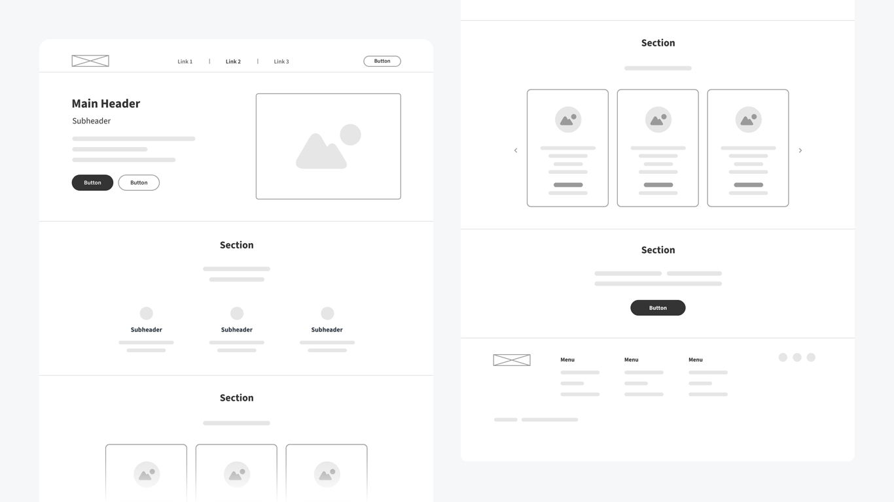
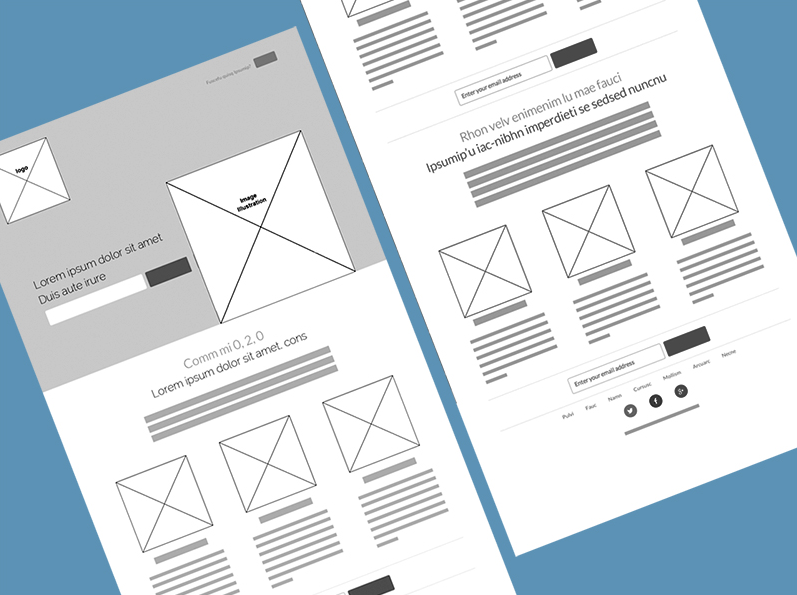

# Lo-Fi

# 🪜 Stage:  Ideation

From paper wireframes to low fidelity prototypes.

# 👋 Context

Now that you’ve created your paper wireframes, the next step is to bring them into the digital space using Figma. This exercise is about taking your sketches and building them out as low-fidelity wireframes.

# 🎯 Goal / Learning Outcome

By the end of this activity, students will have:

- Translated their paper sketches into **digital wireframes** in Figma.
- Focused only on the **essential screens** required for the chosen task flow.
- Practiced reducing ideas to the **MVP level of detail**.
- Understood that lo-fi wireframes are a tool for **research and iteration**, not final design.

# 🛠️ Main Exercise

1. **Open Figma** and set up a new file.
2. Recreate your paper wireframes using **basic shapes, boxes, and text placeholders**.
3. Build only the **screens needed** for your task flow.
4. Keep everything **monochrome and minimal**.

# ⏱️ Estimated Duration

- ~2 hour

# 👉 Extra Notes

- Don’t add colours or images
- Focus on **layout, hierarchy, and clarity**.
- Don’t include complex interaction points.

# 🏞️ Template

# ⚡ Tips

- You are **not designing the full application**.
- Focus only on the **task flow** from the previous exercise.
- Low-fidelity wireframes are a **research method** — the goal is to build something that can be reviewed, critiqued, and improved.
- Think of this as creating an **MVP (Minimum Viable Product)**: the simplest version that communicates your idea clearly.
- Keep everything **simple and blocky**.
- Use **consistent placeholder text** (e.g., “H1,” “Body text, Image Placeholder”).

# ✨ **AI Assist**

You can upload your paper wireframes and ask an AI tool: ‘Make low fidelity screens’ [(In Beta)](https://www.google.com/search?q=in+beta+meaning&sca_esv=7a86b5436430bbb9&source=hp&ei=hAC2aPuZOcSA7M8PhPOniAo&iflsig=AOw8s4IAAAAAaLYOlJUuSx1tvtKSgbxBR36KScykMtO8&ved=0ahUKEwj767GLsriPAxVEAPsDHYT5CaEQ4dUDCBc&uact=5&oq=in+beta+meaning&gs_lp=Egdnd3Mtd2l6Ig9pbiBiZXRhIG1lYW5pbmcyBRAAGIAEMgYQABgWGB4yBhAAGBYYHjIGEAAYFhgeMgYQABgWGB4yBhAAGBYYHjIGEAAYFhgeMgYQABgWGB4yBhAAGBYYHjIGEAAYFhgeSPEQUABYvg9wAHgAkAEAmAFqoAHECqoBBDEyLjO4AQPIAQD4AQGYAg-gAqALwgILEC4YgAQY0QMYxwHCAgUQLhiABMICCxAuGIAEGMcBGK8BwgIHEC4YgAQYCsICBxAAGIAEGAqYAwCSBwM5LjagB-iKAbIHAzkuNrgHoAvCBwYyLTE0LjHIB1E&sclient=gws-wiz)

[Stitch - Design with AI](https://stitch.withgoogle.com/projects/9160201339317693902)

# 🎥 Media

[https://www.youtube.com/watch?v=UU_eyUGWIEI&t=11s](https://www.youtube.com/watch?v=UU_eyUGWIEI&t=11s)

# 📝 Summary

Low-fidelity wireframes bring your sketches into a digital format so they can be tested and discussed. By keeping them minimal and focusing on the **core task flow**, students avoid distractions and stay focused on what matters most: learning whether their structure supports the user’s needs. This stage reinforces the principle of building **only the MVP** and treating wireframes as part of the **research and iteration process**, not as final deliverables.
