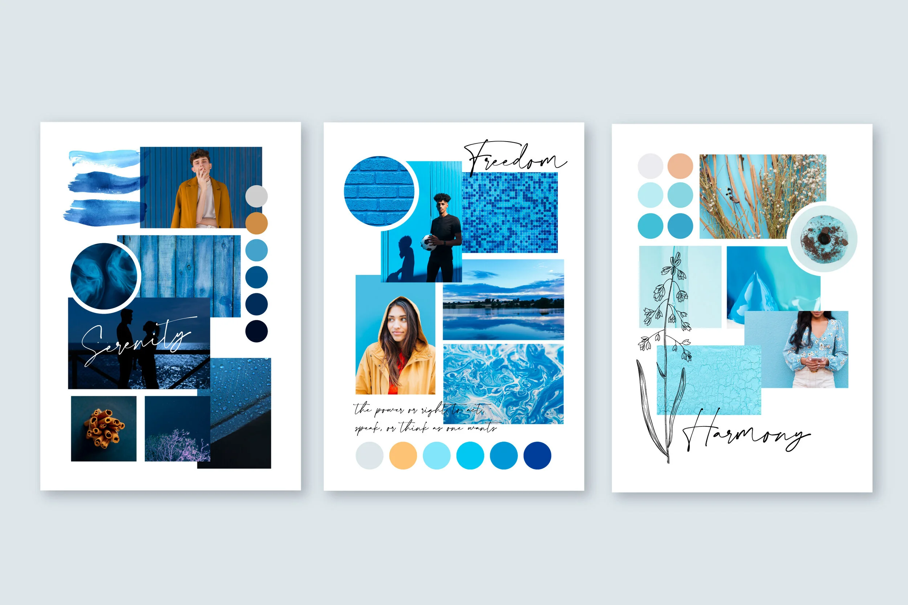

# Mood Board

# 🪜 Stage: Ideation

During the Define stage, we focused mainly on formative UX research methods. Now, it’s time to move forward into the creative stage of Ideation.

# 👋 Context

A mood board is an early visualisation that gives us an abstract version of the aesthetic which we wish to achieve. 

# 🎯 Goal / Learning Outcome

By the end of this activity you should have developed a rough pastiche of colours, typographies, images, textures, icons and graphics that assist us moving forward in our design process. 

# 🛠️ Main Exercise

Using a collaborative design tool (e.g., **Figma**, Miro, or Canva):

1. Collect visual inspiration that resonates with the desired look and feel.
2. Arrange **colors, typography samples, textures, icons, symbols, and imagery** into a single shared canvas.
3. Experiment with different combinations to explore possible design directions.

# ⏱️ Estimated Duration

- ~1 hour

# 🏞️ Template

Sections:

- 🎨 Colours (swatches or palette)
- 🔠 Typography inspiration
- 🖼️ Imagery / photography style
- ✨ Textures, shapes, or icons

# ⚡ Tips

- Keep it cohesive, not cluttered — fewer, stronger images are better.
- Stick to a limited colour palette.
- Think about mood and feeling (warm, minimal, playful, elegant).
- Use keywords alongside visuals to anchor the theme.

# 🎥 Media

[https://www.youtube.com/watch?v=pF1BDc0tZ6w](https://www.youtube.com/watch?v=pF1BDc0tZ6w)

[https://www.youtube.com/watch?v=AXpxZMRM1EY](https://www.youtube.com/watch?v=AXpxZMRM1EY)

# 📚 Resources

[Free Mood Board Creator - Make Mood Boards Online | Canva](https://www.canva.com/create/mood-boards/)

[Pinterest](https://www.pinterest.com/)

[Beautiful Free Images & Pictures | Unsplash](https://unsplash.com/)

[Grabient | Gradient Generator & Palette Finder](https://www.grabient.com/)

# ✅ Checklist

☐ Watched mood board tutorial

☐ Gathered visuals (colours, fonts, imagery, textures)

☐ Created digital board

# 📝 Summary

A **mood board** is a visual collage that communicates the overall look and feel of a project. It brings together colours, images, fonts, and textures into a single board that captures a design direction. Mood boards are useful because they make abstract ideas tangible and visual, create a shared visual language for teams and clients, help designers stay consistent in style choices, and save time by clarifying the mood before detailed work begins. By building mood boards, students learn how to translate ideas into visuals and set the creative tone for their designs.
