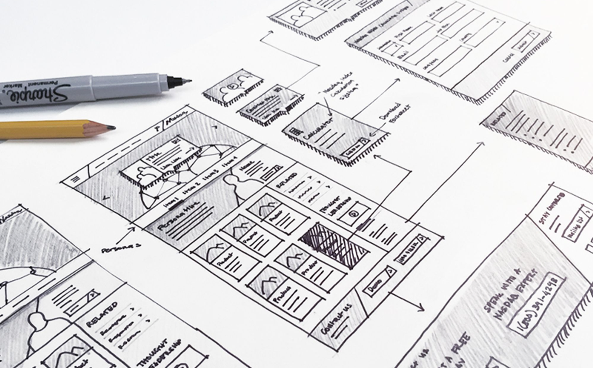

# Paper Wireframes

# 🪜 Stage: Ideation

Building the ideation with paper wireframes.

# 👋 Context

Paper wireframes are simple, black and white drawings that representation your design main concept. This exercise focuses on creating sketches that communicate structure and flow, not visual polish.

# 🎯 Goal / Learning Outcome

By the end of this activity you should have, students will developed a set of paper wireframes that can be brought into the digital space moving forward in the next step.

# 🛠️ Main Exercise

Revisit your user journey, style guide and task flow. Create a step by step representation of your main task flow. 

# ⏱️ Estimated Duration

- 45 Minutes

# 👉 Extra Notes

- Start in pencil and go over in pen if you like
- Use **notes and arrows** if needed.
- Stay away from colour. Some pen and light shading with a pencil is sufficient.

# 🏞️ Template

# ⚡ Tips

- Start **broad**: layout first, details later.
- Label buttons, inputs, and links clearly.
- Think about **user journey**
- Don’t worry about fonts, or images.
- Try to think about your H1-H3 and your body text

# 🎥 Media

[https://www.youtube.com/watch?v=I5u2QOH18W8](https://www.youtube.com/watch?v=I5u2QOH18W8)

[https://www.youtube.com/watch?v=miVcrftnhzM](https://www.youtube.com/watch?v=miVcrftnhzM)

# 📝 Summary

Paper wireframes are a fast and inexpensive method to explore design ideas, test flows, and identify usability issues early. By creating and iterating lo-fi prototypes, students gain confidence in their concepts and set the foundation for higher-fidelity designs.
