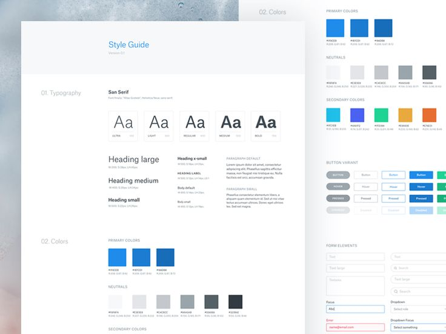
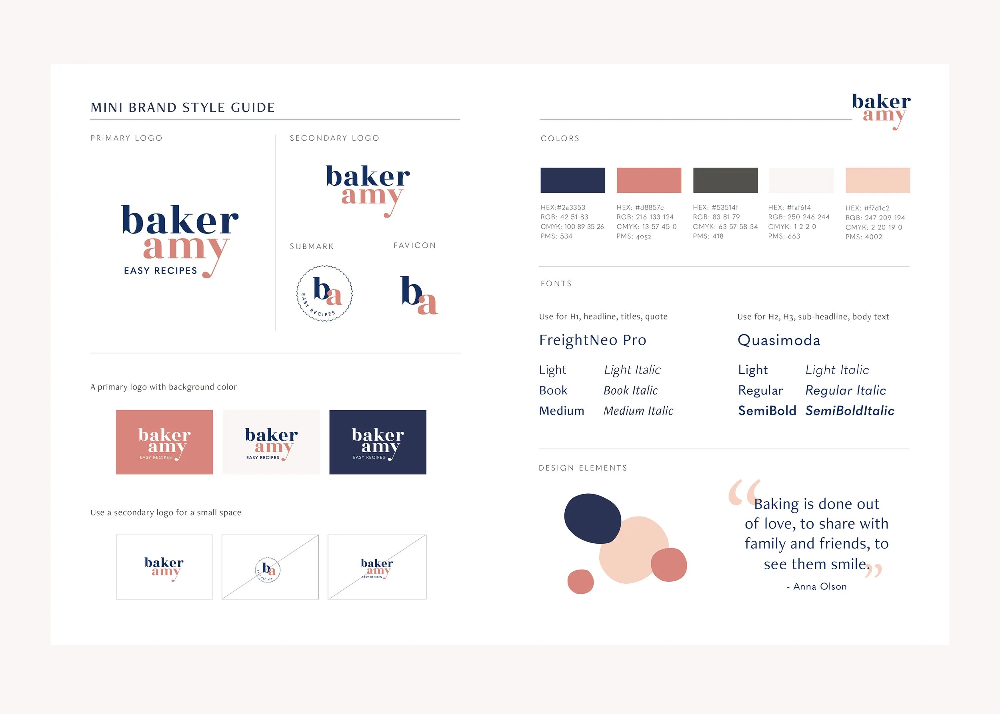
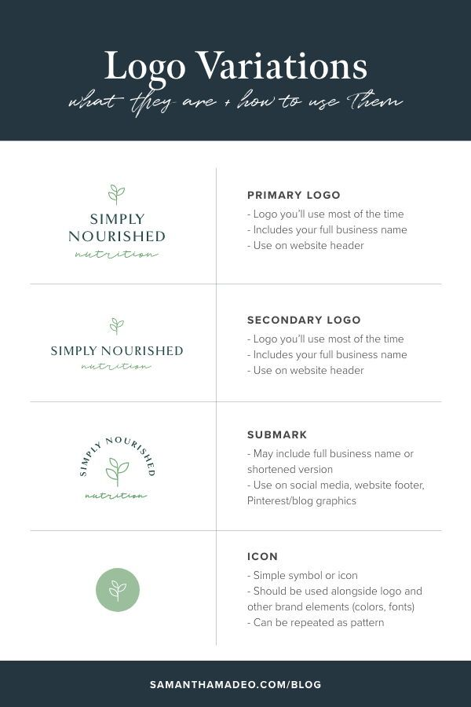
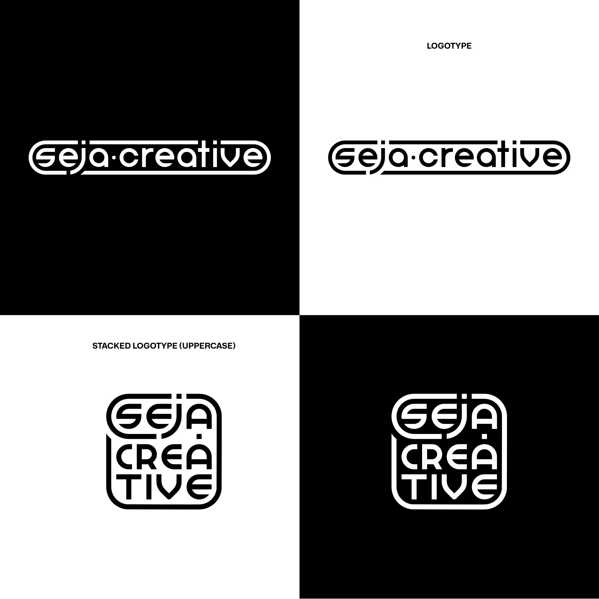
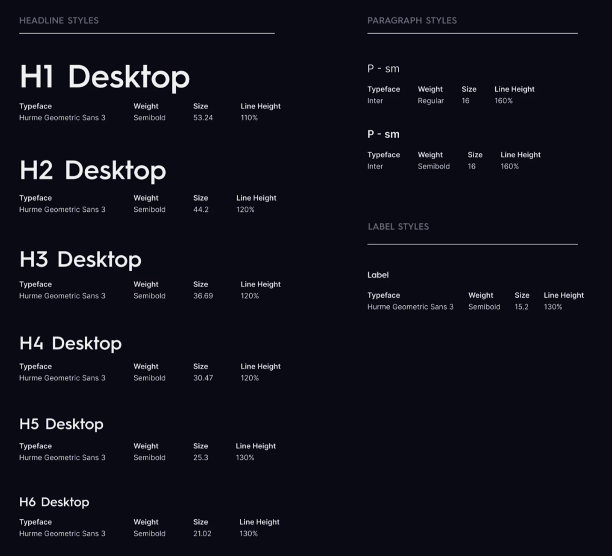
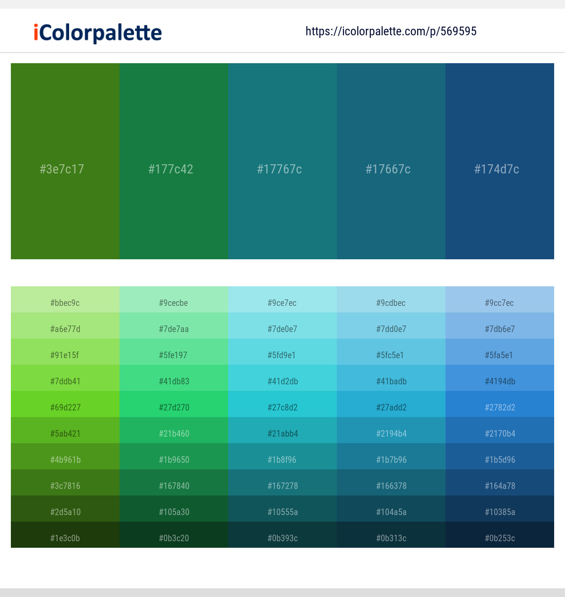
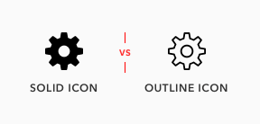
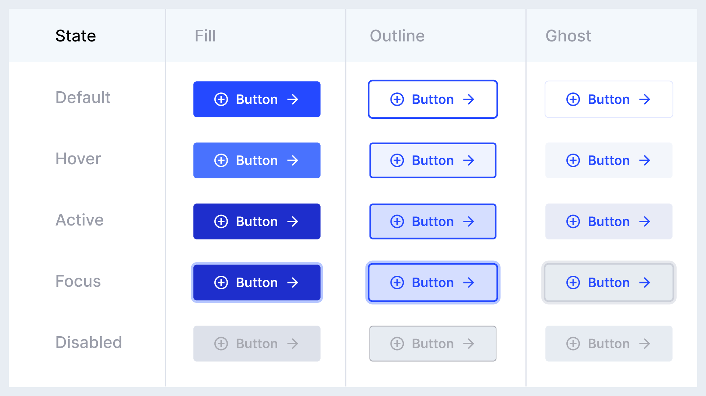
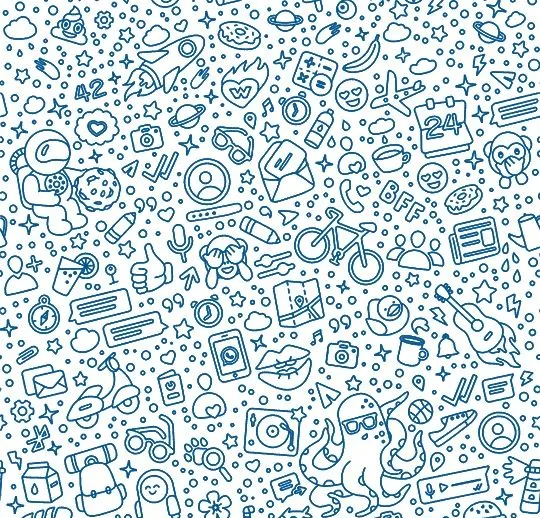

# Style Guide

# 🪜 Stage: Ideation

Styling a technical guide 

# 👋 Context

Now that we have established a visual direction with a **mood board**, it’s time to **formalise that style** into a structured **style guide**. Mood boards are inspirational, but a style guide is practical. It documents rules for typography, colours, and components so that design work stays consistent across screens, pages, or products. In this exercise, students will create their own digital style guide in **Figma**.

# ✅ Total Style Guide **Checklist**

- [ ]  Logo
- [ ]  Typography
- [ ]  Colours
- [ ]  Icons
- [ ]  Buttons
- [ ]  Textures (Optional)
- [ ]  [Components (Advanced)](https://m3.material.io/components)

# 🎯 Goal / Learning Outcome

By the end of this activity you should have, students will have developed a robust style guide that can be used as the basis for a design system. 

# 🛠️ Main Exercise

Please create the following 5 items inside a Figma art board and if you feel like it, develop 6 and 7:

## **1. Logo**

The primary visual identifier of a brand, serving as a consistent symbol of recognition across all user experiences.

✅ Logo **Checklist**

- [ ]  Primary Logo
- [ ]  Secondary Logo
- [ ]  Submark
- [ ]  Icon / Favicon

*Be aware that it can be useful to present a logo against both a black and a white background.* 

## **2. Typography**

Defines the visual style of text, ensuring consistency, readability, and brand personality across all digital and physical experiences.

✅ Typography **Checklist**

- [ ]  Heading 1
- [ ]  Heading 2
- [ ]  Heading 3
- [ ]  Body

*The above example goes from Heading 1 - 6, this is not always necessary and H1 - H3 in many places in sufficient. But always include a Body text. This is typically set at a baseline of 16px.*

✅ **Checklist (Per item)**

- [ ]  Typeface Title Example (i.e, H1 Desktop)
- [ ]  Typeface Name
- [ ]  Weight (Bold, Semi Bold, Light, Italic)
- [ ]  Size (in PX)
- [ ]  [Line Height (Optional)](https://www.google.com/search?q=line+height+meaning&oq=line+height+meani&gs_lcrp=EgZjaHJvbWUqBwgAEAAYgAQyBwgAEAAYgAQyBggBEEUYOTIICAIQABgWGB4yCAgDEAAYFhgeMggIBBAAGBYYHjIICAUQABgWGB4yCAgGEAAYFhgeMggIBxAAGBYYHjIICAgQABgWGB4yCAgJEAAYFhge0gEIMzI4MWowajeoAgiwAgE&sourceid=chrome&ie=UTF-8)

## **3. Colour Palette**

Establishes the brand’s core colours, providing consistency and visual harmony across all user interfaces and touch points.

✅ Colour **Checklist**

- [ ]  Primary Colour
- [ ]  [Primary Colour Palette](https://www.youtube.com/shorts/Vk5fAJmnYzs)
- [ ]  Secondary Colour
- [ ]  [Secondary Colour Palette](https://www.youtube.com/shorts/Vk5fAJmnYzs)
- [ ]  Monochrome Color
- [ ]  [Monochrome Palette](https://www.youtube.com/shorts/Vk5fAJmnYzs)

*Be sure to include [Hex Values](https://www.figma.com/dictionary/hex-value/)*

## **4. Icons**

Defines the brand’s iconography, ensuring clarity and recognisability across all platforms and user interactions.

✅ Icons **Checklist**

- [ ]  Icons Fill
- [ ]  Icons Outline

## 5. Buttons

Dynamic Buttons Exercise →

Touch points that allow users to orientate their way around your site. Be sure to 

✅ Buttons **Checklist**

- [ ]  Default Button
- [ ]  Hover Button
- [ ]  Active Button

*In the above example there are 5 states, and 3 variants, Fill, Outline and Ghosted. Be sure to include at minimum: default, hover and active in the <strong>fill variant.</strong>*  

## **6. Textures (Optional)**

Defines the brand’s iconography, ensuring clarity and recognisability across all platforms and user interactions.

✅ Textures **Checklist**

- [ ]  Textured Background
- [ ]  Alternative Background

*You’ll all be familiar with WhatsApp texture patterns which gives a background flexibility and identity* 

## **7. Components (Advanced)**

Defines reusable [UI elements](https://m3.material.io/components) that ensure consistency, accessibility, and efficiency across the application.

✅ Foundational Components Checklist

- [ ]  Buttons
- [ ]  Inputs (text, password, textarea)
- [ ]  Selects / Dropdowns
- [ ]  Checkboxes
- [ ]  Radio buttons
- [ ]  Toggles / Switches
- [ ]  Sliders
- [ ]  Date & time pickers
- [ ]  Avatars / Badges / Chips
- [ ]  Icons

✅ Complex Components Checklist

- [ ]  Cards
- [ ]  Menus (context, dropdown, mega menu)
- [ ]  Navigation (top bar, side nav, breadcrumbs)
- [ ]  Modals / Dialogs
- [ ]  Tooltips
- [ ]  Tabs
- [ ]  Accordions
- [ ]  Pagination
- [ ]  Tables
- [ ]  Toasts / Alerts / Notifications
- [ ]  Progress indicators (spinner, bar, stepper)

[Components – Material Design 3](https://m3.material.io/components)

# ⏱ Estimated Duration

- ~2 hours

# 👉 Extra Notes

Students can expand their style guide over time by adding grids, spacing, do nots, iconography, or interaction rules. This exercise focuses on the essentials: **typography, colour, and basic components**.

# 📚 Resources

[Colorable](https://colorable.jxnblk.com/)

[Browse Fonts - Google Fonts](https://fonts.google.com/)

[Shapes 2.0 — Fresh SVG Shapes and a Refreshed Website — Framer Blog](https://www.framer.com/blog/shapes-2/)

[Phosphor Icons](https://phosphoricons.com/)

# 🏞️ Template

[RamenGo-Styleguide-v2.pdf](RamenGo-Styleguide-v2.pdf)

# ⚡ Tips

- Keep it simple but structured — your style guide should be easy to scan.
- Always include **technical specs** like font names and hex codes so others can apply them directly.
- Align and organise sections neatly in Figma frames so the guide itself feels professional.

# 🎥 Media

[https://www.youtube.com/watch?v=an9_EvwOMNc&t=267s](https://www.youtube.com/watch?v=an9_EvwOMNc&t=267s)

# 📝 Summary

A **style guide** is a structured reference that translates a design’s mood and inspiration into **practical rules** for consistent use. Unlike a mood board, which is exploratory and inspirational, a style guide is formal and technical. It specifies fonts (with sizes and weights), colors (with hex values), and key interface components (like buttons or text fields). Style guides are useful because they ensure **consistency across projects**, help teams collaborate smoothly, and make design scalable as products grow. By creating their own style guide, students will practice turning **creative ideas into concrete, reusable standards** that anchor all future design work
