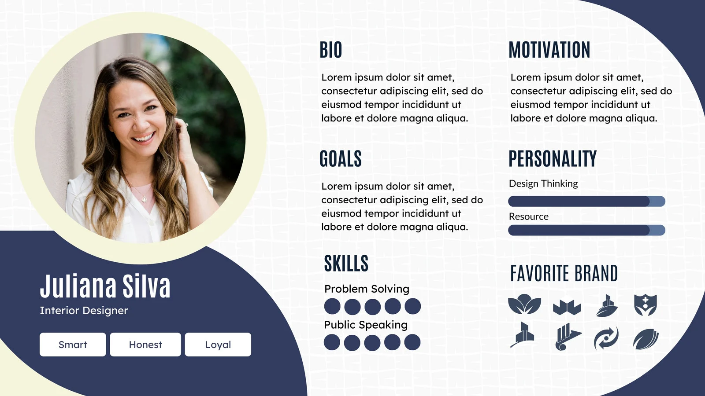

# User Persona

# 🪜 **Stage: Define**

Persona Creation 

# 👋 **Context**

Students have gathered discovery data (surveys, interviews, research goals, problem statement). Now they will **translate insights into a humanised representation of their target users**. Personas help teams empathise and keep design decisions grounded in user reality.

# 🎯 **Goal / Learning outcome**

By the end of this activity you should have:

- Identified key user groups from research findings
- Created a persona that reflects motivations, needs, frustrations, and goals
- Practiced synthesising qualitative/quantitative data into a design piece

# 🛠️ **Main Exercise**

1. **Cluster Insights** 
    - Review past interview/survey notes and problem statements.
    - Group user behaviours, goals, and pain points into clusters
2. **Define Archetypes** 
    - Identify 1–2 primary user types emerging from clusters.
    - Give them working labels (e.g., “The Busy Parent,” “The Tech Skeptic”).
3. **Build the Persona** 
    - For each archetype, fill out a **Persona Template** with:
        - Name, age, background
        - Motivations & goals
        - Pain points & frustrations
        - Behaviours & tools they use
        - A quote that captures their perspective
4. **Present Back**
    - Each team shares their persona with the class.

# ⏱️ **Estimated Duration**

- 55 minutes

# 👉 **Extra Notes**

- Stress that personas are **not stereotypes** but **evidence-based composites**.
- Encourage diversity of perspective, but ensure personas remain tied to research data (not guesses).

# 📚 **Resources**

- [User Persona Guide](https://www.nngroup.com/articles/persona/) (Nielsen Norman Group)
- [User Persona Examples](https://xd.adobe.com/ideas/process/user-research/user-persona/)
- Miro / MURAL persona templates (if digital)

# 🏞️ **Template**

In the above template example, we have:

- **Profile Photo** (portrait of the persona)
- **Name**: *Juliana Silva*
- **Job Title**: *Interior Designer*
- **Traits / Values**: *Smart, Honest, Loyal*
- Age
- Generation

**Sections:**

- Quote – Loosely summarises the current user state of mind
- **Goals** – What they are looking to achieve (inside problem space)
- Pain Points - Where are they suffering as a result of the issue we are currently talking about
- **Personality** (with progress bars)
    - *Design Thinking*
    - *Resource*
- **Favorite Brand** (set of brand-like icons shown visually)
- Technology usage - Instagram or Tik Tok, iOS or Andriod

# ⚡ **Tips**

- Give your persona a name and photo to make them feel real.
- Use direct quotes from interviews wherever possible.
- Keep it concise — it should be quick for others to grasp.

# ✨ **AI Assist**

Students can use AI to:

- Summarise interview/survey data into bullet points
- Suggest persona names, demographics, or phrasing for goals/pain points
- Generate stock-style persona photos (with caution not to stereotype)

# 🎥 **Media**

[https://www.youtube.com/watch?v=rv9yfrV-EAs](https://www.youtube.com/watch?v=rv9yfrV-EAs)

# ✅ **Checklist**

- [ ]  Reviewed discovery research
- [ ]  Grouped insights into clusters
- [ ]  Identified 1–2 archetypes
- [ ]  Completed persona template
- [ ]  Presented to peers

# 📝 **Summary**

Students synthesise research insights into clear, relatable personas. These personas will guide upcoming design decisions, ensuring the product aligns with real user needs.
