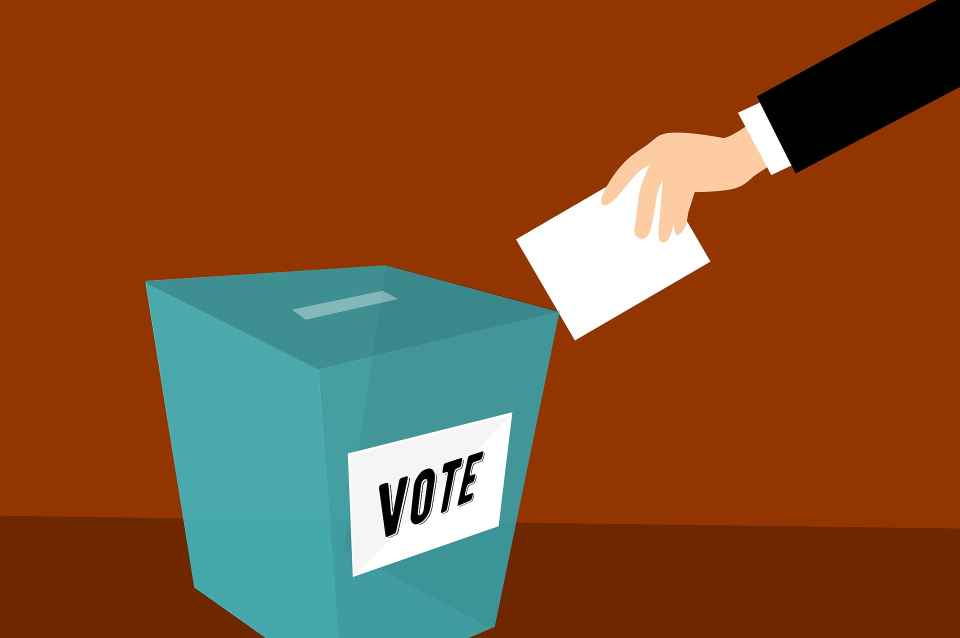

# Vote

# 🪜 Stage: Define

Decide, together and quickly, which ideas move forward.

# 👋 Context

It's time to decide, and to choose the ideas that show the most promise. Without a structure, decisions go to the loudest voice or the most senior person, or drag on for hours. A structured **vote** makes the decision fast, fair and visible.

The Design Sprint uses a sequence of quiet steps: everyone studies the sketches silently, marks what they like with dots (a **heat map**), hears a short critique of each sketch, casts one vote each (a **straw poll**), and then the **Decider** makes the final call with a **supervote**. Nielsen Norman Group calls the dot step **dot voting**: a quick way to prioritise that shows the group's preferences at a glance.

The purpose of voting is **prioritisation**, not popularity: the discussion around the dots tells you *why* certain ideas were favoured and which parts are most valuable.

# 🎯 Goal / Learning Outcome

- Use dot voting to see the group's preferences at a glance.
- Run a short critique so every idea gets a fair hearing.
- Make a clear decision with a straw poll and a Decider's supervote.
- Record why the winning ideas won.

# 🛠️ Main Exercise

1. **Art museum (5 min).** Hang all solution sketches on the wall.
2. **Heat map (10 min, silently).** Everyone walks the wall and puts small dots on the parts they like: a feature, a headline, a flow. No talking.
3. **Speed critique (3 min per sketch).** One person narrates each sketch and points out the clusters of dots. The sketcher stays quiet until the end, then adds anything missed.
4. **Straw poll (5 min).** Everyone gets one big vote. Place it silently on the idea, or part of an idea, you'd test.
5. **Explain (5 min).** Each person says in one sentence why they voted the way they did.
6. **Supervote (2 min).** The Decider (instructor or team lead) places the final votes. Those ideas go forward.
7. **Record.** Photograph the wall and write down the winners and the reasons.

# ⏱️ Estimated Duration

- ~1 hour

# 🏞️ Template

- 🔴 Small dots: unlimited, on the parts you like
- 🔵 One big dot each: your straw-poll vote
- ⭐ Supervotes: the Decider's final choice

# ⚡ Tips

- Vote silently first, discuss after, so people aren't swayed by the first opinion.
- Vote on parts of ideas, not just whole sketches: the best prototype often combines them.
- Don't vote for your own sketch.
- Agree on who the Decider is before you start.

# ✨ AI Assist

After the vote, give Claude the winning ideas and your long-term goal and ask: "Which of these is most likely to answer our sprint questions, and what are we ignoring?" Use it to check the decision, not to make it.

# 🎥 Media

[https://www.youtube.com/watch?v=5-3q4z7ReSQ](https://www.youtube.com/watch?v=5-3q4z7ReSQ)

[https://www.youtube.com/watch?v=o6YNHnt4jLQ](https://www.youtube.com/watch?v=o6YNHnt4jLQ)

# 📚 Resources

[Dot Voting: A Simple Decision-Making and Prioritizing Technique – Nielsen Norman Group](https://www.nngroup.com/articles/dot-voting/)

[The Design Sprint – GV](https://www.gv.com/sprint/)

# ✅ Checklist

☐ Hung up all sketches

☐ Made a silent heat map with dots

☐ Ran a speed critique of each sketch

☐ Held a straw poll and a Decider's supervote

☐ Recorded the winners and why

# 📝 Summary

A structured **vote** turns a room full of opinions into a clear, shared decision. Silent dots show what people like, a short critique gives every idea a hearing, and a straw poll plus the Decider's supervote settles what goes forward.
