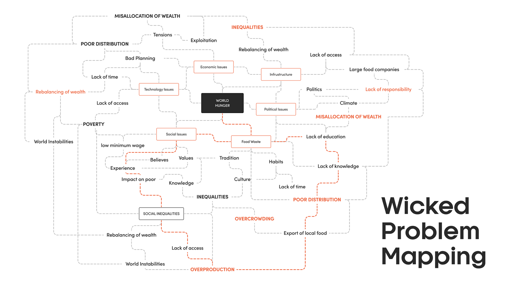

# Wicked Problem Mapping

# 🪜 Stage: Define

Map the mess before you try to fix any part of it.

# 👋 Context

A wicked problem, like food waste, loneliness or over-tourism, has no single cause and no single solution. Solving one part can make another part worse. (See the Wicked Problem lecture.)

You can't design for something you can't see, so the first step is to **map** it. This method combines two tools:

- **The 5 Whys**, to dig from a symptom down to its deeper causes.
- **An ecosystem map**, which Nielsen Norman Group recommends early in discovery, when there are many unknowns: the user in the centre, surrounded by the people, organisations, products and services that affect them.

Together they produce a **non-linear map of causes and actors**. It was developed by a former student investigating world hunger, who turned her 5 Whys into a web of causality instead of a straight line. The map won't solve the problem, but it will show you where a small, well-placed design can make a dent.

# 🎯 Goal / Learning Outcome

- Break a wicked problem into causes, effects and actors.
- Show how causes connect and feed each other, rather than as a straight line.
- Identify the people and organisations involved and how close they are to the user.
- Choose one specific, designable area to focus on.

# 🛠️ Main Exercise

Use **FigJam** or **Miro**, or flipchart paper and sticky notes.

1. **Name the problem space** in the middle of the board, e.g. "Food waste in Barcelona households".
2. **5 Whys, several times.** Start from 3–4 different symptoms. For each, ask "why?" five times and write each answer on a note.
3. **Turn the lines into a web.** Where causes from different chains are the same or linked, connect them. Draw arrows for "causes" and mark loops where effects feed back into causes.
4. **Add the ecosystem.** Around the map, place the actors: people, organisations, products and services. Put the most influential closest to the user.
5. **Spot the leverage points.** Circle 2–3 places where many arrows meet, or where one actor has a lot of influence.
6. **Zoom in.** Choose one leverage point that is small enough to design for, and write it as a draft problem statement.

# ⏱️ Estimated Duration

- ~1.5 hours

# ⚡ Tips

- Stay low-fidelity. A messy map invites people to change it.
- Use desk research to check your causes; don't rely only on what you believe.
- Different colours help: causes, effects, actors, leverage points.
- Expect the map to change as you learn more. Update it after each research debrief.
- You will not solve the whole problem. Aim for a meaningful dent.

# 🎥 Media

[https://www.youtube.com/watch?v=rMj-NuZoEYI](https://www.youtube.com/watch?v=rMj-NuZoEYI)

[https://www.youtube.com/watch?v=2YpC3R1zNdA](https://www.youtube.com/watch?v=2YpC3R1zNdA)

# 📚 Resources

[Why Map in Discovery: 3 Mapping Methods – Nielsen Norman Group](https://www.nngroup.com/articles/mapping-in-discovery/)

[Stakeholder Analysis for UX Projects – Nielsen Norman Group](https://www.nngroup.com/articles/stakeholder-analysis/)

# ✅ Checklist

☐ Named the problem space

☐ Ran the 5 Whys from at least three symptoms

☐ Connected the causes into a web and added the actors

☐ Circled leverage points and chose one to focus on

# 📝 Summary

**Wicked problem mapping** makes a complex, systemic problem visible. Chains of "why?" become a web of causes, and an ecosystem of actors shows who is involved. From the map you can choose one specific leverage point: a problem small enough to design for, inside a problem too big to solve.
