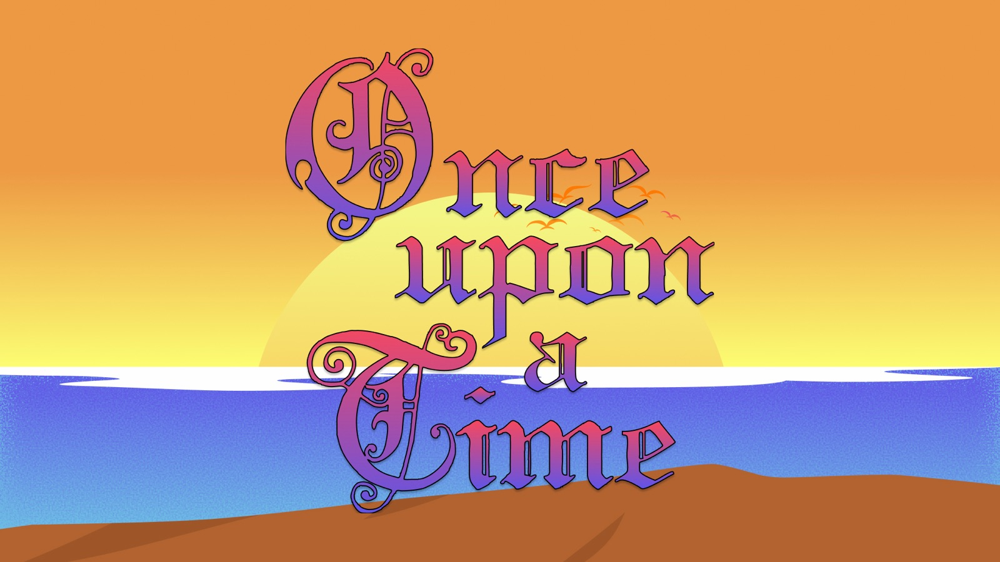
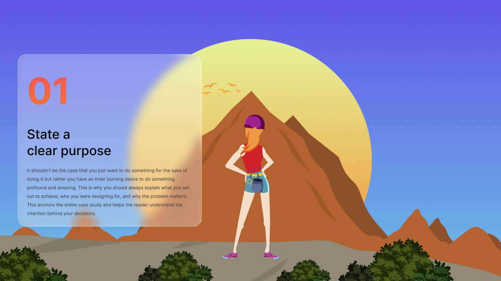

# Writing your Case Study

# 🪜 Stage: Retrospective

Tell the story of how you think: five minutes, honest, and only what you learned.

# 👋 Context

Your case study matters more than your prototype. A hiring manager won't use your app; they'll read your case study, for about five minutes, to decide whether they can picture you on their team. Nielsen Norman Group's portfolio guidance says the same thing: they want to understand **how you work**.

So a case study is not a list of methods ("I did a survey, then a persona, then wireframes"). It's a **story**, with a hero (you and your users), a goal, obstacles, a moment when things went wrong and an ending where something changed.

## It starts with curiosity

The best case studies come from problems the designer was genuinely **curious** about. Curiosity is what makes you ask the extra "why?" in an interview, notice the odd thing in the data and keep going when the first idea fails. Readers can feel it. When you choose a project, especially your personal project, pick something you actually want to understand.

## The rules of evidence

Every phase of your case study has to earn its place:

- **Discovery must discover something.** Show your **initial problem statement** next to what your research actually found. If nothing changed, you didn't discover anything.
- **Define must be based on data.** Your **validated problem statement**, persona and priorities must point back to real research, not assumptions.
- **Ideation must be tested and validated.** Show what you tested with users, what failed and what you changed because of it.
- **The retrospective must be honest.** Never write "everything was amazing". Design is messy, and senior designers expect a non-linear, less-than-perfect journey. Showing what went wrong, and how you recovered, is what makes you credible.

## Short, and only what you learned

Aim for a case study someone can read in **five minutes**. Don't show every artifact you made: show the moments where you **learned** something. That includes the emotional side: the interview that changed your mind, the test that went badly, how you felt when the idea you loved didn't work. That's the part people remember.

# 🎯 Goal / Learning Outcome

- Structure a case study as a story with a clear beginning, middle and end.
- Show evidence at every phase: what discovery discovered, what the data defined, what testing validated.
- Write an honest reflection, including what went wrong and how it felt.
- Cut it down to a five-minute read that a hiring manager can scan.

# 🛠️ Main Exercise

Use the artifacts you catalogued and your **Retrospective**, and write the story in four beats.

**1. State a clear purpose.**

What did you set out to achieve, for whom, and why does it matter? Include your **role** and the team, and why you were curious about this problem.

**2. Show what you discovered.**

Put your initial problem statement next to your validated one. Show the research that changed your mind, the real constraints you faced (time, access to users, a vague brief) and how you reached a direction.

**3. Say when things got tough.**

A film where the hero sails through is boring. Tell the reader about the test that failed, the idea you abandoned, the feedback that stung, and how you **recovered**, with before-and-after evidence of what changed.

**4. Reflect honestly.**

What was the impact on users? What did you learn, about the problem and about yourself? What would you do differently? How did it feel? Take this straight from your retrospective.

**Then build it:**

1. Write a one-line hook and a three-sentence summary for the top of the page.
2. Draft each beat in a few short paragraphs.
3. Choose 2–3 artifacts per beat, only the ones where you learned something, each with a caption that says what it shows and why it mattered.
4. Cut until it reads in five minutes. Use headings, short paragraphs and bold key points.
5. Read it aloud to a classmate. Where they get lost, rewrite.
6. Publish it on Medium (or your portfolio), share it with your instructor, then post a short summary on LinkedIn.

## Three case studies to learn from

None of these is perfect, and that's the point. Read each one critically and ask: what did they learn, and how do they show it?

- **[Case Study: Pizza Hut Delivery App Redesign](https://medium.com/@kellyyspace/uxdi-project-3-pizza-hut-delivery-app-redesign-d49f93c94857)**, Kellyyspace (UX bootcamp team project). Closest to what you'll write: research, personas, usability tests with real numbers (satisfaction up from 3.8 to 7.9 out of 10 with six users), changes made because of the feedback, and an honest "what I learned".
- **[It's OK to be Human in a Machine-Learned World](https://medium.com/spotify-insights/its-ok-to-be-human-in-a-machine-learned-world-4ad62a947a9e)**, Spotify Insights. A researcher at Spotify on naming a feature when the A/B test "returned neutral". Proof that real design is messy, that data doesn't always decide for you, and that honest reflection is compelling.
- **[Redesigning Medium](https://medium.com/@dustin/redesigning-medium-f665d2cc9c29)**, Dustin Senos (Medium's head of design). A four-minute read built entirely around lessons learned, from a brainstorm that wasn't working to asking the right questions at the right fidelity. A model of "only highlight what you learned".

# ⏱️ Estimated Duration

- ~3 hours

# 🏞️ Template

- 🪝 Hook and three-sentence summary
- 🎯 1. Purpose: problem, users, role, and why you were curious
- 🔍 2. Discovery: initial vs validated problem statement, the evidence that changed your mind
- 🌧️ 3. When things got tough: what failed, how you recovered, before and after
- 🌅 4. Honest reflection: impact, lessons, what you'd do differently, how it felt
- ⏱️ Five-minute read

# ⚡ Tips

- Lead with the problem, not the method.
- Use "I" for what you did and "we" for the team, and be honest about which is which.
- Every image needs a caption. An uncaptioned journey map is just decoration.
- Show abandoned ideas: they prove you explored before you decided.
- Only use numbers you can back up: "task time down from 3 min to 50 s with 5 users".
- If you used AI, say where and how you checked it.

# ✨ AI Assist

Paste your draft into Claude and ask: "Read this as a hiring manager with five minutes. What was the problem, what did my research discover, what did testing change, and what did I learn? Where did you get lost?" If its answers are wrong, your story isn't clear yet.

# 🎥 Media

[https://www.youtube.com/watch?v=jt1WroGHvBs](https://www.youtube.com/watch?v=jt1WroGHvBs)

[https://www.youtube.com/watch?v=88GQ6tXTYcg](https://www.youtube.com/watch?v=88GQ6tXTYcg)

# 📚 Resources

[5 Steps to Creating a UX-Design Portfolio – Nielsen Norman Group](https://www.nngroup.com/articles/ux-design-portfolios/)

[UX Stories Communicate Designs – Nielsen Norman Group](https://www.nngroup.com/articles/ux-stories/)

[Retrospective](sprint-retrospective.html)

# ✅ Checklist

☐ Chose a problem you're curious about, and said why

☐ Showed what discovery discovered (initial vs validated problem statement)

☐ Backed every decision with data, and showed what testing changed

☐ Wrote an honest reflection, including what went wrong and how it felt

☐ Cut it to a five-minute read with captioned artifacts

☐ Published it and shared the link

# 📝 Summary

A **case study** is the story of how you think. Start from curiosity, make every phase earn its place (discovery that discovers, definitions based on data, ideas that were tested) and finish with an honest reflection. Keep it to five minutes and show only what you learned, including when things got messy.
