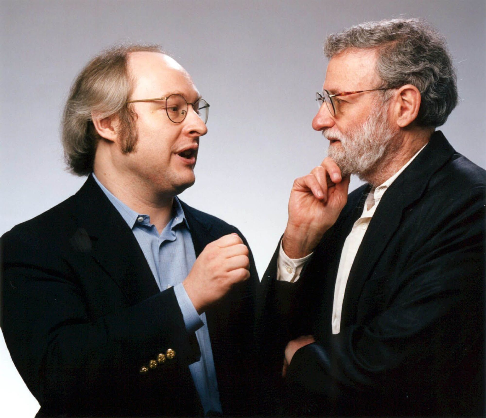

# Neilson Heuristics

Dr Jakob Neilson (featured above, left), talking to Don Norman, Norman wrote a number of critically acclaimed books on the subject of UX and is currently an IDEO fellow. He outlined his fundamental criteria for ensuring positive User Experience know as the Usability Heuristics. 

It is of paramount importance that we learn and apply these rules and combine them with the design thinking phases in order to produce a meaningful product which can actually be used in the way the customer wants to use it. This in essence is achieved by knowing the users behaviours and responding appropriately to them.
