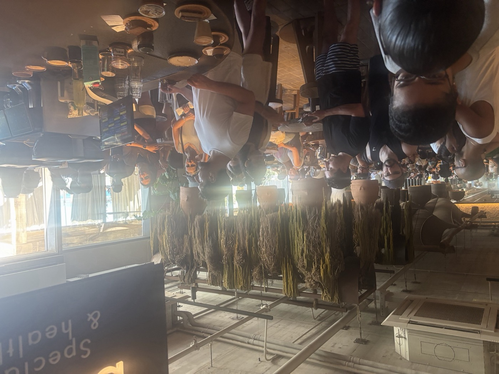
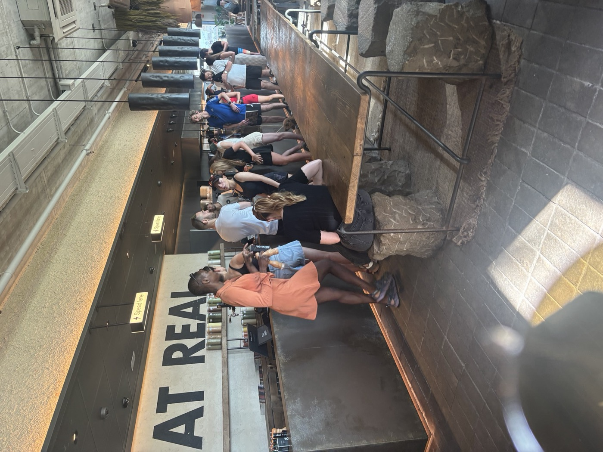

# Sprint 01: Honest Greens

> The Coffee Station Crush: nobody knows when their order is ready.

## The brief

Your client is **Honest Greens, Barceloneta**. At the weekend brunch peak, customers at the coffee station have no way of knowing when their order is ready. Your job this sprint is to fix that.

| | |
| --- | --- |
| **Where** | Honest Greens Barceloneta, the coffee station |
| **When** | Saturdays and Sundays, 11:00–12:30, summer season |
| **Who it hurts** | Customers waiting for coffee and cake, and the servers making it |
| **Problem type** | Customer ordering and service visibility |

This is a **service design** sprint. You are designing the whole experience, not just a screen: the people, the space, the technology and the processes behind the counter.

## The problem

There is clearly a need for a system at the coffee station, and right now there isn't one. Nobody knows what is happening: not the customer, and often not the server.

What happens today, on a busy weekend morning:

- **Servers shout names**, Starbucks-style, across a loud and crowded room. Half the time nobody hears, or the person has gone back to their table.
- **Servers tape the receipt or a label to the cup.** Coffees and cakes sit on the counter with a slip of paper on them, going cold, until someone claims them.
- **Customers don't know when to come up.** So they come up early and stay, crowding the counter and queuing behind each other without knowing what they are queuing for.
- **There is an app**, but in practice servers fall back on shouting or receipts. Find out why.

The result is a stressful experience for servers and customers alike.

### One order, two journeys

Most people order food and coffee together, but the two are handled in different places:

| Part of the order | Where it goes | What the customer experiences |
| --- | --- | --- |
| Food | Routed to the kitchen | Handled separately, on its own timeline |
| Coffee and cake | Routed to the coffee station | Often told at the till to go to the coffee station to order, so they queue a second time |

### From the site

Both photos were taken at Honest Greens Barceloneta during the weekend peak. Look closely at them before your site visit.

The photo at the top of this page is the coffee station. Customers stand at the bar holding receipts. Cups and cakes sit on the counter with paper slips attached, waiting to be claimed.

*The main counter. The queue runs the length of the bar and spills along the communal table. Where does this queue end, and where does the coffee queue begin?*

## Your challenge

**How might we** improve visibility so that customers stop crowding around the coffee station on a busy Saturday?

This is a visibility problem first. The coffee is being made; the information about it isn't reaching the people waiting for it. Make it work: design a system that tells every customer, wherever they are in the restaurant, when their order is ready and where to collect it.

## Sprint goals

- Observe the coffee station as it really works today, during the 11:00–12:30 weekend peak.
- Map the journey of a food + coffee order, from till to first sip, and the service behind it.
- Find out why shouting, receipts and the app all fail at peak time.
- Learn from how other services, outside food, let many people wait for their turn without queuing.
- Design and test a better system with real people, in public.

**Questions to explore**

- Where else do lots of people wait for their turn in one room without queuing? How do they know when it's their turn to step up?
- Where is the customer *while* they wait: at the counter, at their table, outside on the terrace? What can they see from each spot?
- What does the server already know the moment a coffee is ready, and how could that reach the customer without anyone shouting?
- How should the food and coffee halves of one order come back together?

## Scope

**In scope**
- The coffee station at the weekend brunch peak: ordering, waiting, being told the order is ready, collecting.
- How coffee and food orders are routed, and how the customer finds out about each.
- The touchpoints that support it, including the existing app, and anything in the space itself.
- What servers do frontstage and backstage to deliver it.

**Out of scope**
- The menu, recipes and prices.
- How the kitchen cooks the food.
- Delivery-only orders and partner delivery apps.
- Rebranding Honest Greens. You may set a visual direction, but the brand stays theirs.

## Deliverables

1. **Site visit notes** from the 11:00–12:30 weekend peak: photos, a map of where people stand, and a timed walkthrough of at least one order.
2. **As-Is customer journey map** for a food + coffee order, from till to first sip, with the pain points marked.
3. **Service design blueprint** in the FigJam template, showing how an order reaches the coffee station and how "ready" reaches the customer.
4. **Indirect benchmark** of three services outside food where many people wait for their turn in one room.
5. **Mood board and brand pack** for your redesign.
6. **Your concept, shown in the space**: where it lives in the restaurant, what customers and servers see, and how it connects to the existing ordering flow.
7. **Paper, mid-fi and hi-fi prototypes** of your key touchpoints.
8. **Usability-testing findings** from real people, synthesised into themes.
9. **A general-audience presentation** of your redesign.

## How the sprint runs

| Week | Day | What you do |
| --- | --- | --- |
| 1 | Mon | Sprint brief, [Site Visit](../methods/site-visit.html), As-Is [User Journey Map](../methods/user-journey-map.html) |
| 1 | Tue | [Service Design Blueprint](../methods/service-design-blueprint.html) |
| 1 | Wed | Indirect benchmarking ([Competitive Analysis](../methods/competitive-analysis.html)) |
| 1 | Thu | [Mood Board](../methods/mood-board.html), [Mood Board with AI](../methods/mood-board-with-ai.html), [Brand Pack](../methods/brand-pack.html) |
| 1 | Fri | Checkpoint presentation |
| 3 | Mon–Tue | [Paper Wireframes](../methods/paper-wireframes.html), [Mid-Fi](../methods/mid-fi.html) |
| 3 | Wed | [Hi-Fi](../methods/hi-fi.html) |
| 3 | Thu | [Usability Test](../methods/usability-test.html) in public, [Data Synthesis with AI](../methods/data-synthesis-with-ai.html) |
| 3 | Fri | General audience-style presentation |

## Constraints and tips

- **Go at the right time.** Saturday or Sunday, 11:00–12:30. A quiet weekday tells you nothing about this problem.
- **Two moments matter:** knowing *where* to go, and knowing *when* to go there.
- **The room is loud, large and packed.** Anything that relies on hearing your name will struggle.
- **The app already exists.** Your solution can work with it, around it, or explain why it isn't used. Don't ignore it.
- **Servers are under pressure.** Anything that adds steps for them at peak time will be dropped. Design for their side of the counter too.
- **Cold coffee is a real cost.** Every cup left waiting with a receipt on it is a quality and waste problem, not just an inconvenience.
- **Be a respectful guest.** Buy something, don't get in the staff's way, and never photograph people without consent.
- **If Honest Greens isn't available**, pick another busy coffee shop with the same pattern: customers order in one place, collect in another, and nobody is sure when their order is ready. Confirm it with your tutor before your first site visit, and observe it at its own peak hours.
- This is a speculative student project: Honest Greens has not commissioned it.

## Success looks like

On a packed Saturday, every customer knows when their order is ready and where to collect it, without asking, shouting or crowding the counter. You can point to the exact moment in today's journey that fails, show its backstage cause on your blueprint, and show a tested system that fixes it.
