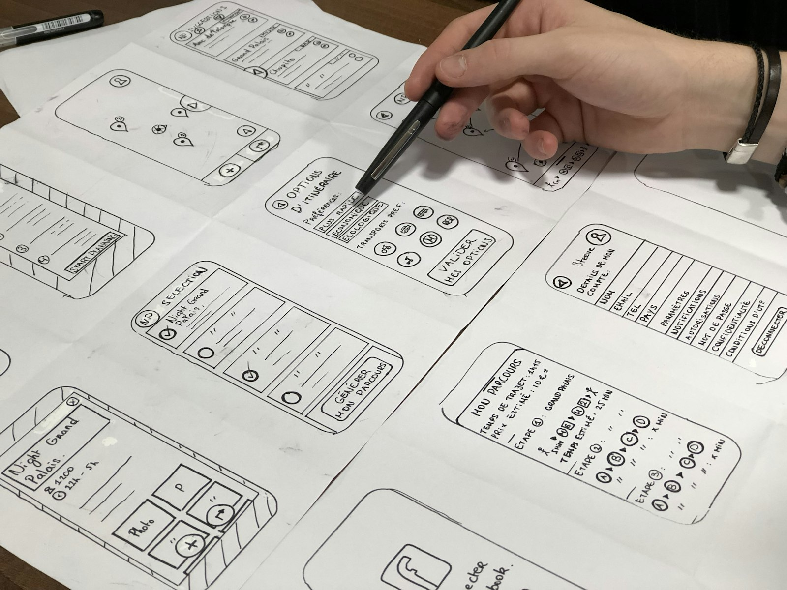

# Sprint 04: The Personal Project

> Your problem, your users, your methodology.

*Photo: Amélie Mourichon, via Unsplash*

## The brief

For two weeks, you are the lead designer. Choose a problem that matters to you, something entirely your own or a continuation of an earlier sprint, and take it from research to a tested, high-fidelity product. This is your first chance to choose and defend your own UX methodology, and it will become the flagship case study in your portfolio.

## The problem

You define it. A good personal project starts from a real problem for real people that you can actually reach, not from an app idea. Your pitch on day one must convince us that the problem is real, that you can research it in time, and that design can help.

## Your challenge

Write your own **How might we** question for your pitch, and refine it once your research is in.

## Sprint goals

- Pitch a focused problem and choose the research methods that fit it.
- Collect primary data from real users in the field.
- Synthesise your research and define the problem clearly.
- Structure the product: information architecture and sitemap.
- Build a design system and brand.
- Design, test and iterate a high-fidelity prototype, with before-and-after evidence.

## Scope

**In scope**
- One problem, one main user group and one core task flow, done properly.
- Your own choice of methods from the method bank, with reasons.
- A reusable AI workflow for your project (Claude.md and Skill.md files).

**Out of scope**
- Designing a whole platform. Depth beats breadth.
- Coding a production app (that's not what this sprint is assessed on).

## Deliverables

1. **Pitch**: the problem, the users and your research plan.
2. **Research plan** with your chosen methods, and why.
3. **Field research and primary data** (interviews, observations, surveys).
4. **Synthesis and problem definition** (affinity map, problem statement, persona).
5. **Information architecture**: task flows and a sitemap.
6. **Design system and brand**: style guide and components.
7. **Hi-fi prototype**, usability-tested, with **before-and-after screens**.
8. **A general-audience presentation**.

## How the sprint runs

| Week | Day | What you do |
| --- | --- | --- |
| 7 | Mon | Sprint brief, pitch, choose your research methods from the [method bank](../methods.html) |
| 7 | Tue | Field research ([Site Visit](../methods/site-visit.html)), primary data collection ([User Interview](../methods/user-interview.html)) |
| 7 | Wed | Synthesis ([Affinity Mapping](../methods/affinity-mapping.html), [Discovery Summary](../methods/discovery-summary.html)), definition ([Problem Statement](../methods/problem-statement.html)) |
| 7 | Thu | [Task Flows](../methods/task-flows.html), [Sitemap](../methods/sitemap.html) |
| 7 | Fri | Design system and branding ([Style Guide](../methods/style-guide.html)) |
| 8 | Mon | [Paper Wireframes](../methods/paper-wireframes.html) |
| 8 | Tue | [Hi-Fi](../methods/hi-fi.html) |
| 8 | Wed | High-fidelity [Usability Test](../methods/usability-test.html) |
| 8 | Thu | [Design Iteration](../methods/design-iteration.html): before-and-after screens |
| 8 | Fri | General audience-style presentation |

## Constraints and tips

- **Choose a problem you can reach.** If you can't talk to five real users this week, pick another.
- **Defend every method.** For each one, be ready to say why it fits this problem.
- **Keep it small.** One core flow, designed and tested properly, beats ten half-done screens.
- **Think portfolio.** Save your artifacts as you go ([Cataloguing Artifacts](../methods/cataloguing-artifacts.html)): this becomes your main case study.

## Success looks like

A focused problem, a methodology you can defend, and a tested, high-fidelity product with clear before-and-after evidence: a case study a hiring manager will read to the end.
