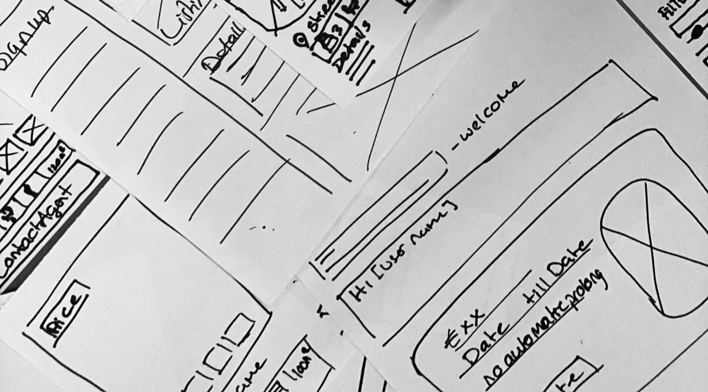
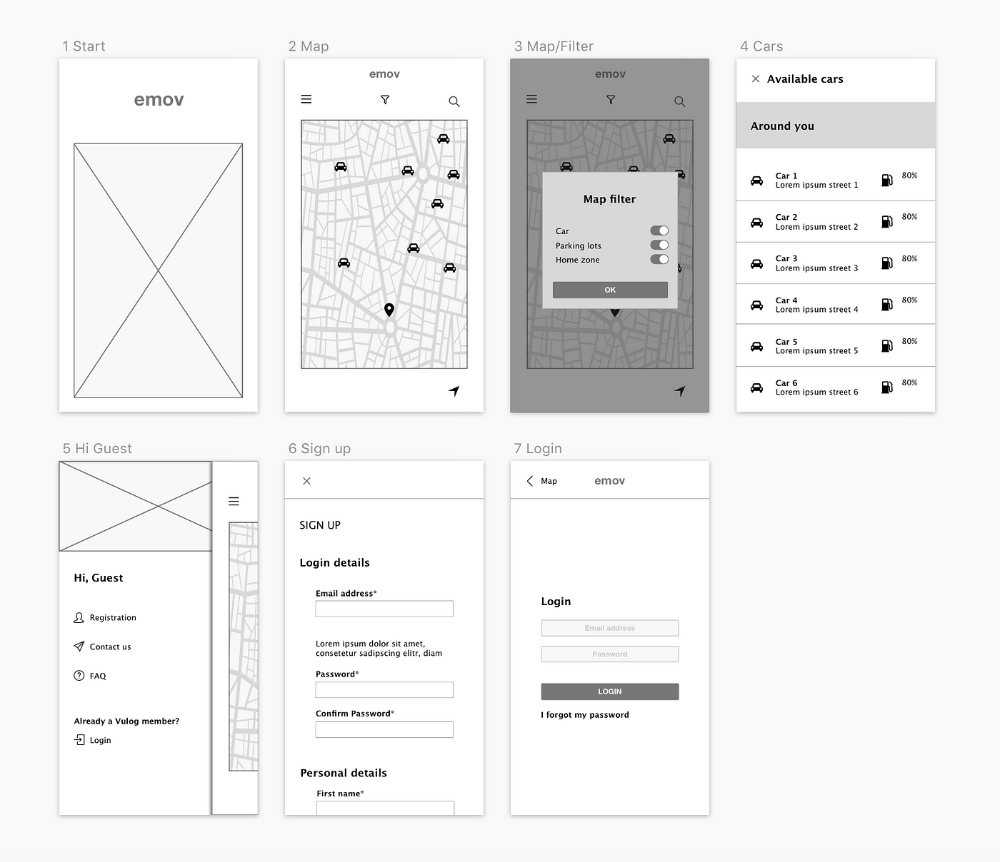

# Stages of Wireframes

### Iterative Design

Initial Hypothesis → User Stories → MVPoint → IA: Task Flows → Paper Wireframes → **Low Fidelity Prototype** → **Style Guide** → **High Fidelity** → Test → Feedback

Here we will discuss stages within the iterative process. How many steps you take will severely depend of the time you have to complete the project. The important thing to remember is that the word ‘fidelity’ simply means faithfulness in reference to the final design, so the more faithful you are to the final look, the higher the fidelity will be. 

1. Task Flow 
2. Paper Wireframes
3. Low Fidelity Wireframes (monochrome)
4. Styleguide
5. High Fidelity Wireframes
6. Prototype

---

## Task Flow

The Task Flow is the preliminary stage of wire framing and the lowest fidelity wireframe you can make. User flows majorly consist of an ordered sequence of actions that a designer considers so that a user can complete a task. Part of information architecture, the Task Flow represents the raw logic of the prototype and is nearly always brought about by the more generalised abstract user goal for the user. It is a vital preliminary step to take before beginning wireframes.

---

## Sketching

Sketching can be a stage that you can introduce that involves creating visual representations of ideas to explore different solutions to a problem. Typically they are not presented to a design team but serve as a starter for core visualisations.

---

## Paper Wireframes

Paper wireframes are simple drawings, usually done on paper, that outline the basic premise and layout of a design without detailing finalised content or visuals. They focus on functionality and user flow, using basic shapes and lines to represent elements. In low fidelity wire-framing, designers do tend to introduce logic to their work to represent their concept to a wider team and they can also serve as an important step two in the iterative process. 

---

## Low Fidelity Wireframes

Low Fidelity wireframes typically include basic interaction elements like buttons and input fields, and use digital tools for clearer presentation. They offer an enhanced visualisation of the completed user flow and content structure. Typically created in software like Miro rather than Figma, medium fidelity wireframes place a greater emphasis on positioning and logic and they can sometimes be referred to as greyscales given they are usually presented monochromatically, meaning without colour. This is to emphasis the function as oppose to the form.  

---

## Style Guide

A style guide is a comprehensive document that outlines the design standards and visual elements of a brand or project. It includes guidelines for typography, colour schemes, logos, imagery, and overall layout. This ensures consistency across all materials, enhancing brand identity and ensuring cohesive, professional presentation. It is typically created in advance of high fidelity work to ensure that the coloration and visualisations can be quickly switched out without interfering with the logic of the wireframe.

---

## High Fidelity Wireframes

High fidelity wireframes represent as close to the finished product as it will get. The ‘faithfulness’ to the final design is 95% complete and there is a detailed inclusion of logic and aesthetic.  

---

## Prototype

The prototype itself refers to the high fidelity wireframes **+ interaction design**. This means that the touch points and user interactions have all been added to the screens resulting in a completed interactive mockup of the product which can be now tested with users.  

It’s important to note that not every step may be necessary for every project and furthermore, you must consider how much work has already been achieved ahead of time before know which stage to start and finish on.
