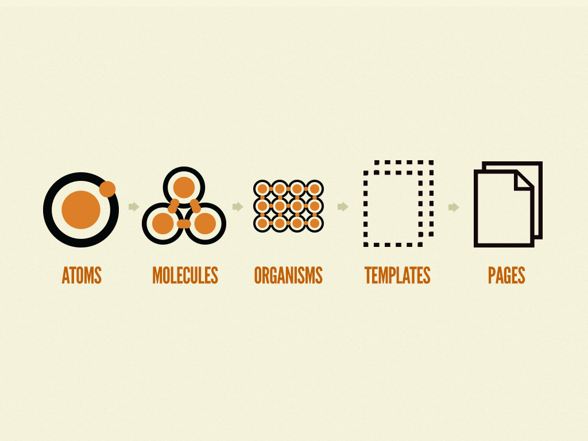
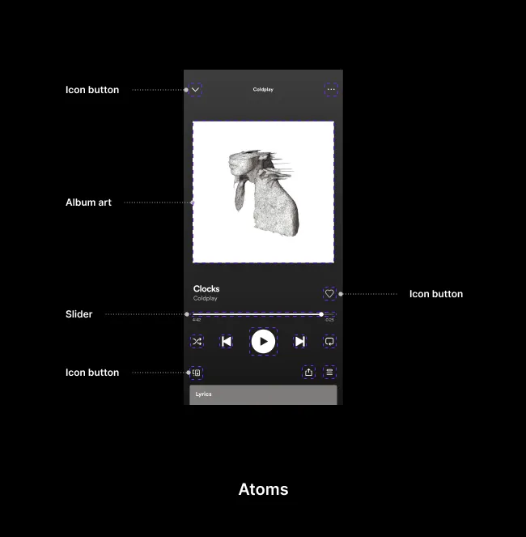
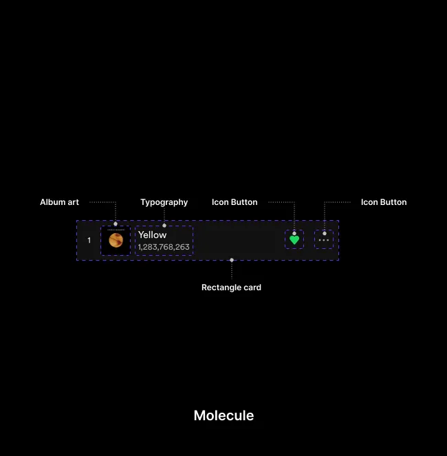
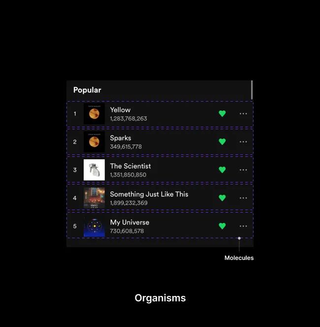
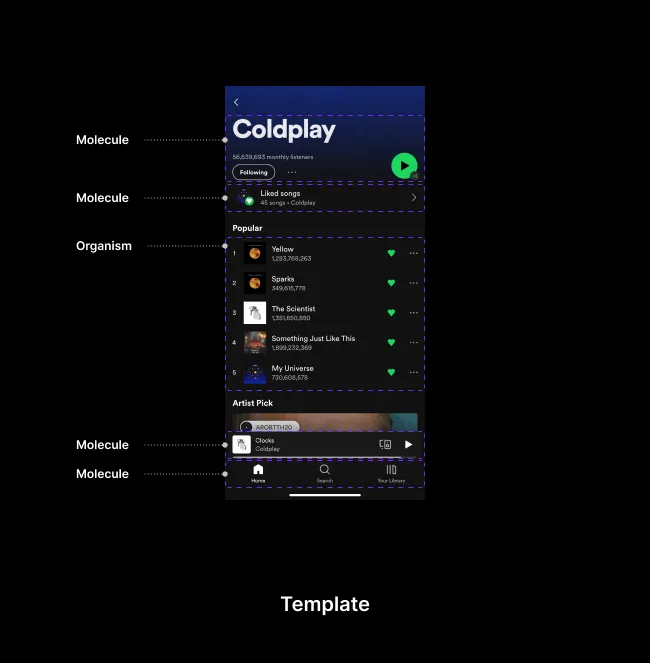
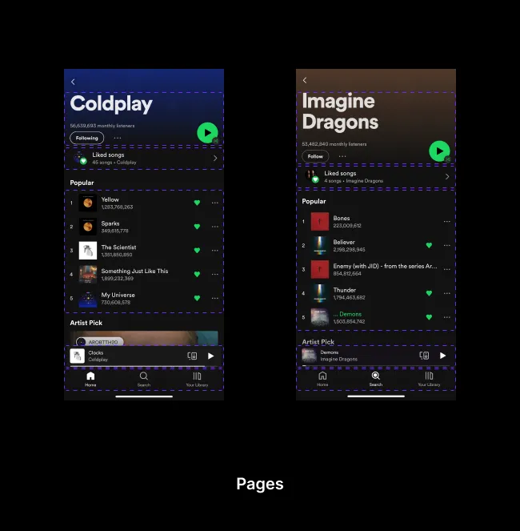

# Atomic Design Methodology

<aside>
📝 A **design system** is a complete set of standards intended to manage design at scale using reusable components and patterns.

</aside>

**Atomic design is not a linear process**, but rather a mental model to help us think of our user interfaces as both a cohesive whole and a collection of parts *at the same time*. Each of the five stages plays a key role in the hierarchy of our interface design systems. Let’s dive into each stage in a bit more detail.

## Atoms

The smallest building blocks: a label, an input, a button, a colour, an icon. On their own they do little, but every interface is made of them. In Figma, atoms are your base components and styles.

## Molecules

Small groups of atoms that work together as a unit: a label, an input and a button become a search form. Molecules should do one job, and do it well.

## Organisms

Larger sections built from molecules and atoms: a header with a logo, navigation and search; a product card grid; a footer. Organisms are where your interface starts to look like a product.

## Templates

Page-level layouts that place organisms on the grid and show the content structure, using placeholder content. A template is the skeleton of a page.

## Pages

Templates filled with real content: real images, real copy, real data. Pages are where you test the system, because real content breaks things placeholder content never will.

---

## Why it matters for UX

Atomic design is how you think about a design system: build small, reusable parts, combine them into bigger ones, and every screen stays consistent. It maps directly onto Figma components and variants, and onto how developers build interfaces in code.

## Try it: break a screen into atoms (30 minutes)

1. Take a screenshot of an app's home screen.
2. Circle and label every atom (buttons, icons, labels, inputs).
3. Group them into molecules and organisms, and draw the template underneath.
4. Rebuild one molecule in Figma as a component made of atom components.

## Media

[https://www.youtube.com/watch?v=PK_PICNTgAg](https://www.youtube.com/watch?v=PK_PICNTgAg)

## Resources

[Atomic Design, Chapter 2 – Brad Frost](https://atomicdesign.bradfrost.com/chapter-2/)

[Design Systems vs. Style Guides (video) – Nielsen Norman Group](https://www.youtube.com/watch?v=5BgKwkpJQdE)

## Key takeaways

- Atomic design builds interfaces from atoms, molecules, organisms, templates and pages.
- It's a mental model, not a linear process: think of parts and the whole at once.
- In Figma, it maps onto styles, components and nested instances.
