# Beginner’s Guide to Grids

Grids are everywhere around us. The are an essential part of the natural world and in User Interface Design, we use them all the time to create beauty!

Let’s go over the absolute basics of grids in Figma. What we are going to do in this exercise is end up with this layout;

Using 4 core principals: 

1. **Columns** 
2. **Rows** 
3. **Gutters**  
4. **Margins**

Let’s learn by doing! Let’s go! 

## 1. Make Columns

So let’s jump back into Figma and make a new frame and, as we have already learned, **change it’s name** to ‘My Third Frame’;

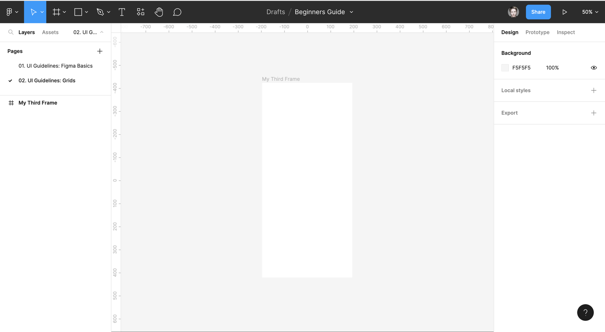

Click on the title ‘My Third Name’ to activate the right hand properties panel.  

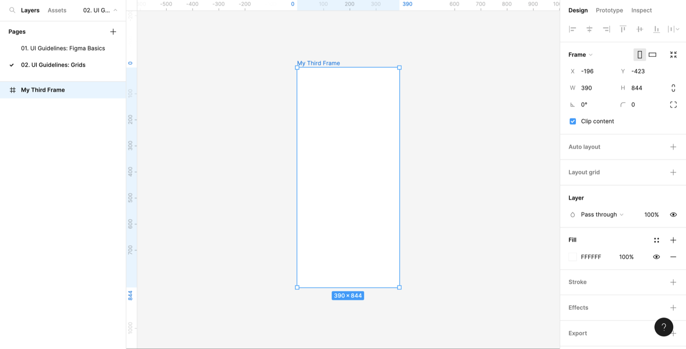

Navigate to the right hand side and **click Layout Grid;**

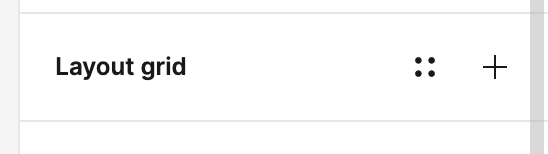

This will automatically generate a **10px Grid by default** to your frame but we will want to change that;

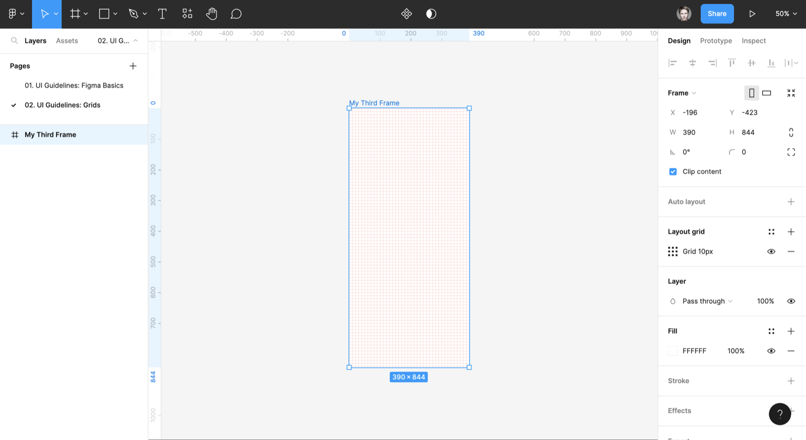

Hover over the 9 squares beside our newly applied grid to open the Grid properties panel;

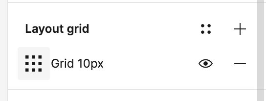

Now, **Click the Grid dropdown** to change the Grid Type;

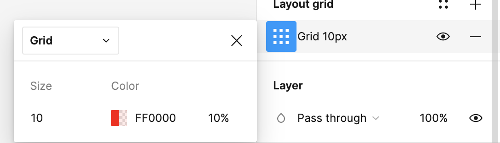

Change Grid Type **to Columns;**

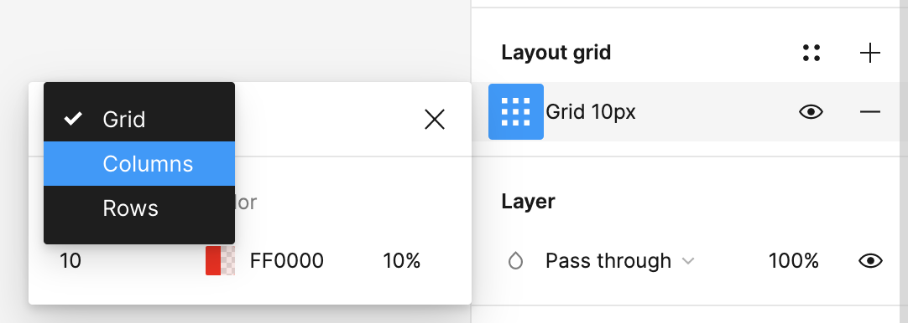

This will automatically place 5 columns on our Frame. Let’s change the columns count to 4 columns; 

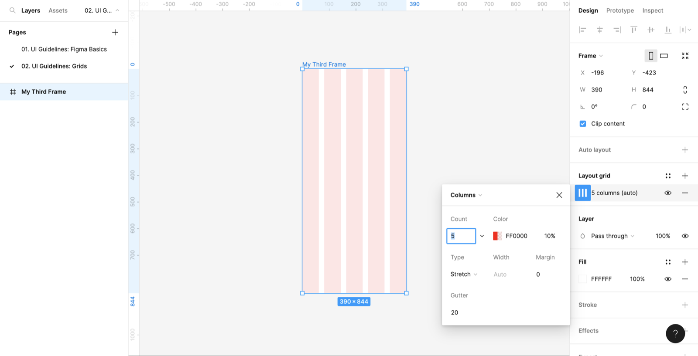

You may have noticed that the 9 Squares icons has changed to a 3 Columns icon. Give it a click and **let’s change the count to 4 columns;**

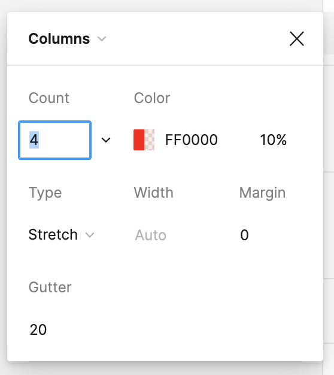

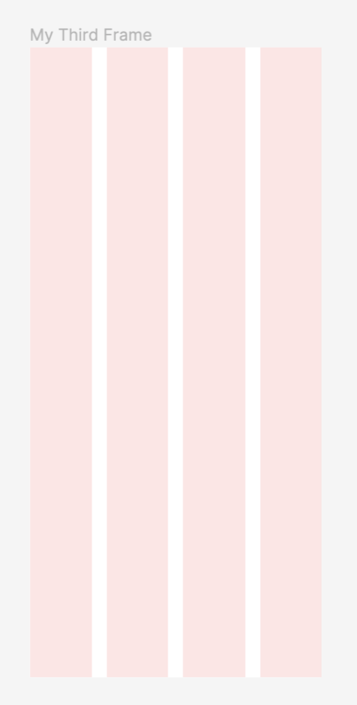

Well done! Now it’s time to make some Margins.

---

## 2. Make Margins

**Click the Margin Field**;

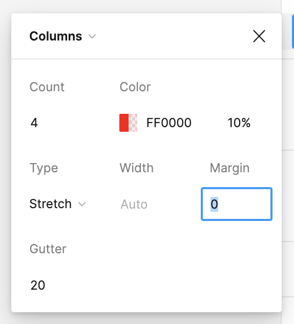

**Change** the margin to **24px;**

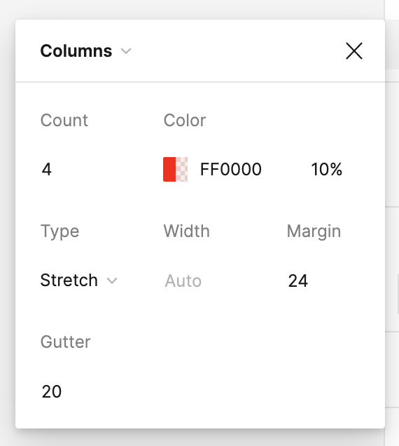

Well Done! You have Some nice Margins on the **right** and **left** hand side of your frame. 

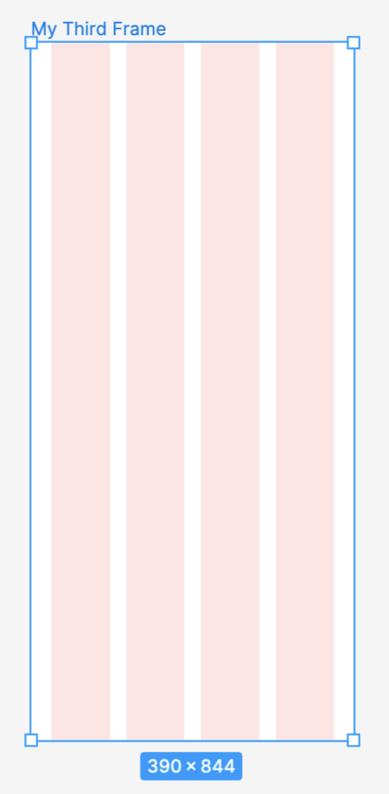

So now let’s even up the frame by making the gutters the same proportion as the margins.

---

## 3. Change the Gutters

The gutters are the negative space between the columns. 

Now as Default; Figma will put a default gutter size of 20px but we will want to change that. 

Let’s **open the Layout Grid Properties panel** again 

but this time **click the Gutter Field;**

  

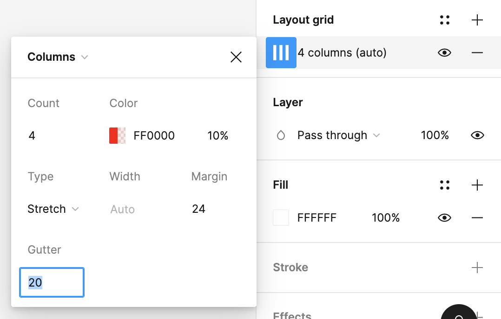

Change the value to **24px;**

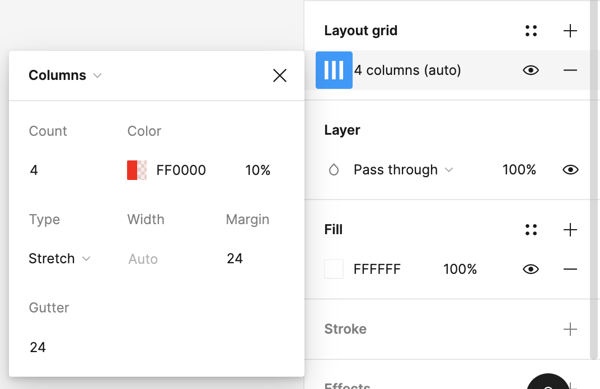

Voilà! We have beautifully aligned Columns, Gutters and Margins. As a Grande finale, add some rows!

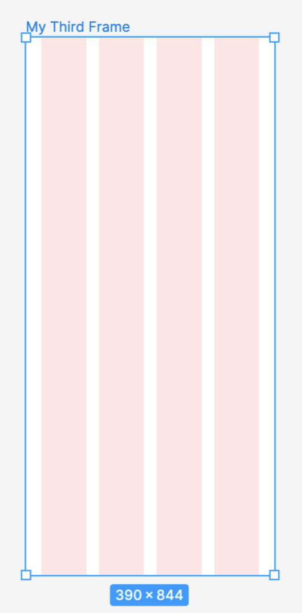

---

## 4. Add Rows

Let’s go back to our Grid Layout panel on the right hand side and hit the plus icon.

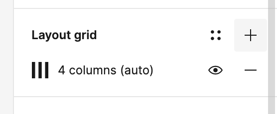

This will place a second grid over the Frame;

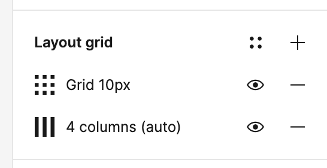

Activate the Grid Layout Properties panel by hovering over the nine squares;

Based on what you have learned so far, apply the following settings;

1. Number of Rows: **4**
2. Margin: **24px**
3. Gutter: **24px**

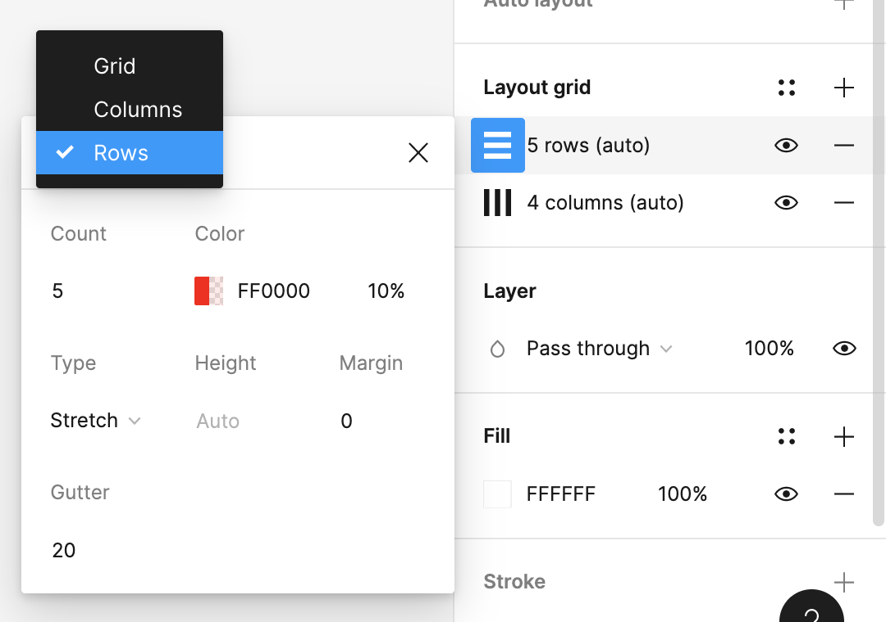

Bellissima! Well done, you have some beautiful rows there! 

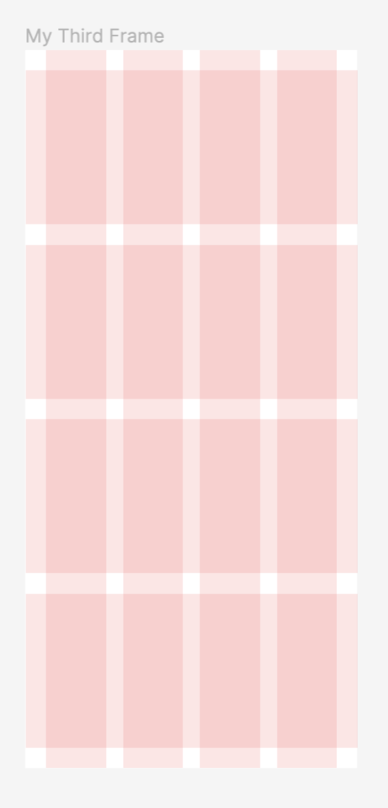

---

## 5. Add Shape Layers

Now based on what you have previously learned from *01. UI Guidelines* 

- Create shape layers using the grids and rows.

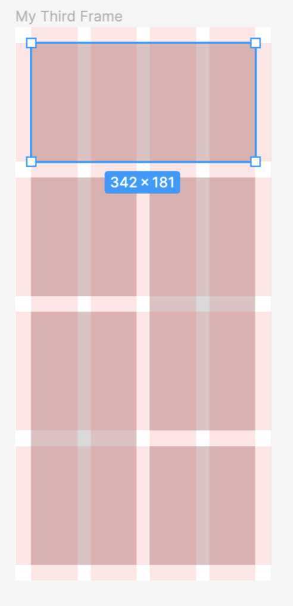

Nice one! Now we simply need to remove our grids to see the harmony of our design. 

---

## 6. Delete the Grids

**Hover over the minus (-) icon** within the **Layout Grid Properties panel** and click it. 

- Remove 4 rows (auto)
- Remove 4 columns (auto)

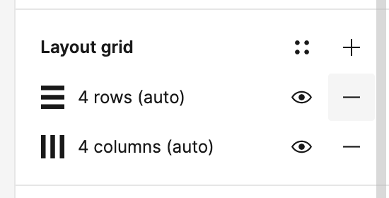

Magnifico! Now you have your perfectly aligned grid using columns, margins, rows and gutters. 

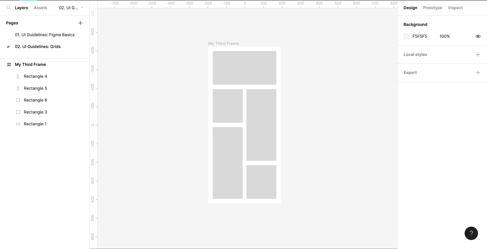

## 7. Well Done! Job Completed!

As we say, grids are everywhere around us. Their natural symmetry is a constant source of inspiration for us. You should aim to apply columns and rows as frequently as you can. This is the way to good UI. 

[https://www.figma.com/embed?embed_host=notion&url=https%3A%2F%2Fwww.figma.com%2Ffile%2Fhou4SjHuPWJm1g7CwboZGp%2FUI-Elements%3Ftype%3Ddesign%26node-id%3D169%253A2510%26t%3D7deFSlmA8vMJzIUu-1](https://www.figma.com/embed?embed_host=notion&url=https%3A%2F%2Fwww.figma.com%2Ffile%2Fhou4SjHuPWJm1g7CwboZGp%2FUI-Elements%3Ftype%3Ddesign%26node-id%3D169%253A2510%26t%3D7deFSlmA8vMJzIUu-1)

Above are three frame sizes; mobile, tablet and desktop. As you can see, using two, then four and finally twelve columns is a useful way to keep your content aligned. At a later stage we can dive into how to utilise inner content but for now, well done on a good job completed.
