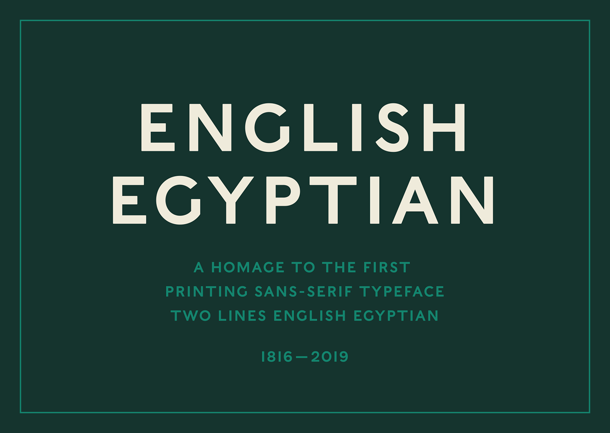

# Caslon Egyptian

> A blunt, utilitarian typeface that rejected classical elegance in favour of function, marking a radical break from elite typographic traditions.
> 

**Designed by:**

William Caslon IV

**Foundry:**

Caslon Foundry

**Country:**

🇬🇧 England

**Year:**

1816

---

## Intent

- Designed to serve **practical, industrial communication**, not refinement
- A clear rejection of classical Roman proportions and calligraphic tradition
- Built without serifs to maximise impact and clarity
- Prioritised function, legibility, and economy over beauty or taste

Caslon Egyptian was not trying to be elegant — it was deliberately *unpolished*, reflecting the needs of commerce and industry rather than cultural elites.

---

*Used primarily in posters, signage, and commercial printing rather than books or high literature*

---

## Context

- The **Industrial Revolution** was transforming society
- Rapid growth of advertising, signage, and mass communication
- Printing expanded beyond books into streets, factories, and shops
- Typography shifted from serving education and religion to serving **commerce**

At the same time, high society and academic printers still favoured **classical serif typefaces** inspired by Roman inscriptions and Renaissance calligraphy — fonts associated with tradition, authority, and taste.

Caslon Egyptian stood in direct opposition to this.

---

## Type classification

- Sans-serif
- Early grotesque (proto-grotesque)

---

## Characterised by

- Complete absence of serifs
- Heavy, uneven stroke weights
- Awkward proportions compared to classical type
- Crude, mechanical appearance
- Limited refinement or optical correction
- Feels bold, utilitarian, and confrontational

Compared to later sans-serifs, Caslon Egyptian feels rough and unsophisticated — but that rawness is exactly what makes it historically important.

---

## Examples in use

- Early 19th-century posters and broadsides
- Commercial signage and advertisements
- Industrial and utilitarian printed materials

(It was notably *not* used in books or elite publishing.)

---

## Why designers still use it

- Strong historical significance as one of the **first sans-serif typefaces**
- Communicates bluntness, honesty, and anti-elitism
- Useful for referencing early industrial or experimental typography
- Powerful teaching tool for understanding how typography evolves socially

---

## When not to use it

- Long-form reading or body text
- Projects requiring elegance or refinement
- Modern interfaces needing polish and subtlety
- Situations where typographic neutrality is required

---

## Usage

> Use Caslon Egyptian when you want to communicate rebellion, utility, and industrial bluntness — but not classical beauty, refinement, or tradition.
> 

---

## Why it was called “grotesque”

The term *grotesque* was originally **dismissive**, not descriptive.

To the typographic gatekeepers of the time — who valued Roman capitals, symmetry, and calligraphic heritage — sans-serif letters looked *wrong*, unfinished, even vulgar.

What they mocked as grotesque would later become one of the most important typographic categories in history.

---

## Why it matters for UX

Caslon Egyptian is the ancestor of every sans-serif in your interface. It shows that the plain, functional type we now take for granted was once a radical choice: function over taste, commerce over the elite.

## Try it: trace the family tree (15 minutes)

1. Find an image of Caslon Egyptian (1816), Helvetica (1957) and Roboto (2011).
2. Put them side by side and list three things that stayed the same and three that changed.
3. Write one sentence on why sans-serifs won on screens.

## Media

[https://www.youtube.com/watch?v=dYrzYnx4Dr4](https://www.youtube.com/watch?v=dYrzYnx4Dr4)

## Resources

[Sans-serif – Wikipedia](https://en.wikipedia.org/wiki/Sans-serif)

[Google Fonts Knowledge](https://fonts.google.com/knowledge)

## Key takeaways

- Caslon Egyptian (1816) is one of the first sans-serif typefaces.
- It put function and impact before classical beauty.
- "Grotesque" began as an insult and became a whole category of type.
